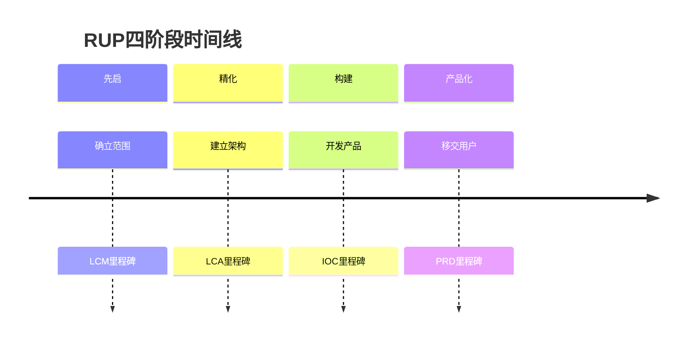

# 统一过程（UP）的四个阶段：先启、精化、构建、产品化

## 统一过程的四个阶段是什么

如果软件开发不能像瀑布模型那样一次性规划到底，我们该如何划分里程碑来降低风险？Rational统一过程（RUP）将生命周期在时间轴上分解为四个连续阶段：==先启、精化、构建、产品化==。每个阶段都以一个明确的里程碑结束，而非以完成某种文档为标志。

> [!IMPORTANT]
> 四阶段的核心目标是==逐步消除风险==，而非单纯推进进度。先启解决“做什么”，精化解决“怎么做才稳”，构建解决“做出来”，产品化解决“用起来”。

## 各阶段具体做什么

- **先启（Inception）**：定义项目边界与核心用例，评估可行性，产出初始业务案例。里程碑为生命周期目标（LCM）。
- **精化（Elaboration）**：细化大部分用例，==建立稳健的架构基线==，制定详细项目计划。这是RUP最关键的阶段，里程碑为生命周期架构（LCA）。
- **构建（Construction）**：基于稳定架构进行增量开发，产出可运行的软件版本。里程碑为初始运作能力（IOC）。
- **产品化（Transition）**：部署、培训、修复缺陷，确保平滑移交最终用户。里程碑为产品发布（PRD）。

| 阶段 | 核心任务 | 关键制品 | 里程碑 |
| :--- | :--- | :--- | :--- |
| 先启 | 确定范围与可行性 | 愿景文档、核心用例 | LCM |
| 精化 | 架构设计与计划 | 架构原型、项目计划 | LCA |
| 构建 | 增量开发与测试 | 可执行版本、测试报告 | IOC |
| 产品化 | 部署与用户支持 | 用户手册、发布说明 | PRD |

## 与相近概念的区别

许多同学误将RUP阶段等同于传统瀑布模型的“需求→设计→编码→测试”。实际上，==RUP每个阶段都包含所有工作流（需求、设计、实现等）==，只是侧重不同。例如精化阶段仍有编码活动（用于验证架构），构建阶段仍可能补充少量需求分析。

> [!WARNING]
> 切勿认为“精化=纯设计”或“构建=纯编码”。RUP是迭代式的，各阶段内部均通过多次迭代完成多种工作流，区别仅在于==风险类型与工作流权重==的差异。

## 常见误区与正确理解

> [!CAUTION]
> 高危误区：把阶段当作固定时长模块。实际上各阶段长度由风险决定，精化阶段可能因架构复杂而远超构建阶段。

一个典型正确示例：某餐馆系统在精化阶段发现订单并发处理存在性能瓶颈，团队并未进入构建，而是继续迭代优化架构原型，直到压力测试达标才宣布LCA达成。这体现了==“以里程碑为导向，而非以时间为导向”==的原则。若强行按日历切换阶段，将导致架构债务累积，后期返工成本剧增。

> [!TIP]
> 记忆口诀：“先启定方向，精化打地基，构建盖楼房，产品交钥匙。”重点记住精化阶段的==架构基线==是整个项目的技术锚点。
