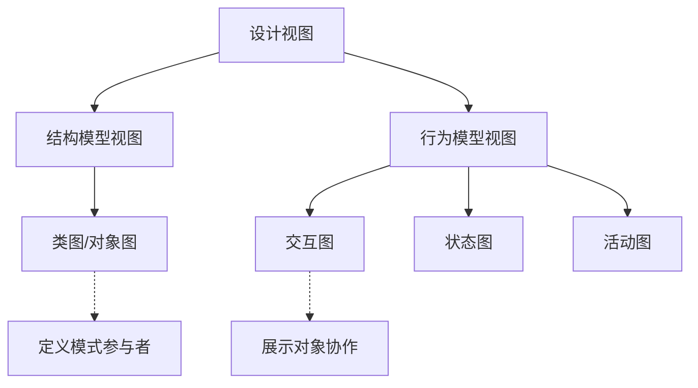
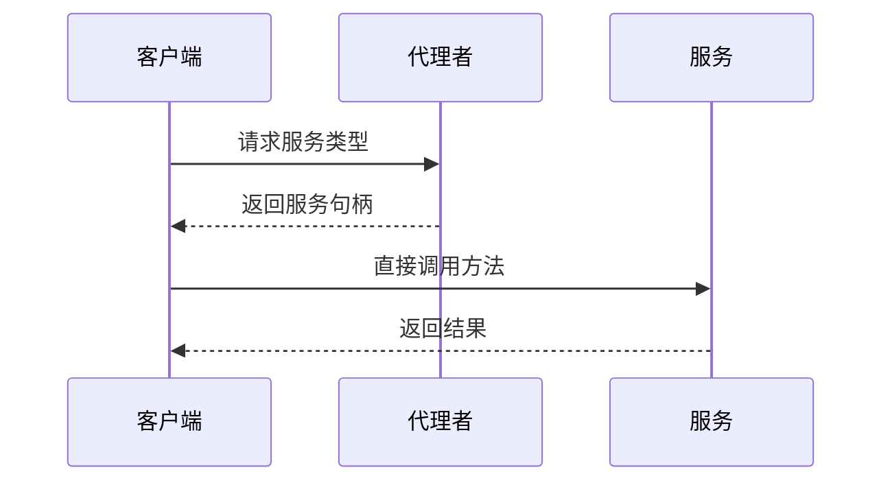

# 设计模式（Design Patterns）在体系结构中的作用

## 设计模式在体系结构中的作用

体系结构设计并不是从零开始画图，而是站在前人总结的成熟方案上解决共性问题。设计模式（Design Patterns）正是这些可复用方案的结晶——它们针对特定上下文中反复出现的问题，给出经过验证的类与对象结构及协作方式。

在面向对象的体系结构中，设计模式的作用体现在：

- **固化最佳实践**：将成功的设计经验抽象成模板，避免重复造轮子
- **提高沟通效率**：说"用了观察者模式"，团队立即明白对象间的依赖结构
- **增强可复用性与可维护性**：模式使系统结构更清晰，修改局部不影响整体

> [!IMPORTANT]
> 设计模式不是可以直接调用的代码库，而是==解决特定设计问题的方案模板==。同一个模式在不同系统中可以有完全不同的实现代码。

## 设计视图中的模式定位

设计视图（Design View）从静态和动态两个维度刻画系统：

| 维度 | 描述内容 | 常用图 | 模式的作用 |
|------|---------|--------|-----------|
| 结构模型视图 | 系统的静态结构 | 类图、对象图 | 定义模式的**参与者类**及它们的关系 |
| 行为模型视图 | 系统的动态行为 | 交互图、状态图、活动图 | 展示模式运行时**对象如何协作** |

一个设计模式通常包含：模式名称、问题（何时使用）、解决方案（类/对象结构）、效果（优缺点）。在体系结构设计阶段，设计师根据问题特征选择合适的模式，再用结构视图表达其静态骨架，用行为视图验证其动态交互是否符合预期。

## 代理者模式：一个典型例子

考虑分布式系统中，客户端想调用远程对象的方法，但不想处理网络细节。代理者（Broker）模式引入一个中间层——代理者——来转发请求，使客户端像调用本地对象一样调用远程服务。

但什么时候需要**取代代理者转发模式**（即客户端不通过代理者转发，而是直接定位服务）？思考：如果客户端知道需要什么类型的服务，但不知道具体是哪个实例在服务，该怎么办？

> [!TIP]
> 关键区分：客户端对服务的**了解程度**决定了模式选择。知道类型但不知道具体服务 → 需要查找机制；知道具体地址 → 可直接通信。

**正确选项分析**（对应复习题）：

- A. 只通信一次 → 转发开销可忽略，无需取代
- B. 一次对话 → 建立连接后持续通信，与代理者存在与否无关
- **C. 知道类型但不知道确切服务** → ✅ 需要代理者提供查找/注册功能，返回句柄后客户端直接与服务通信
- D. 提供句柄给代理者 → 方向颠倒，是代理者给客户端句柄

> [!WARNING]
> 易混点：代理者模式的核心价值是**位置透明性**。取代转发模式后，代理者仍参与初始的查找过程，只是后续通信不再经过它。不要理解为"完全去掉代理者"。

## 常见误区

- **过度设计**：不是所有地方都需要模式。简单问题用模式反而增加复杂度
- **模式堆砌**：一个系统中模式过多会导致结构难以理解，应遵循"恰到好处"原则
- **混淆层次**：架构模式（如分层、MVC）关注系统宏观结构，设计模式关注微观对象协作，二者粒度不同但可配合使用
