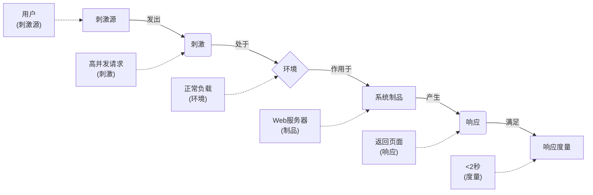

# 质量属性（Quality Attributes）与体系结构决策

# 质量属性与体系结构决策

在软件体系结构中，**质量属性（Quality Attributes）**并非指代码写得是否整洁，而是指系统整体表现出的非功能性特征，如性能、安全性、可用性等。如果说功能需求决定了系统“做什么”，那么质量属性就决定了系统“做得有多好”。

## 为什么需要关注质量属性？

很多初学者容易陷入一个误区：先实现所有功能，最后再考虑优化。然而，==体系结构决策一旦做出，后期修改成本极高==。例如，若初期未考虑高并发，后期想从单体架构改为微服务以支持横向扩展，几乎等同于重构整个系统。因此，必须在设计早期通过**架构策略**来保障关键的质量属性。

> [!IMPORTANT]
> 核心结论：质量属性是驱动体系结构设计的核心力量。不同的质量目标往往相互冲突（如安全性 vs 易用性），架构师的任务就是根据业务优先级进行**权衡（Trade-off）**。

## 怎么做：从场景到策略

如何确保架构满足特定的质量属性？通常采用**质量属性场景（Scenario）**来具体化模糊的需求。一个完整的场景包含六个部分：刺激源、刺激、环境、制品、响应、响应度量。

针对识别出的关键场景，我们需要选择对应的**架构策略**。例如，为了提高**可用性**，可以采用“心跳检测”或“冗余部署”；为了提高**性能**，可以采用“缓存”或“负载均衡”。

## 常见陷阱与辨析

| 概念 | 侧重点 | 典型错误 |
| :--- | :--- | :--- |
| **功能需求** | 系统行为 (What) | 混淆为“系统快不快” |
| **质量属性** | 系统约束 (How well) | 认为可以后期随意添加 |
| **架构策略** | 实现手段 | 忽视策略间的冲突 |

> [!WARNING]
> 易错坑：**“银弹”思维**。不存在一种架构能同时最大化所有质量属性。例如，引入加密机制提升了**安全性**，但必然增加计算开销，降低**性能**。考试常考此类权衡分析。

## 实例解析

**题目背景**：某电商系统在“双11”期间需应对流量洪峰，要求主页加载时间不超过 2 秒。

**分析步骤**：
1.  **识别属性**：核心质量属性为==性能==。
2.  **构建场景**：
    *   刺激源：大量用户。
    *   刺激：并发访问主页。
    *   环境：高峰时段。
    *   响应度量：延迟 $\le 2s$。
3.  **架构决策**：
    *   策略1：引入 CDN 缓存静态资源（减少服务器负载）。
    *   策略2：后端服务无状态化，配合负载均衡器横向扩展。

> [!TIP]
> 解题技巧：遇到此类题，先定性（是哪个属性），再定量（度量指标是什么），最后匹配策略（用什么架构手段解决）。记住，**缓存**和**并行**是提升性能的两大法宝。
