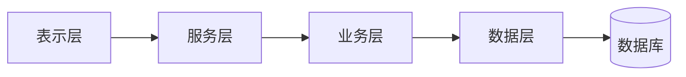

# 软件体系结构（Software Architecture）的定义与重要性

## 什么是软件体系结构

==软件体系结构描述的是软件系统的总体结构==，包括主要子系统、构件、连接器以及它们之间的组织与协作关系。它关注的不是某个类或某个函数的内部实现，而是系统由哪些部分构成、各部分承担什么职责，以及部分之间如何交互。

可以把它理解为软件系统的“总体骨架”：构件是系统中的可部署或可复用单元，连接器描述构件之间如何通信和协作，子系统则是由若干构件按一定结构组成的较大部分。

> [!IMPORTANT]
> 软件体系结构回答的是“系统整体如何组织”，而不是“某个对象内部如何实现”。

## 为什么需要软件体系结构

软件规模增大后，如果只关注类和代码，很容易出现职责混乱、依赖失控、重复开发以及后期难以修改等问题。体系结构设计把关键结构决策提前明确，能够：

- 划分职责边界，降低模块之间的耦合；
- 指导构件和子系统的开发与集成；
- 支持复用、部署、测试和维护；
- 统一团队对系统整体形态的理解。

因此，软件体系结构是连接需求分析与详细设计的重要环节，也是决定软件质量、可扩展性和长期维护成本的关键因素。

## 体系结构模式是什么

软件体系结构模式是对一类系统结构的通用解决方案。它描述反复出现的问题、适用的环境以及相应的组织方式，并给出构件、连接器和配置关系。

例如，三层结构、分层结构、客户机/服务器结构、面向服务结构等，都可以看作体系结构模式。

> [!TIP]
> 记忆：模式 = 在不同系统中重复出现的体系结构。

| 概念 | 主要描述什么 |
|---|---|
| 软件体系结构 | 一个软件系统的总体结构 |
| 体系结构模式 | 可反复应用的体系结构解决方案 |
| 子系统 | 系统中具有相对独立职责的较大组成部分 |
| 构件 | 可复用、可部署或可集成的软件单元 |
| 连接器 | 构件之间的通信与协作机制 |

## 怎样进行体系结构设计

首先分析系统需求，确定主要功能和运行约束；然后识别候选构件，划分子系统及职责；接着安排构件之间的连接方式，形成系统的总体结构；最后检查该结构是否满足功能、性能、可靠性、可修改性和部署等要求。

划分子系统时通常要遵循高内聚、低耦合原则。一个构件应集中承担一类明确职责，同时避免把必须频繁协作的部分拆得过度分散。

例如，一个外部对象访问系统时，接口通常应与一个明确的服务子系统建立，而不必分别连接每个内部子系统。这样既能隐藏内部实现，也能避免接口关系复杂化。

> [!IMPORTANT]
> 外部接口应连接到合适的服务边界，而不是机械地与每个子系统相连。

## 相近概念辨析

**体系结构与详细设计**不同：体系结构关注总体结构、职责和交互；详细设计关注类、算法、数据结构及实现细节。UML 类图主要表达类及其关系，而部署图表达节点、构件及运行环境，不能把某一张图直接等同于整个体系结构。

**子系统和构件**也不完全等同。构件是软件单元，子系统通常由多个构件组成，强调系统中的职责边界和协作关系。

## 常见易错点

> [!CAUTION]
> 不要把软件体系结构简单理解为“主要子系统的列表”。连接方式、职责划分和协作规则同样是体系结构的重要内容。

另一个常见错误是把客户端/服务器结构当作体系结构的全部。实际上，软件体系结构还包括分层、管道、过滤器、事件驱动、微服务等多种组织方式，具体选择取决于系统需求。

## 算对的例子

题目问：“软件体系结构描述了什么？”正确答案是：

> **软件系统的总体结构。**

因为软件体系结构需要说明系统由哪些主要构件或子系统构成，以及它们通过何种连接器协作；它并不限于某个类图，也不只表示客户端/服务器形式。
