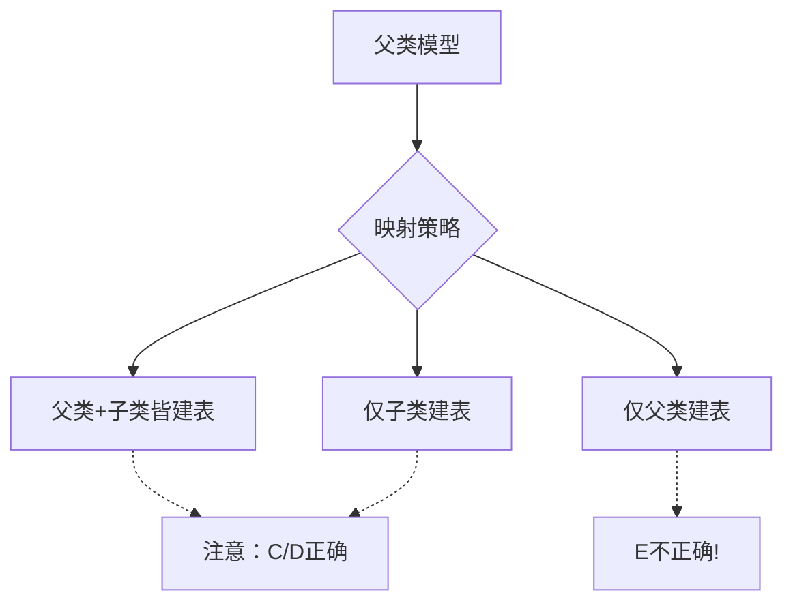

# 软件建模的概念与重要性

软件建模，简单来说就是==在写代码之前，用图形化的方式把软件“画”出来==。

想象你要盖一栋楼，会直接搬砖砌墙吗？肯定不会。你需要先画设计图纸。软件开发同理：面对复杂的业务需求，如果上来就敲代码，往往会陷入逻辑混乱、返工不断的泥潭。软件建模就是为软件系统绘制“蓝图”的过程。

## 什么是软件建模

软件建模是运用==抽象==和==可视化==的手段，对软件系统的结构、行为与数据进行描述。它不是最终运行的程序，而是沟通需求、指导设计与编码的中间产物。

在南邮这门课中，我们主要围绕面向对象（OO）方法展开建模。这里有一个极易混淆的边界：**面向对象概念**与**面向过程概念**。

> [!WARNING]
> 常见坑：把面向过程的术语当成面向对象的概念。例如真题中考过：“下面哪一项不是面向对象概念？”选项有信息隐藏、类、子类、子程序。正确答案是==子程序（D）==。因为“子程序”是面向过程编程中的调用单元，而“类”“子类”“信息隐藏”才是面向对象的核心机制。

| 面向对象概念 | 面向过程概念 |
| :--- | :--- |
| 类、子类 | 函数、子程序 |
| 信息隐藏、封装 | 全局变量共享 |
| 泛化/特化 | 顺序执行流程 |

## 为什么需要软件建模

1. **控制复杂度**：通过分层、分类将庞大的系统拆解为可管理的模块。
2. **促进沟通**：图形比文字和代码更容易让客户、设计师和程序员达成共识。
3. **指导实现**：模型直接映射到代码结构。例如，建模时识别出的“数据库包装器类”，其本质不是单纯封装数据结构或关系表，而是==封装如何访问数据库中数据的细节的类==（真题选择 3 答案 C），从而将底层数据库操作与上层业务逻辑解耦。

## 怎么做：从模型到代码的映射

建模完成后，需要将设计模型落地为具体的实现。我们以面向对象中最常见的**泛化/特化关系（继承）**为例，看看它是如何映射到关系数据库的。

> [!IMPORTANT]
> 核心结论：将泛化/特化关系映射到关系数据库时，==只有父类被设计为关系表是不正确的==（真题选择 8 答案 D）。正确的做法要么是每个类（父类和子类）都建表，要么是只让叶子节点（子类）建表以包含所有属性。

再看并发架构建模。在设计任务交互时，我们需要区分不同任务的职责。例如“用户交互任务”，它的定义非常明确，就是==与用户交互的任务==（真题选择 7 答案 B），而不是泛指与 I/O 设备交互，也不必然是并发或顺序的，具体取决于系统状态机设计。

## 相近概念辨析

很多初学者分不清“建模”和“画图”的区别。

> [!NOTE]
> 画图只是手段，建模是思维。随手画个框图不叫建模；使用规范的建模语言（如 UML），严格遵循元模型语义（如聚合、组合、泛化的区别）来表达系统架构，才是真正的软件建模。

## 一个算对了的例子

回顾前面提到的真题：
**题目**：将一个泛化/特化关系映射到关系数据库时，以下哪个不正确？
A. 父类和每个子类都被设计为关系表
B. 只有子类被设计为关系表
C. 聚合类和部分类都被设计为关系表
D. 只有父类被设计为关系表

**解析**：
- A 策略（全表映射）：可行，通过外键关联。
- B 策略（叶子表映射）：可行，子类表冗余存储父类属性。
- C 描述的是聚合关系的常规映射，本身是正确的做法。
- D 策略（仅父表）：如果把所有子类特有属性都塞进父表，会导致大量空值且破坏类型约束，这在标准 O-R 映射中被视为==不正确==的做法。

因此选 D。这道题完美体现了建模的重要性：如果在设计阶段没有理清泛化关系的映射策略，到了数据库实施阶段就会引发严重的数据冗余和完整性问题。

> [!TIP]
> 记忆口诀：建模先辨 OO 词，子程序非面向对象；泛化映射看子类，单留父表必出错；包装类藏访问细，用户交互对人机。
