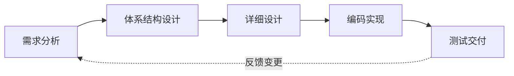
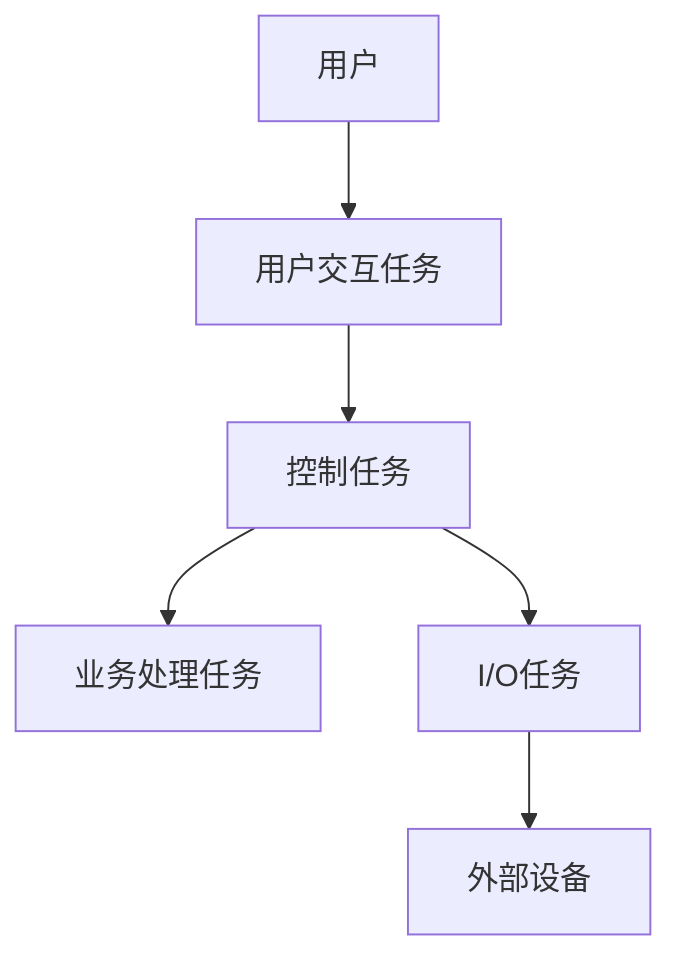

# 软件开发方法论概览

软件开发方法论，是把“需求—分析—设计—实现—测试—维护”组织成可管理过程的一套原则、模型与技术。它回答三个问题：先做什么、产出什么、如何检查。没有方法论，团队容易边做边改，需求遗漏、接口冲突和返工会不断累积。

## 方法论与过程模型

常见过程模型可按需求稳定程度选择：

| 模型 | 基本做法 | 适用场景 | 主要风险 |
|---|---|---|---|
| 瀑布模型 | 阶段顺序推进，文档驱动 | 需求明确、变更少 | 问题发现晚 |
| 原型模型 | 先做原型，澄清需求 | 界面多、需求模糊 | 原型被误当成品 |
| 增量模型 | 分批交付可用功能 | 可拆分、希望早交付 | 架构统筹不足 |
| 螺旋模型 | 迭代并重点分析风险 | 大型、高风险项目 | 管理成本较高 |
| 敏捷方法 | 短迭代、持续反馈 | 变化快、用户可参与 | 忽视整体设计 |

> [!IMPORTANT]
> ==过程模型决定开发活动如何组织，具体建模方法决定各活动怎样完成==；二者不能混为一谈。例如，采用迭代过程，并不排斥面向对象分析与设计。

## 面向对象开发怎么做

面向对象方法以对象和类组织系统：先识别业务概念与用例，再划分对象职责，建立类、交互和状态模型，最后映射为代码。其优势是分析、设计使用相近概念，便于追踪需求和控制变化；难点不在“画几张图”，而在职责分配是否合理、模型之间是否一致。

进入设计阶段，还要把系统行为分配给可并发执行的任务。常见任务包括：

- **用户交互任务**：负责与用户交互，接收命令、输入数据并反馈结果。
- **I/O 任务**：负责与设备或其他外部系统交换数据。
- **控制任务**：协调多个任务，响应事件并控制执行次序。
- **周期任务**：按固定时间间隔触发处理。

## 一道题怎样选对

“什么是用户交互任务？”正确选项是 **B：与用户交互的任务**。判断依据就是任务名称所表达的外部交互对象，而不是它是否使用某种设备，也不是交互一定顺序或并发发生。

> [!WARNING]
> A 把用户交互等同于 I/O 设备交互，范围过窄；C、D 额外加入“顺序”“并发”限制。==顺序或并发描述执行方式，不是用户交互任务的定义==。

## 常见混淆与取舍

| 易混概念 | 区别要点 |
|---|---|
| 方法论与工具 | 前者指导开发，后者辅助建模或实现 |
| 原型与增量 | 原型用于澄清需求，增量形成可交付功能 |
| 迭代与无序返工 | 迭代有计划、有评审、有基线 |
| 用户交互与 I/O | 前者面向用户，后者面向设备或外部系统 |

选择方法时，应综合需求稳定性、项目规模、风险、交付压力和团队能力，而不是机械追求“最新”。考试中也应先抓定义中的**对象、职责和触发方式**，再排除附加了无关限制的选项。
