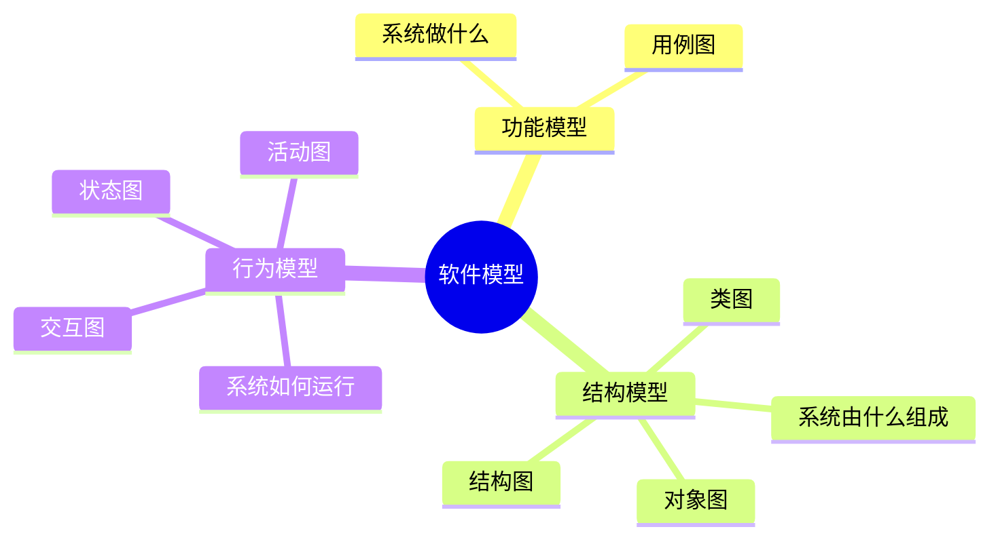
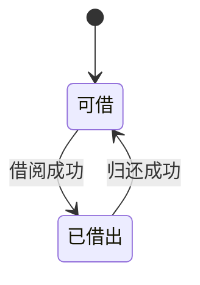

# 软件模型的类型（功能、结构、行为等）

## 软件模型是什么

软件模型是对软件系统某一方面特征的抽象描述，它==忽略底层实现细节，突出当前分析或设计所关心的内容==。例如，描述现实世界应用的结构属于分析阶段，描述拟开发软件系统的结构属于设计阶段。

大型软件很难用一张图说明全部问题，因此需要从不同视角建模。常见模型可分为功能模型、结构模型和行为模型，三者回答的问题不同，但又相互补充。

## 三类模型分别解决什么问题

| 模型类型 | 核心问题 | 主要内容 | 常用表示 |
|---|---|---|---|
| 功能模型 | 系统“做什么” | 外部参与者、系统功能、业务流程 | 用例图、用例描述 |
| 结构模型 | 系统“由什么组成” | 类、对象、构件及其静态关系 | 类图、对象图、结构图 |
| 行为模型 | 系统“如何变化与协作” | 消息交互、状态转换、活动流程 | 交互图、状态图、活动图 |

功能模型强调系统的外部特性。例如，在图书管理系统中，“读者借阅图书”是一个用例，它说明系统应提供什么功能，但不直接规定由哪些类实现。

结构模型强调系统的静态组成。例如，可以设置 `Reader`、`Book` 和 `Loan` 类，并用关联表示它们之间的关系。课件中的结构图还可用于刻画软件的总体功能和模块划分，并强调模块之间的调用关系。

行为模型强调时间维度上的动态过程。例如，借书时各对象如何传递消息，图书状态如何从“可借”变为“已借出”。

> [!IMPORTANT]
> ==结构模型描述静态结构，行为模型描述动态行为==；功能模型则侧重从外部观察系统提供的功能，不能简单归入结构模型。

## 与视图、开发阶段的区别

模型类型和 UML 视图不是同一个概念。视图是观察系统的角度，一种视图中可以包含多种模型：

- **Use case View**：描述系统的外部特性和系统功能。
- **Design View**：描述系统设计特征，包括结构模型视图和行为模型视图。
- **Process View**：表示系统内部的控制机制，可用类图描述过程结构，用交互图描述过程行为。

分析模型与设计模型也不能按“功能、结构、行为”直接划分。分析阶段和设计阶段都可以建立结构模型，区别在于前者面向现实问题，后者面向拟实现的软件系统。

> [!WARNING]
> 不要误认为“类图只用于设计、用例图只用于分析”。图的使用取决于建模目的；也不要把状态图当成结构图，状态图描述的是对象随事件发生的状态变化。

## 一个做对了的例子

仍以图书借阅为例：先用用例图确定“读者借阅图书”这一功能；再用类图表示 `Reader`、`Book`、`Loan` 及其关联；最后用状态图描述图书状态。

这里，用例图回答“提供什么功能”，类图回答“由哪些类构成”，状态图回答“图书如何变化”。若题目问“状态机类封装了什么”，应抓住状态机的执行需要两部分信息：状态转换规则，以及机器当前处于什么状态。因此选择 **D：状态转换表和机器的当前状态**，而不是只选状态转换表。

> [!TIP]
> 解题时先找关键词：“功能、外部特性”偏向功能模型；“类、对象、组成、调用关系”偏向结构模型；“消息、状态、活动、转换”偏向行为模型。
