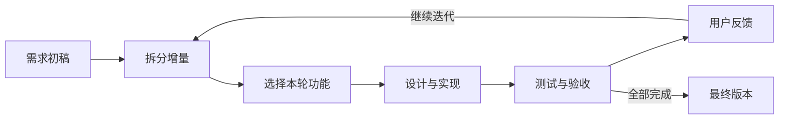

# 迭代式开发与增量式开发

## 什么是迭代式与增量式开发

==迭代式开发==是把一个系统分成若干轮开发，每一轮都经历“分析—设计—实现—测试—反馈”的完整过程，并根据用户反馈继续完善。==增量式开发==则是把系统功能拆成若干可交付部分，逐步加入产品。

两者常结合使用，但关注点不同：

| 方法 | 主要关注 | 典型产出 |
|---|---|---|
| 迭代式 | 每轮如何改进 | 可工作的软件版本 |
| 增量式 | 每轮增加什么 | 逐步扩展的功能集合 |

> [!IMPORTANT]
> 迭代是“反复做、不断改”，增量是“分段加、逐步齐”。一个增量通常要经过一次迭代完善后才能交付。

## 为什么需要

需求往往无法在项目开始时完全确定。若等全部需求明确后再开发，一旦发现设计错误，返工成本会很高。迭代与增量开发因此支持：

- 尽早交付可用软件；
- 通过用户反馈校正需求；
- 将复杂系统分解，降低单轮开发难度；
- 把风险分散到各轮，而不是集中在末期。

## 怎么做

常见步骤是：确定初始需求 → 识别并排序功能增量 → 规划迭代 → 实现与测试当前增量 → 验收并收集反馈 → 纳入下一轮。

增量划分应尽量形成完整、可验证的功能。例如，在线商城可先交付“商品查询”，再增加“购物车”，最后增加“支付”，而不是先只写一个商品页面，再补一个无法独立运行的页面。

## 与相近概念的区别

**增量式**与**螺旋模型**不同：增量式强调功能逐步增加，螺旋模型还突出风险分析，并在每一圈包含规划、风险评估、客户评估和工程实现。

**迭代式**与**递归式**也不同：递归把大问题分解为同类子问题并求解；迭代通过重复执行步骤逼近结果，如数值迭代算法。

此外，“每轮都改进已有产品”不必然意味着增量开发。例如团队可能反复重构同一版本以修复缺陷，但功能范围并未增加。

> [!TIP]
> 判断口诀：**功能在长，是增量；过程在重复，是迭代。**

## 常见的坑

> [!WARNING]
> 不要把“迭代次数少”误认为增量式，也不要把每轮只写几行代码称为一次迭代。迭代必须有可检查的阶段产出和反馈。

1. **增量不可验收**：只增加半成品功能，用户无法试用。
2. **顺序失控**：基础依赖尚未完成，却先开发依赖它的功能。
3. **反馈不闭环**：只向用户演示，没有收集意见并调整后续计划。
4. **瀑布式变相执行**：名义上分轮，实际仍等全部功能完成才测试。

## 算对了的例子

某系统计划分三轮交付：

| 轮次 | 增量 | 工作量 |
|---|---|---:|
| 第1轮 | 用户登录、权限控制 | 8人天 |
| 第2轮 | 信息查询 | 5人天 |
| 第3轮 | 报表导出 | 3人天 |

项目当前进入第2轮，已完成登录和权限控制，工作量为8人天。若第2轮需再投入5人天，则截至当前累计投入为：

$$
8+5=13\text{ 人天}
$$

第3轮尚未开始，不能计入当前完成量。因此答案是**13人天**，而不是全部计划的 $8+5+3=16$ 人天。这个例子体现了增量按轮次累加，也说明“计划总量”和“当前累计量”必须区分。
