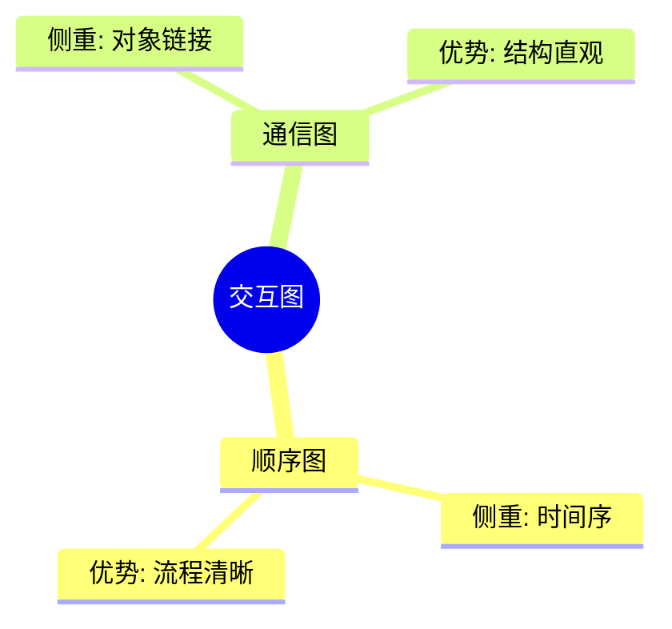
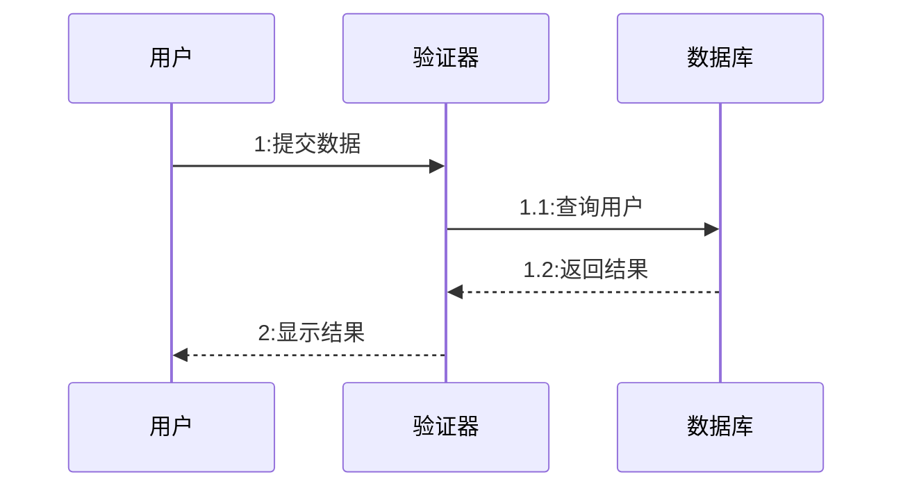

# 通信图（Communication Diagram）与顺序图的转换

# 通信图与顺序图的转换

在《软件建模与设计》的动态建模章节中，交互图是描述对象间协作的核心工具。虽然顺序图（Sequence Diagram）和通信图（Communication Diagram，UML 2.0前称协作图）侧重点不同，但它们表达的信息在本质上是等价的，可以相互转换。

## 核心概念辨析

==顺序图强调时间次序==，通过垂直的生命线和水平的消息箭头清晰展示消息发送的先后；而==通信图强调空间结构==，展示参与交互的对象及其链接关系，通过消息编号（如 `1:`, `1.1:`）来隐含时间顺序。

> [!IMPORTANT]
> 两者包含完全相同的信息集：参与对象、消息内容、消息方向及执行顺序。区别仅在于可视化布局。

## 转换方法与步骤

从顺序图转换为通信图，需遵循以下逻辑：

1.  **提取对象**：识别顺序图中所有参与交互的对象（生命线），将其作为通信图中的节点。
2.  **建立链接**：若两个对象间有消息传递，则在通信图中建立一条关联线（Link）。
3.  **标注消息**：将顺序图中的消息移至对应的链接上，并添加==嵌套序号==以保留时序。
    *   同步消息通常标记为 `1:`, `2:`。
    *   若消息 `2` 是在处理消息 `1` 的过程中发出的子调用，则标记为 `1.1:`。

> [!TIP]
> 记忆口诀：**“去线留点，连线标号”**。去掉生命线，保留对象点；连接发消息的对象，用数字编号锁定顺序。

## 常见误区与考点

许多同学容易混淆“集成通信图”的概念。在复习提纲中，这是一个高频选择题考点。

> [!WARNING]
> 不要认为通信图只是静态对象的简单堆砌。它必须体现动态交互的逻辑完整性。

针对考题：**什么是集成通信图？**
*   A. 通过将对象结合在一起形成的通信图
*   B. 所有支持相关用例的通信图的合成
*   C. 描述了实现一个用例的所有对象的通信图
*   D. 集成了来自静态模型中的对象的通信图

==正确答案是 B==。集成通信图并非单一场景的描述，而是为了全面理解系统行为，将支持同一用例的多个局部交互视图进行逻辑合成。选项 C 具有干扰性，但“集成”强调的是多视图的汇总（Synthesis），而非单张图的描述。

## 实例演示

假设有一个“用户登录”场景：
1.  用户输入账号密码。
2.  界面对象验证格式。
3.  控制对象查询数据库。

**顺序图视角**：

**转换为通信图**：
对象 `U`, `V`, `D` 成为节点。`U` 与 `V` 相连，`V` 与 `D` 相连。
*   链接 `U-V` 上标注：`1:提交数据`, `2:显示结果`
*   链接 `V-D` 上标注：`1.1:查询用户`, `1.2:返回结果`

这种转换确保了在不丢失时序信息的前提下，更清晰地展示了对象间的依赖结构，便于后续进行耦合度分析。
