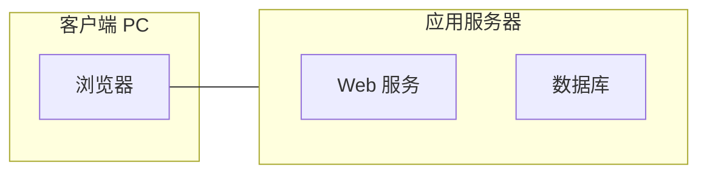
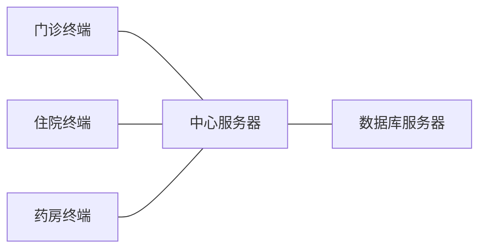

# 部署图（Deployment Diagram）的符号与用途

## 部署图：把软件“安装”到硬件上

先想一个问题：类图和构件图描述的是“系统由哪些逻辑部件组成”，但用户最终关心的是——**这套系统跑在哪些机器上？谁和谁通过网络相连？** 部署图（Deployment Diagram）回答的就是这个问题。

> [!IMPORTANT]
> 部署图刻画的是==运行时的物理配置==：构件实例被分配到哪些硬件结点上，这些结点之间如何连接。它属于实现模型，而不属于逻辑模型。

---

## 它是什么：结点 + 构件实例 + 通信路径

部署图只有三种核心元素：

| 元素 | 符号 | 含义 |
|---|---|---|
| 结点（Node） | 三维立方体 | 一台物理设备，如服务器、PC、传感器 |
| 构件实例 | 矩形 + `<<artifact>>` 或小构件图标 | 部署在该结点上的可执行部件 |
| 通信路径 | 结点之间的实线 | 网络连接或物理链路 |

用 Mermaid 画一个最简部署图：

> [!NOTE]
> 这里 `client` 和 `server` 是**结点**，`浏览器`、`Web 服务`、`数据库`是**构件实例**，连线是**通信路径**。

---

## 为什么需要：类图替代不了部署图

课件里有一条容易被忽视但考试常考的判断：

> ==只有型（Type）的形式，没有实例形式。为了显示构件的实例需要使用部署图。==

这句话的意思是：构件图描述的是“系统中存在哪些构件类型以及它们的依赖关系”，它是**类型级别**的视图。而部署图描述的是“某一次实际运行时，哪个构件实例跑在哪台具体机器上”，它是**实例级别**的视图。

| 维度 | 构件图 | 部署图 |
|---|---|---|
| 抽象层次 | 类型（Type） | 实例（Instance） |
| 核心问题 | 代码结构如何组织 | 代码跑在哪里 |
| 可见内容 | 构件与依赖 | 结点、构件实例、通信路径 |
| 类能出现吗 | 不能，只有构件 | 不能，只有构件实例 |

> [!WARNING]
> 类代表事物的逻辑抽象，==不能==出现在部署图的结点中；只有构件（以及构件实例）可以。

---

## 怎么做：四步画出部署图

课件给出的步骤，以客户机/服务器系统或 Web 应用为例：

1. **确定结点**：列出所有物理设备（客户端 PC、应用服务器、数据库服务器）。
2. **确定构件**：找出要部署的可执行构件（如浏览器端脚本、服务端程序、数据库存储过程）。
3. **分配构件到结点**：把每个构件实例放进对应结点的立方体中。
4. **绘制通信路径**：连接有交互的结点，并标注协议（HTTP、JDBC 等）。

一个医院诊疗系统的部署图示例：

> [!TIP]
> 这个图是**对象部署图**——每个结点都是具体的实例（如“门诊终端”），而不是抽象的结点类型（如“终端”）。考试时看清题目问的是“部署图”还是“部署图的实例形式”。

---

## 和相近概念的区别

| 概念 | 回答的问题 | 图中能否出现实例 |
|---|---|---|
| 类图 | 系统有哪些类及其关系 | 否 |
| 构件图 | 系统由哪些构件组成 | 否（只有类型） |
| 部署图 | 构件实例部署在哪些硬件上 | 是 |

---

## 常见的坑

1. **把结点当构件**：结点是硬件（或执行环境），构件是软件。数据库服务器是结点，数据库管理系统是构件。
2. **在部署图中画类**：部署图只关心物理部署，类的逻辑关系不属于这里。
3. **混淆“部署”与“执行”**：部署应用是把构件实例==分配==到硬件结点上，而不是执行应用。考题中“在部署应用时”的答案是“会把构件实例分配给硬件结点”，不是“会执行应用”。

> [!CAUTION]
> 构件实例能够部署在不同地理位置的结点上，但前提是==设计和实现已经完成==。设计之前谈不上部署。

---

## 一个算对了的例子

**题目**：软件体系结构的部署视图体现为什么？

**分析**：四个选项中，模块层次是逻辑视图；构件和连接器是构件视图；对象和消息是运行时交互视图。部署视图关心的是物理结点及其互联关系。

**答案**：C——==结点和互联关系的物理配置视图==。

再看一题：在部署应用时会发生什么？

**分析**：部署 = 分配。执行、实例化都是运行时行为，发生在部署之后。

**答案**：C——==把构件实例分配给硬件结点==。
