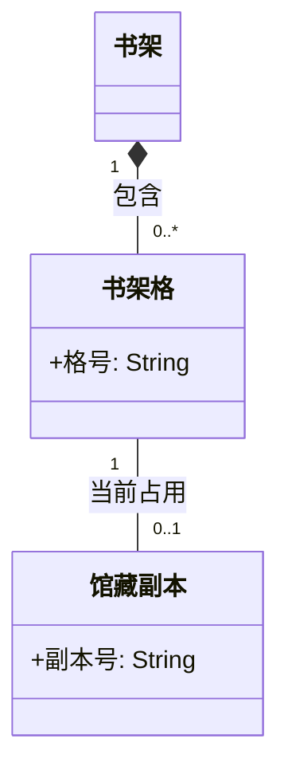

# 限定关联：先固定范围，再数关联对象

图书管理员看整个书架时，希望知道上面有哪些馆藏副本；报出一个格号时，则希望找到这个格里放的那一本。若直接在普通的“书架—馆藏副本”关联上把副本端改为 `0..1`，就把第一个需求也限制成“整架至多一本”了。==先写清已知条件，再数另一端对象==：这两句数的不是同一个集合。

假设每个书架可以有多个格，每格至多一本。这张图只纳入当前上架的副本，每本恰占一格；若把借出或待归架的副本也纳入，书架格端的多重性就应改为 0..1。下图把书架格画成独立的类，适合还要管理**空格**的场景，例如登记损坏或预留的位置。图中实心菱形表示撤除书架时其格位也撤销，但并不删除馆藏副本。格号在同一书架内不能重复，但不同书架可以重复使用同一格号。这条唯一性限制要另写，光靠两条线上的多重性不能推出。

若模型不需要单独跟踪空格，只需表达“给定书架和格号可查得至多一本”，可以不用建“书架格”类，直接在书架端的关联线上贴一个小框，写限定符 `格号: String`，在副本端标 `0..1`。该小框属于关联，不是另一个类；上图画的是显式书架格模型，不是这个小框的替代符号。两种读法可直接比较：

| 问题 | 已知 | 副本结果 |
| --- | --- | --- |
| 用普通关联列出整架所有副本 | 一个书架 | `0..*` |
| 用限定关联按格号查询 | 一个书架、一个格号 | `0..1` |

例如，甲架 `01` 格有副本 `C17`，`02` 格有副本 `C21`，`03` 格空着；乙架 `01` 格有副本 `C42`。只给甲架就得到两本；给“甲架、01”只得到 `C17`，给“甲架、03”则没有结果。看到“某个……内按编号找”时，把作用域和编号一起写出来再建模；若试图同时把 `C17` 和 `C99` 放进甲架 `01` 格，才真正违反副本端的 `0..1`。

> [!NOTE]
> 限定符回答“给同一来源对象的关联目标怎样分组”；关联类回答“关联本身有哪些属性或操作”。如果要保存某本书在某格的放入时间，时间属于一次放置关系；它不是用来说明格号如何缩小查询范围的。

参考：[OMG UML 2.5.1 规范，§11.5 Associations](https://www.omg.org/spec/UML/2.5.1/PDF)。
