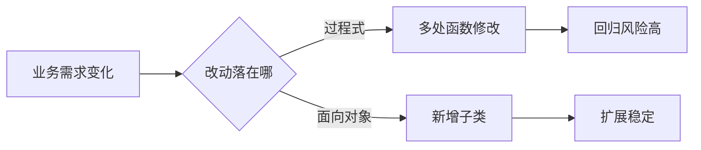

# 面向对象体系结构的特点与优势

面向对象体系结构（OOA/OOD 风格）把系统组织成一组 ==相互协作的对象==，每个对象==封装数据与对数据的操作==，并通过消息/接口与外界交互。它和传统的"过程 + 数据分离"风格的最大区别在于：变化被吸收进类与对象，而不是散落在各个函数里。

## 为什么需要它

当需求变化频繁、领域概念稳定但行为多变时，面向对象体系结构能让你==通过继承与多态扩展，而不是修改原有代码==。想一想：如果新增一种"取现规则"，你希望改的是一个 switch 分支，还是新增一个子类？



## 主要特点

- **封装（信息隐藏）**：对象是==封装数据的被动对象==（属性 + 服务），外部只通过接口访问，内部表示可自由更改。
- **抽象与类**：类是模板，对象是实例；子类复用父类的属性与服务。
- **继承与多态**：子类继承父类，覆盖方法实现差异化行为。
- **消息传递**：对象间通过消息协作，不直接摸对方的私有数据。
- **构件即对象**：构件可以是==由其他对象组成的复合对象==，也可以是简单对象，但必须==提供一个接口==。

## 与相近概念的区别

| 概念 | 关注点 | 与面向对象体系结构的关系 |
| --- | --- | --- |
| 子程序（函数） | 过程步骤 | **不是**面向对象概念 |
| 信息隐藏 | 隐藏内部表示 | 是面向对象的封装基础 |
| 业务逻辑类 | 业务规则、对实体类的调用 | 属于面向对象设计 |
| GUI 类（菜单/窗口/按钮） | 界面元素 | 也是对象，但不承载业务规则 |

> [!WARNING]
> ==子程序（subroutine）不是面向对象概念==，它是过程式编程的产物。信息隐藏、类、子类才是面向对象的基本构件。

## 常见的坑

- 把 ==对话框（dialog）== 这类 GUI 控件塞进业务逻辑类：它属于界面层，不属于业务规则的封装。
- 把 ==业务规则==（如"余额小于 10 美元则拒绝取现"）写到界面里：这是典型的分层错位，规则应封装在业务逻辑类。
- 混淆"对象"和"类"：对象是运行时实例，是封装数据的==被动对象==；类是它的类型模板。
- 把构件误认为"一个操作"：构件是封装体（复合或简单对象），不是函数或操作。

> [!TIP]
> 记忆口诀：对象 = **数据 + 服务**；构件 = **复合对象 + 接口**；GUI = **界面元素**，业务规则不放它里头。

## 一个对了的例子

选择题："关于构件下面哪一句话是错误的？"
- A. 一个由其他对象组成的复合对象 ✔
- B. 一个操作 ✘（**答案选 B**）
- C. 一个简单对象 ✔
- D. 提供一个接口 ✔

因为构件 ==可以是复合对象或简单对象，但必须提供接口==，它不是单个"操作"。

> [!IMPORTANT]
> ==面向对象体系结构的核心：对象封装数据与服务，通过接口协作；用继承和多态吸收变化。==

```mermaid
flowchart TD
  C["抽象类/接口"] --> S1["子类A"]
  C --> S2["子类B"]
  S1 --> M["多态调用"]
  S2 --> M
