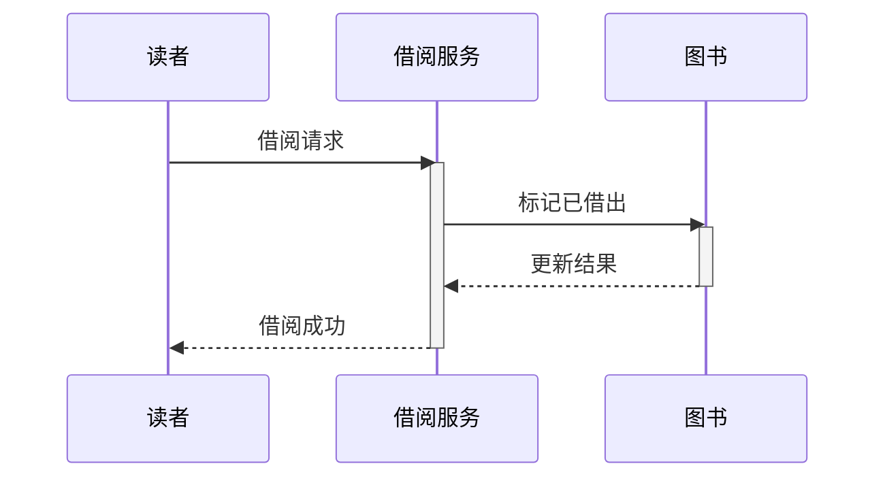

# 顺序图（Sequence Diagram）的元素：生命线、激活、消息

## 什么是顺序图

顺序图（Sequence Diagram，也称序列图）是一种**交互图**，描述对象之间传送消息的**时间顺序**，用于把一个用例具体化为“谁先做什么、随后谁响应谁”。

它回答的是：一次用例执行中，参与对象有哪些？消息按什么先后发生？对象在什么时候处于执行状态？

> [!IMPORTANT]
> 顺序图的核心是消息序列，而不是对象之间的静态关系。

## 为什么需要顺序图

用例图只能说明参与者与用例的关系，类图也不能完整说明一次业务执行时对象之间的调用过程。顺序图通过生命线、激活和消息，把动态行为直观地展开。

顺序图中的每条消息通常对应：

- 某个类操作；
- 状态机中引起状态转换的触发事件；
- 对象之间的一次通信请求。

例如“借阅图书”用例中，读者、图书、读者服务和借阅记录对象之间的调用先后，就很适合用顺序图表达。

## 三类核心元素

### 生命线

生命线表示参与交互的对象实例，用生命线上的矩形及虚线表示。名称可以是对象实例，如“图书管理员”，也可以是类，如“借阅服务”。

生命线从图表上方向下延伸，==时间总体自上而下推进==。

### 激活

激活表示对象正在执行某项任务。绘制时把生命线局部加粗，形成窄矩形，也称**激活条**。

- 激活开始：对象开始处理消息；
- 激活持续：对象仍在执行内部操作；
- 激活结束：对象完成处理，重新处于空闲等待状态。

如果一个对象调用另一个对象，后者通常出现一段激活；调用结束后，激活条结束。

### 消息

消息用箭头表示，描述发送者与接收者之间的通信，通常包含：

- 消息名称；
- 参数；
- 可选的返回值或前置、后置条件。

消息编号不是必需的，因为顺序图本身已经表达了先后顺序。复杂交互可用“1.2.1”式**层次编号**表示嵌套关系。

## 常见消息类型

| 类型 | 含义 | 发送方是否等待回复 |
|---|---|---|
| 简单消息 | 未特别区分同步或异步 | 视建模需要而定 |
| 同步消息 | 接收方处理后返回结果 | ==等待== |
| 异步消息 | 发送后继续自己的活动 | ==不等待== |
| 返回消息 | 返回处理结果或确认 | 与同步调用配合 |

> [!TIP]
> 判断同步还是异步，关键不是箭线画得是否漂亮，而是“发送方是否必须等待接收方完成处理后才能继续”。

自调用表示对象向自身发送消息；回调则是接收方在事件发生或操作完成后，异步通知原调用者。==回调不等于返回消息==：回调通常不带同步调用所要求的立即应答关系。

## 与相近概念的区别

| 对比项 | 顺序图 | 协作图 |
|---|---|---|
| 强调重点 | 消息的时间顺序 | 对象承担的角色及关系 |
| 消息顺序 | 由纵向位置直接体现 | 依赖消息编号体现 |
| 激活状态 | 可以表达 | 不能直接表达 |
| 创建与销毁 | 可表达相对时间 | 表达较弱 |

两者语义上等价，可以相互转换。若关注“事件先发生什么、后发生什么”，优先使用顺序图。

## 常见坑

> [!WARNING]
> 不要把“异步消息”理解成“接收方不回复消息”。异步只表示发送方不等待；接收方之后仍可处理消息，甚至主动发送回调。

> [!CAUTION]
> 同步消息一般可以省略显式返回箭头，因为返回过程通常隐含在接收方激活条的结束处；但省略不等于禁止绘制。

## 例题分析

题目：一个生产者向消费者发送消息，哪种情况属于带回复的同步通信？

- A. 生产者等待消费者的应答  
- B. 生产者不等待消费者的应答  
- C. 生产者进入休眠  
- D. 生产者等待超时  

答案是 **A**。

因为带回复的同步通信中，生产者发送请求后必须等待消费者处理并返回结果，才能继续后续活动。B更接近异步通信；C、D没有完整体现“等待接收方回复”的同步语义。

> [!IMPORTANT]
> 做题时先抓两点：消息沿生命线向下体现顺序；同步与异步的区别在于发送方是否等待返回。
