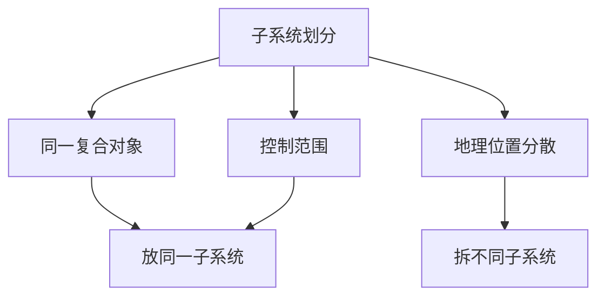

# 子系统设计中的高内聚与低耦合原则

## 高内聚与低耦合：子系统划分的总原则

把分析阶段得到的对象组织成子系统时，只有一条总原则：**==子系统内部高内聚，子系统之间低耦合==**。高内聚指一个子系统内的对象彼此职责相关、协作紧密；低耦合指子系统之间的依赖和通信尽可能少。划得好，每个子系统可以独立设计、独立测试、独立复用；划得差，一处改动牵一发动全身。

## 判断"该放一起"的启发式规则

课件给出了一组可以直接套用的分配规则，按"同子系统 / 不同子系统"归纳如下：

| 应放在**同一个**子系统 | 应放在**不同**子系统 |
|---|---|
| 属于同一复合对象一部分的对象 | 地理位置不同的对象 |
| 状态相关的控制对象 + 它所控制的对象 | 仅"彼此相关联"的对象（关联太弱） |
| 用户接口对象 + 它更新的实体对象 | 客户端和服务对象（两侧各自成层） |
| 业务逻辑对象 + 它操作的实体对象 | 不同安全等级 / 不同变更频率的对象 |

其中"控制范围"规则是常考点：==一个状态相关的控制对象必须与它所控制的对象同子系统==，因为控制逻辑与被控状态必须同步演进，分开会导致接口膨胀。

## 易混点辨析

- **"彼此相关联" ≠ 应同子系统**。几乎任何两个对象都有关联，若据此划分会得到一个巨型子系统。判断标准应是"是否构成同一复合对象 / 同一控制范围"。
- **用户接口对象与实体对象**：只有当 UI 直接更新该实体时才同子系统；若实体被多个界面共享，则应下沉到独立子系统，由控制对象协调——这就是选择 8 选 A 的原因。
- **信息隐藏对象**：是==封装数据的被动对象==，由外部主动对象调用，本身不拥有控制线程。
- **数据库包装器类**：==封装"如何访问数据库中数据"的细节==，对外提供数据访问接口，使实体对象与具体数据库解耦。

> [!IMPORTANT]
> 复合对象整体、控制范围是"强内聚"信号，必须同子系统；地理位置、客户端/服务端是"天然边界"信号，必须拆开。

> [!WARNING]
> 看到"相关联""有交互"就合并子系统是典型错误。关联只是存在联系，不代表变更频率、生命周期一致。

## 例题验证

以选择题 1 为例：若按控制范围组织子系统，则状态相关的控制对象应与被控对象同子系统，答案 B。选择题 3 中"属于同一个复合对象一部分的对象"同子系统，答案 A；而"客户端和服务对象"分属不同层，"用户接口和实体对象"仅在直接更新时才同子系统，均不选。
