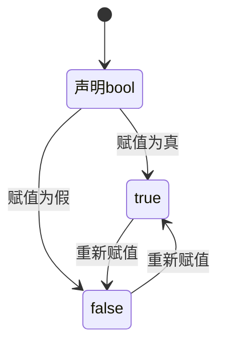

# 新增的bool类型

---
requires: [C语言基础/数据类型]
---

在 C 语言中，我们是如何表达“真”和“假”的？通常用整数 `0` 表示假，非 `0` 值表示真。但这样真的足够清晰吗？如果一个函数返回 `int`，它到底是在返回一个计算结果，还是在返回一个逻辑状态？为了解决这种语义模糊的问题，C++ 引入了专门的类型。

## 它是什么

> [!IMPORTANT]
> C++ 新增了 ==`bool`（布尔）数据类型==，专门用于处理逻辑值。它只有两个取值：`true`（真）和 `false`（假）。

`bool` 类型变量在内存中通常占用 $1$ 个字节。虽然只存两个状态，但底层依然分配了一个字节的空间。



## 为什么需要

在没有 `bool` 类型的 C 语言里，逻辑判断全靠整型“兼职”。这带来了两个问题：

1. **语义不清**：看到 `int flag;`，你无法确定它是用来计数的还是做开关标志的。
2. **缺乏类型安全**：整型和逻辑值混用，容易引发误操作。

C++ 增加 `bool` 类型后，代码的意图一目了然，==让逻辑值与数值彻底分家==。

| 对比维度 | C 语言的做法 | C++ 新增的 `bool` |
| :--- | :--- | :--- |
| 类型关键字 | `int` 兼任 | `bool` 专用 |
| 逻辑常量 | `0` 和非 `0` 整数 | `true` 和 `false` |
| 语义清晰度 | 低（数值与逻辑混淆） | 高（专词专用） |
| 典型大小 | $4$ 字节（32位系统） | $1$ 字节 |

## 怎么做

定义和使用 `bool` 变量非常直观：

```cpp
bool isPassed = true;   // 初始化为真
bool isEmpty = false;   // 初始化为假

int score = 85;
isPassed = (score >= 60); // 关系表达式结果直接赋给 bool
```

> [!TIP]
> 任何关系表达式（如 `a > b`）或逻辑表达式（如 `x && y`）的计算结果，其类型都是 `bool`。

当 `bool` 参与算术运算时，会发生隐式类型转换：`true` 被转换为 $1$，`false` 被转换为 $0$。

## 常见的坑

> [!WARNING]
> 不要对 `bool` 变量进行多余的比较！很多初学者习惯写 `if (flag == true)`，这不仅啰嗦，还容易因为手误写成 `if (flag = true)` 导致赋值而非比较。

正确的做法是直接判断：

```cpp
bool flag = true;
// 错误且危险的写法：
// if (flag = true) { ... } 
// 推荐的规范写法：
if (flag) { ... }
if (!flag) { ... }
```

> [!CAUTION]
> 将非零整数赋给 `bool` 变量时，无论原值是 $2$、$-5$ 还是 $100$，都会被统一截断转换为 `true`（即内部存储为 $1$），原始数值信息会丢失。

## 算对了的例子

回顾南邮这门课的期末填空题：

> **题目**：为了方便处理逻辑值，C++ 中新增加了 ③ 数据类型。
> **答案**：`bool`

**解析**：题目中的关键词是“方便处理逻辑值”。在 C++ 对 C 语言的改进及扩展中，专门为了剥离整型与逻辑值的耦合而引入的基础数据类型就是 `bool`。填空时注意拼写全小写，切勿写成 `Bool` 或 `boolean`（后者是 Java 的关键字，不是 C++ 的）。
