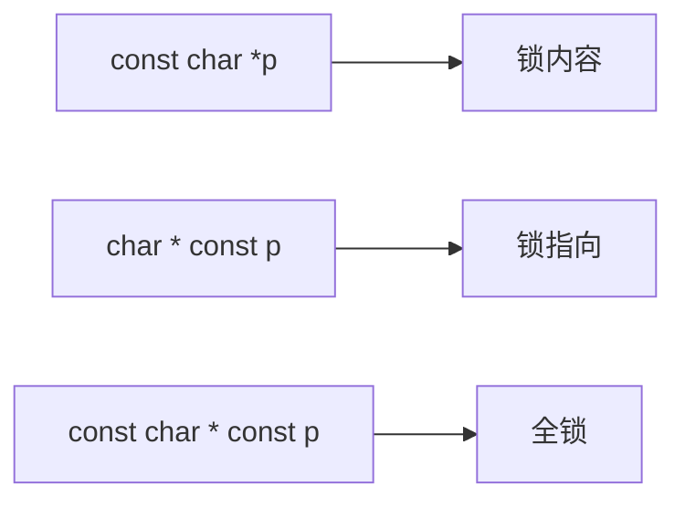

# 使用const定义常量（与宏定义的区别）

## 为什么需要 const

C 语言用 `#define` 定义符号常量，但预处理只做**简单文本替换**：没有类型检查、不分配内存、出错信息难定位。C++ 引入 `const` 让常量拥有**类型与作用域**，编译器能做类型检查并给出更友好的报错。

```cpp
#define PI 3.14159          // 宏：无类型，纯替换
const double PI = 3.14159;  // const：有类型，占内存，受作用域约束
```

> [!IMPORTANT]
> `const` 常量在**定义时必须初始化**，之后值不可修改；它像变量一样参与类型检查，而宏只是“换了个名字的文本”。

## 与宏定义的区别

| 对比项 | `#define` 宏 | `const` 常量 |
|---|---|---|
| 处理时机 | 预处理（文本替换） | 编译（语义检查） |
| 类型 | 无类型，不做检查 | 有类型，严格检查 |
| 内存 | 不占内存（展开） | 占内存（可优化） |
| 作用域 | 从定义处到文件尾 | 遵循块作用域 |
| 调试 | 无法看到符号名 | 调试器可见 |
| 安全性 | 无边界保护 | 编译器拦截非法修改 |

> [!TIP]
> 记忆口诀：**宏是“盲替换”，const 是“真常量”**。能用 `const` 就不用 `#define`。

## const 与指针：三种写法

`const` 靠近谁，谁就“锁死”。这是考试最爱挖的坑。

```cpp
const char *p;        // 指向常量的指针：内容不可改，指向可改
char * const p;       // 常量指针：指向不可改，内容可改
const char * const p; // 双锁：指向和内容都不可改
```

用一张图看清“锁”的位置：



> [!WARNING]
> `const char *name = "chen";` 中，`name` 指向的是**字符串常量**。此时 `name[0]='c'` 试图修改常量区，属于**未定义行为**（通常崩溃），但 `name="lin"` 或 `name=new char[5]` 只是改变指向，语法合法。

## 典型例题解析

题目：已有定义 `const char *name="chen";`，下面语句中**错误**的是？

- A. `name[3] = 'a';`
- B. `name = "lin";`
- C. `name = new char[5];`
- D. `cout << name[3];`

分析：

| 选项 | 操作 | 是否合法 | 原因 |
|---|---|---|---|
| A | 修改 `name[3]` | ==错误== | 通过常量指针写常量区，未定义行为 |
| B | 改指向 | 合法 | 指针本身未被 `const` 锁定 |
| C | 改指向新内存 | 合法 | 仅改变指向，原内存泄漏但语法正确 |
| D | 读 `name[3]` | 合法 | 读操作不受 `const` 限制 |

> [!CAUTION]
> 看到 `const char *p`，先问自己：**`const` 修饰的是 `char` 还是 `*`？** 它锁的是“指针所指向的内容”，不是指针本身。因此“改指向”永远安全，“改内容”一定报错。

## 常见误区

> [!WARNING]
> 1. 认为 `const` 常量必须占内存：现代编译器常直接内联优化，概念上有存储，实现上可能无。
> 2. 混淆 `char * const p` 与 `const char *p`：前者是“指针常量”，后者是“指向常量的指针”，考试高频陷阱。
> 3. 用宏定义数组长度：`#define N 10` 在 C 中常见，C++ 推荐 `const int N = 10;` 或 `constexpr`，更安全。
