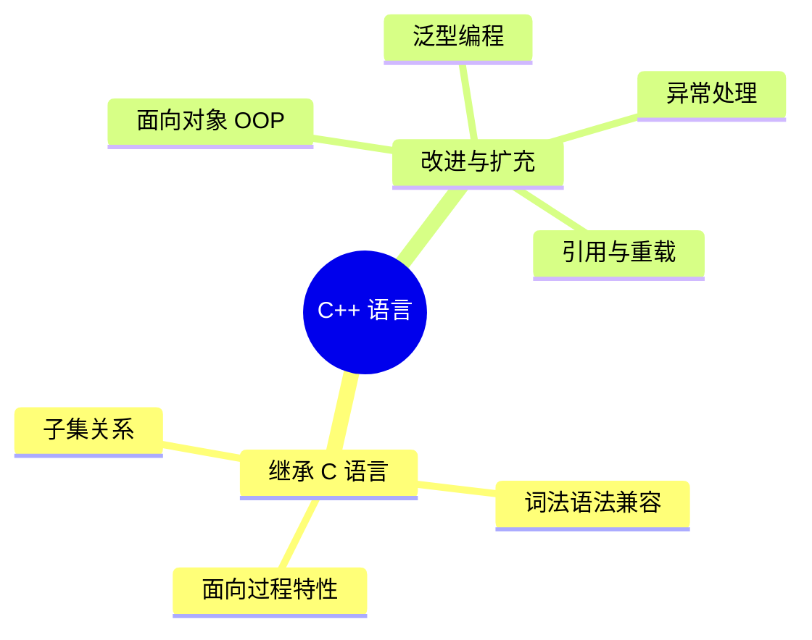

# C++语言与C语言的关系

## C++ 与 C 语言的关系：继承与改进

C++ 并非凭空创造，而是由 Bjarne Stroustrup 在贝尔实验室基于 C 语言发展而来。理解二者关系的核心在于两个词：**==继承==** 与 **==改进==**。C++ 既保留了 C 语言高效、面向过程的特性，又引入了面向对象机制，成为一种混合型语言。

### 核心关系解析

C 语言是 C++ 的一个**子集**。这意味着绝大多数合法的 C 代码可以直接在 C++ 编译器中编译运行。
- **继承**：C++ 保留了 C 的词法、语法及面向过程的设计风格（如指针、结构体）。
- **改进**：针对 C 语言在大型软件开发中的不足（如缺乏类型安全、代码复用难），C++ 增加了类、继承、多态、模板及异常处理等特性。

> [!IMPORTANT]
> C++ 相对于 C 语言的**最根本变化**是引入了**面向对象程序设计**的支持，实现了从“以函数为中心”到“以对象为中心”的思维转变。

### 关键区别对比

虽然 C++ 兼容 C，但在实际开发中，建议采用“C++ 风格”而非简单的“C 风格”。以下是常见差异：

| 特性 | C 语言风格 | C++ 推荐风格 | 优势 |
| :--- | :--- | :--- | :--- |
| **输入输出** | `printf/scanf` | `cin/cout` | 类型安全，自动推导 |
| **常量定义** | `#define PI 3.14` | `const double PI = 3.14` | 有类型检查，作用域可控 |
| **内存管理** | `malloc/free` | `new/delete` | 自动调用构造/析构函数 |
| **函数参数** | 指针传递 | 引用传递 `&` | 语法简洁，避免空指针 |

### 常见误区与考点

1.  **兼容性的边界**：虽然 C 是 C++ 的子集，但并非 100% 完全兼容。例如，C 语言中 `void*` 可以隐式转换为其他指针类型，而在 C++ 中必须显式强制转换。
2.  **运算符重载限制**：C++ 允许重载大多数运算符，但有几个**不能重载**，常考的是：`::` (作用域解析), `.` (成员访问), `.*` (成员指针访问), `?:` (条件运算符), `sizeof`。
3.  **多态性分类**：C++ 支持两种多态：
    *   **编译时多态**（静态）：通过**函数重载**和**模板**实现。
    *   **运行时多态**（动态）：通过**虚函数**和**继承**实现。

> [!TIP]
> 记忆口诀：**“C 是基础，OOP 是灵魂”**。在做题时，若问及 C++ 对 C 的改进，优先联想**类、引用、重载、内联、默认参数**等关键字。

### 典型例题解析

**题目**：C++ 语言对 C 做了很多改进，C++ 语言相对于 C 语言的最根本的变化是（ ）
A. 增加了一些新的运算符
B. 允许函数重载
C. 增加了布尔类型
D. 引进了类和对象的概念

**解析**：
选项 A、B、C 均为 C++ 的具体语法改进或特性扩展，属于“术”的层面。而 **D 选项** 引入了**类和对象**，标志着程序设计范式从面向过程转变为面向对象，这是 C++ 诞生的初衷和最本质的特征。

**答案**：D

> [!WARNING]
> 考试中若遇到“C++ 源程序扩展名”或“入口函数”类基础题，需牢记：源文件为 `.cpp`，目标文件 `.obj`，可执行文件 `.exe`，且程序始终从 `main()` 开始执行。
