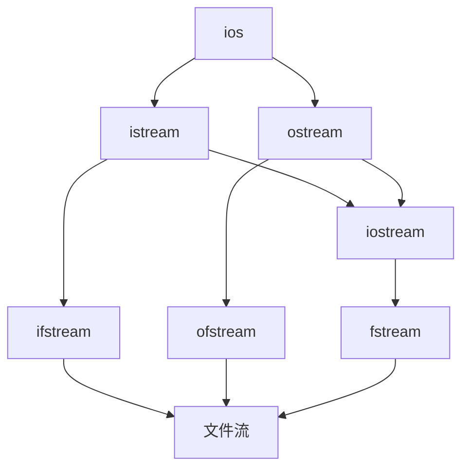

# I/O流的概念及流类库体系结构

C++ 里凡是"要和外部世界打交道"的操作，无论是屏幕、键盘还是磁盘文件，都是把数据当成一串**字节流**来处理的。这串字节流由 `istream` / `ostream` 之类的**流类**负责封装——这既是"==I/O 流=="的字面来源，也是理解 C++ I/O 体系的钥匙。

## 为什么要引入流

C 语言的 `printf` / `scanf` 用"格式串 + 变参表"，类型写错编译器不报错、运行时悄无声息地给出垃圾结果。C++ 用 ==运算符重载==把类型检查交还给编译器，用 `<<` `>>` 自动匹配类型，还能被自定义类（如 `complex`）继续扩展。想一想：如果我要打印一个自定义的 `Student` 对象，是给 `printf` 拼格式串方便，还是让 `operator<<` 自动识别类型更安全？

## 流类库体系结构

标准 I/O 流类层层派生，底座是 `ios`，中间抽取"输入/输出"能力形成 `istream`、`ostream`，二者汇合出 `iostream`，再细分到文件 `fstream`、字符串 `strstream` 两族。



| 家族 | 头文件 | 代表类 | 用途 |
|---|---|---|---|
| 标准流 | `<iostream>` | `cin` `cout` `cerr` `clog` | 控制台 I/O |
| 文件流 | `<fstream>` | `ifstream` `ofstream` `fstream` | 文件读写 |
| 字符串流 | `<strstream>` | `istringstream` `ostringstream` | 内存串格式化 |

> [!IMPORTANT]
> ==`<iostream>` 是 C++ 风格 I/O 的基本头文件==，命名空间为 `std`（使用前需 `using namespace std;` 或 `std::cout` 限定）。`<fstream>`、`<strstream>` 都建立在其流类层次之上。

## 流的常见操作

- **格式化**：`cout << hex << setw(8) << setfill('0')` 控制进制、宽度、填充。
- **成员函数**：`get()`、`put()` 逐字符读写；`getline()` 读整行；`eof()`、`fail()`、`good()` 判状态。
- **文件流三步**：打开 `ifstream ifile("D:\\abc.txt");` → 判状态 `if (!ifile)` → 关闭 `ifile.close()`（析构函数亦会自动关）。

> [!WARNING]
> 文件路径中的反斜杠要写成 `\\`，或者直接用 `/`；判断文件是否打开成功必须在使用前做，否则后续读取全部静默失败。

## 与相近概念的区别

- **`cin` vs `scanf`**：前者类型安全、可重载；后者格式串易错。
- **`<iostream>` vs `<stdio.h>`**：前者面向对象、可扩展；后者 C 风格、性能略优。
- **`cout` vs `cerr`**：`cout` 缓冲、可重定向；`cerr` 无缓冲、直接输出到标准错误，常用于出错提示。

## 一个算对了的例子

把 `D:\abc.txt` 复制到当前目录 `xyz.txt`（教材例 8.8 的骨架）：

```cpp
#include <iostream>
#include <fstream>
using namespace std;

int main() {
    ifstream ifile("D:\\abc.txt");
    if (!ifile) {
        cout << "abc.txt cannot be openned!" << endl;
        return 0;
    }
    ofstream ofile("xyz.txt");
    char ch;
    while (ifile.get(ch))    // 逐字符读
        ofile.put(ch);       // 逐字符写
    ifile.close();
    ofile.close();
    return 0;
}
```

读程填空里让补的就是 `ofile.put(ch);` 这一类"用 `get`/`put` 完成流搬运"的语句——记住 ==文件复制 = `get` 循环 + `put` 输出==，再配合打开失败检查，基本不会丢分。

> [!TIP]
> 记忆口诀：**先开、再判、后关**；读写对象分清 `ifstream` 只读、`ofstream` 只写、`fstream` 读写。`>>` 会跳过空白、`get()` 不跳过空白，两者差异是常见选择题陷阱。
