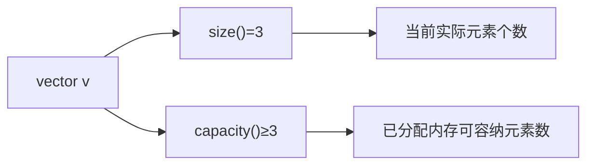

# 泛型程序设计与C++ STL简介：顺序容器vector的操作（插入、删除、capacity、size、at、front、back、赋值）

## 泛型程序设计与 vector 容器

先从一个编程中的实际问题出发：你需要一个存放整数的“动态数组”，又想再有一个存放浮点数的“动态数组”。按普通写法，你得为每种类型分别写一套插入、删除、访问的代码。这些代码逻辑完全一样，唯一区别就是数据类型不同。能不能只写一次代码，让编译器根据需要自动生成不同版本？

==C++ 模板正是为此而生==。模板将类型参数化，让你编写 ==“与类型无关”的通用代码==。STL（标准模板库）就是基于模板构建的一套强大工具集，其中 vector 是最常用的顺序容器。

### 什么是 vector

vector 是一个==可动态增长的数组==。与普通数组相比，它无需在创建时就固定大小——当你往 vector 里添加元素且内存不够时，它会自动重新分配更大的连续内存空间。

> [!IMPORTANT]
> vector 内部存储是**连续的**，因此支持通过下标 `[]` 随机访问元素，访问速度与普通数组一样快。

### 为什么需要掌握这些操作

vector 在实际编程中几乎无处不在。理解 `size` 和 `capacity` 的区别、正确使用 `at` 代替 `[]` 做安全检查、知道 `push_back` 何时触发重新分配，这些都是写出高效、安全代码的基础。

### 核心操作详解

#### 插入元素

| 方法 | 功能 | 注意事项 |
|------|------|----------|
| `push_back(val)` | 在尾部追加元素 | 最常用；可能触发重新分配 |
| `push_front(val)` | 在首部插入元素 | ==vector 不支持此操作== |
| `insert(pos, val)` | 在指定位置插入 | 可能导致迭代器失效 |

#### 删除元素

| 方法 | 功能 | 注意事项 |
|------|------|----------|
| `pop_back()` | 移除尾部元素 | 不会减小 capacity |
| `pop_front()` | 移除首部元素 | ==vector 不支持此操作== |
| `clear()` | 清空所有元素 | size 归零，capacity 不变 |
| `erase(pos)` | 删除指定位置元素 | 会导致后续迭代器失效 |

> [!WARNING]
> vector 没有 `push_front` 和 `pop_front` 方法。如果需要从两端操作元素，考虑使用 `deque`（双端队列）。

#### size 与 capacity 的区别——最容易混淆的一对概念



- **`size()`**：容器中当前存放的元素个数。
- **`capacity()`**：当前分配的内存最多能容纳多少元素（不需重新分配）。
- **`reserve(n)`**：预留至少能容纳 n 个元素的内存，==capacity 增长后不会自动缩回去==。

> [!TIP]
> 记忆技巧：`size` 是“现有多少”，`capacity` 是“最多装多少”。
> 当 `size() == capacity()` 时再插入元素，就会触发内存重分配。

#### 元素访问——at 与 `[]` 的抉择

`[]` 运算符访问速度快，但==不做下标越界检查==。如果你误用了一个超出范围的索引，程序可能悄无声息地读写了不该访问的内存。

`at(n)` 则会检查索引是否在合法范围内（0 ~ size-1），越界时抛出 `out_of_range` 异常。

```cpp
vector<int> v{10, 20, 30};
v[5] = 100;      // 危险！未定义行为，程序可能崩溃
v.at(5) = 100;   // 安全，抛出 std::out_of_range 异常
```

> [!CAUTION]
> 面试和考试高频考点：`[]` 不检查越界，`at()` 会检查。需要安全保证时优先用 `at()`。

#### front 与 back

- `front()`：返回**首元素**的引用，等价于 `*v.begin()`。
- `back()`：返回**尾元素**的引用，等价于 `*(v.end() - 1)`。

对空 vector 调用这两者属于==未定义行为==，调用前务必用 `!v.empty()` 判空。

#### 容器赋值

`=` 运算符可以直接将一个 vector 的内容复制给另一个同类型的 vector：

```cpp
vector<int> v1{1, 2, 3};
vector<int> v2;
v2 = v1;               // v2 现在是 {1, 2, 3}
v1[0] = 99;            // v2 不受影响，它持有独立副本
```

另外 `assign()` 方法提供了更灵活的赋值方式，比如用 n 个相同值填充。

### 常见易错坑

1. **迭代器失效**：在 vector 中插入或删除元素（特别是中间位置）时，==之前获取的迭代器很可能失效==。比如 `push_back` 引发重分配后，所有迭代器都失效；`erase` 使被删位置及其后的迭代器失效。
2. **基类与派生类混用**：不要将派生类对象直接存到 `vector<基类>` 中，对象会被“切片”，只保留基类部分。应该存 `vector<基类*>`（指针）来实现多态。
3. **频繁在首部或中间插入/删除**会导致大量元素移动，效率低，应优先考虑 `deque` 或 `list`。

### 算对一道题

下面是一个函数模板，用于计算两个向量的和：

```cpp
template <class T>
vector<T> vectorSum(const vector<T>& v1, const vector<T>& v2) {
    vector<T> result;
    size_t size = v1.size() < v2.size() ? v1.size() : v2.size();
    result.reserve(size);        // 预留空间，避免多次重分配
    for (size_t i = 0; i < size; ++i) {
        result.push_back(v1[i] + v2[i]);
    }
    return result;
}
```

`template <class T>` 声明了类型参数 `T`，`vector<T>` 即元素类型为 `T` 的 vector。函数体中 `v1[i] + v2[i]` 要求类型 `T` 支持 `+` 运算——这正是“以类型需求为中心”的泛型程序设计思想。调用时编译器会根据实参自动推断 `T` 是什么类型。

### 与迭代器的关系

vector 支持==随机访问迭代器==，功能最强，可以像指针一样做 `it + n`、`it1 - it2` 等运算。通过 `v.begin()` 和 `v.end()` 获取迭代器后，就能使用 STL 通用算法（如 `sort`、`find`、`for_each`）处理 vector 中的元素。
