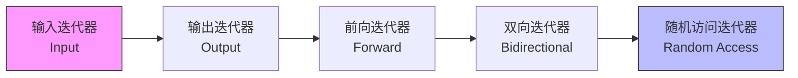

# STL中主要的五种迭代器及容器中的迭代器、常量迭代器

## 迭代器与常量迭代器

在 C++ STL 中，迭代器（Iterator）是连接算法与容器的桥梁。你可以将其理解为一种**广义的指针**，它提供了统一的方式来遍历容器中的元素。对于 `vector` 等连续存储的容器，迭代器行为类似原生指针；而对于 `list` 或 `map`，迭代器则封装了复杂的节点跳转逻辑。

> [!IMPORTANT]
> 核心定义：迭代器重载了 `*`（解引用）和 `->`（成员访问）运算符，使得 `*it` 能直接访问或修改指向的元素。

## 为什么需要常量迭代器？

既然普通迭代器既能读也能写，为什么还需要 `const_iterator`？

想象一下，如果你编写一个只用于“打印”或“统计”的函数，传入的是普通迭代器，编译器无法阻止你在函数内部意外修改数据（如 `*it = 0;`）。使用 `const_iterator` 可以强制实施**只读保护**，确保数据安全性，同时让代码意图更清晰。

> [!TIP]
> 记忆技巧：`const_iterator` 类似于 `const int* p`（指针指向的内容不可变），而非 `int* const p`（指针本身不可变）。

## 五种迭代器及其能力

STL 根据操作能力将迭代器分为五类，能力依次增强：



| 迭代器类型 | 读写能力 | 移动方向 | 典型容器 |
| :--- | :--- | :--- | :--- |
| **输入** | 只读 | 单向 (`++`) | `istream` |
| **输出** | 只写 | 单向 (`++`) | `ostream` |
| **前向** | 读写 | 单向 (`++`) | `forward_list` |
| **双向** | 读写 | 双向 (`++`, `--`) | `list`, `set`, `map` |
| **随机访问** | 读写 | 任意 (`+n`, `-n`, `[]`) | `vector`, `deque`, `array` |

==核心结论==：`vector` 和 `deque` 支持随机访问迭代器，效率最高；`list` 仅支持双向迭代器，不支持 `it + n` 或 `it[n]`。

## 常量迭代器的使用与常见坑

### 1. 声明与获取
- **普通迭代器**：`vector<int>::iterator it`
- **常量迭代器**：`vector<int>::const_iterator cit`

在现代 C++ (C++11) 中，推荐使用 `cbegin()` 和 `cend()` 直接获取常量迭代器，即使容器本身非 `const`。

### 2. 常见误区
> [!WARNING]
> **易错点**：`const iterator` $\neq$ `const_iterator`。
> - `const vector<int>::iterator it`：迭代器本身是常量（不能 `it++`），但 `*it` 可修改。
> - `vector<int>::const_iterator it`：迭代器可移动（可以 `it++`），但 `*it` **不可修改**。

### 3. 实例演示

```cpp
#include <iostream>
#include <vector>
using namespace std;

void printVec(const vector<int>& v) {
    // 使用 const_iterator 确保只读
    for (auto it = v.cbegin(); it != v.cend(); ++it) {
        // *it = 10; // 编译错误！不能通过常量迭代器赋值
        cout << *it << " ";
    }
}

int main() {
    vector<int> v = {1, 2, 3};
    
    // 普通迭代器：可读可写
    auto it = v.begin();
    *it = 10; // 合法，v 变为 {10, 2, 3}
    
    // 常量迭代器：只读
    auto cit = v.cbegin();
    // *cit = 20; // 非法！编译报错
    
    printVec(v);
    return 0;
}
```

> [!NOTE]
> 在考试或实际编程中，若函数参数为 `const Container&`，其内部使用的迭代器自动推导为 `const_iterator` 类型，此时任何试图通过 `*it` 修改元素的操作都会导致编译错误。
