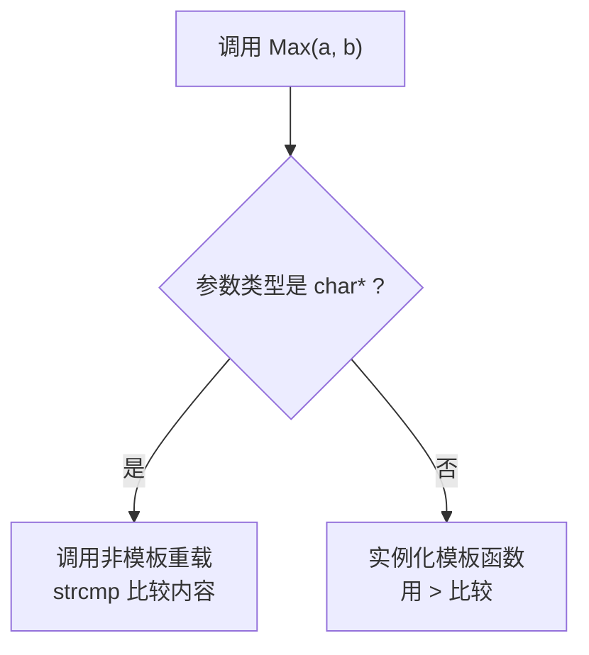

# string类型的初始化、I/O、比较函数与修改内容操作

## string 是什么

`string` 是 C++ 标准库提供的**字符串类**（定义在头文件 `<string>` 中），它把"字符数组 + 一组操作"封装成一个整体。相比 C 风格的 `char*` 字符数组，`string` 能自动管理内存、直接拼接、比较、查找，不容易越界。在第 7 章"模板"的语境下，`string` 本身就是 `basic_string<char>` 的模板特化——理解它有助于理解模板如何生成具体类型。

> [!IMPORTANT]
> `string` 不是内置基本类型，而是**类模板实例化出来的类**。它重载了大量运算符（`+`、`==`、`>`、`[]`、`<<`、`>>` 等），所以使用起来像基本类型一样直观。

## 为什么需要它

如果只用 `char*` 数组，比较两个字符串必须调用 `strcmp`，拼接要用 `strcat` 且要担心空间不够；而 `string` 把这些操作都变成了运算符或成员函数，更安全也更直观。当函数模板的参数类型是 `char*` 时，直接 `a > b` 比较的是**指针地址**而非内容，必须用 `strcmp` 才能得到正确结果——这正是引出"重载模板函数"的经典场景。

## 初始化与 I/O

`string` 的常用初始化方式：

| 写法 | 含义 |
|---|---|
| `string s;` | 空串 |
| `string s("abc");` | 用 C 串初始化 |
| `string s = "abc";` | 同上（拷贝初始化） |
| `string s(n, 'c');` | n 个字符 c |
| `string s(s2);` | 用另一个 string 拷贝 |

输入输出：

- `cin >> s`：读到空白字符为止；
- `getline(cin, s)`：读一整行（含空格）。

```cpp
#include <iostream>
#include <string>
using namespace std;

int main() {
    string s1 = "Nanjing";
    string s2(3, 'P');       // "PPP"
    cout << s1 << " " << s2 << endl;

    string s3;
    getline(cin, s3);        // 读入一整行
    cout << s3 << endl;
}
```

## 比较函数

`string` 重载了关系运算符，**按字典序逐字符比较**（ASCII 码小的在前）：

| 运算符 / 函数 | 作用 |
|---|---|
| `s1 == s2`、`!=` | 内容是否相等 |
| `s1 < s2`、`>`、`<=`、`>=` | 字典序比较 |
| `s1.compare(s2)` | 返回 0 / 负 / 正 |

> [!WARNING]
> 如果参数是 `char*` 而不是 `string`，`a > b` 比较的是**指针地址**而非字符串内容！必须改用 `strcmp(a, b)`。

## 修改内容操作

| 函数 | 作用 | 示例 |
|---|---|---|
| `s += t` / `append` | 追加 | `s += "Post"` |
| `s.insert(pos, t)` | 插入 | `s.insert(0, "Hi")` |
| `s.erase(pos, len)` | 删除 | `s.erase(2, 3)` |
| `s.replace(pos, len, t)` | 替换 | `s.replace(0, 2, "NJ")` |
| `s.substr(pos, len)` | 取子串 | `s.substr(0, 5)` |
| `s.length()` / `size()` | 长度 | `s.length()` |
| `s[i]` / `s.at(i)` | 访问字符 | `s[0]` |

## 重载模板函数：为什么、怎么做

考虑一个求最大值的模板：

```cpp
template <typename T>
T Max(T a, T b) { return a > b ? a : b; }
```

对 `int`、`double` 都正确，但对 `char*` 会出错——因为 `a > b` 比较的是地址。解决办法是**重载模板函数**：写一个参数为 `char*` 的非模板版本，函数体中用 `strcmp` 比较内容：

```cpp
char* Max(char* a, char* b) {
    return strcmp(a, b) > 0 ? a : b;
}
```

编译器匹配规则：**非模板函数优先于模板函数**。当实参是 `char*` 时，精确匹配的非模板版本胜出；实参是 `int` 等其它类型时，才实例化模板版本。



> [!TIP]
> 记忆口诀：==普通函数优先，模板兜底==。重载的目的是让同一函数名在不同类型上有"看起来一样、实现不同"的行为。

## 一个算对了的例子

```cpp
#include <iostream>
#include <cstring>
using namespace std;

template <typename T>
T Max(T a, T b) { return a > b ? a : b; }

char* Max(char* a, char* b) {
    return strcmp(a, b) > 0 ? a : b;
}

int main() {
    cout << Max(3, 7) << endl;            // 模板版 → 7
    char s1[] = "apple", s2[] = "banana";
    cout << Max(s1, s2) << endl;          // 重载版 → banana
}
```

> [!CAUTION]
> 常见坑：忘记给 `char*` 写重载，导致 `Max("apple", "banana")` 返回的"最大值"取决于两个字符串常量的存放地址，结果不确定；`string` 对象虽然可以直接用 `>`，但 `char*` 数组不能。
