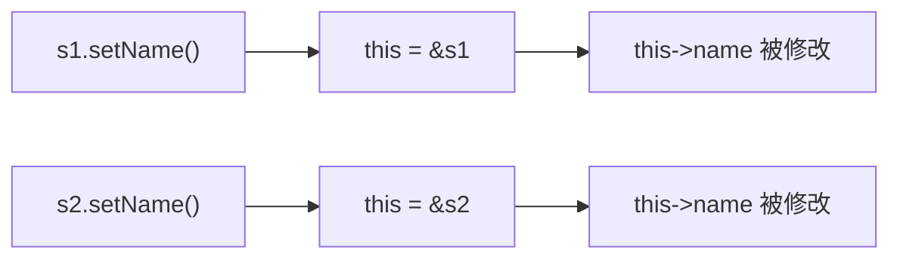

# this指针的概念与作用

## this 指针的概念与作用

### 从一个问题切入

定义一个 `Student` 类，创建两个对象 `s1` 和 `s2`：

```cpp
class Student {
private:
    string name;
    int score;
public:
    void setName(string n) { name = n; }
};
```

调用 `s1.setName("Alice")` 时，成员函数 `setName` 是如何知道该修改 `s1` 的 `name`，而不是 `s2` 的？——同样的函数代码，却操作了不同对象的数据成员，这背后的“自动导航”机制，就是 `this` 指针。

### this 是什么

==`this` 是指向当前对象的指针，隐含于类的每个非静态成员函数中。==

当写下 `s1.setName("Alice")` 时，编译器实际上将这次调用编译为类似：

```cpp
setName(&s1, "Alice");
```

在成员函数内部，`this` 就是调用者 `s1` 的地址。于是函数体中的 `name = n`，其全称实为 `this->name = n`——只不过 `this->` 通常被省略了。

> [!IMPORTANT]
> `this` 只在非静态成员函数中存在。静态成员函数属于类本身，没有“当前对象”的概念，因此不能使用 `this`。

### 为什么需要 this

**场景一：区分局部变量与成员变量**

当函数形参名与数据成员名相同时：

```cpp
void setName(string name) {
    this->name = name;  // 左 name 是成员，右 name 是形参
}
```

没有 `this->` 的 `name = name` 只是局部变量自赋值，数据成员不会被修改。

**场景二：返回对象自身**

在运算符重载或链式调用中，需要返回当前对象：

```cpp
Complex& add(const Complex& other) {
    this->real += other.real;
    this->imag += other.imag;
    return *this;   // *this 即当前对象本身
}
```

这样支持 `c1.add(c2).add(c3)` 的链式写法。

### 对象作函数参数的三种形式与 this

对象作为函数参数时，`this` 在与不同参数形式配合中的角色有所区别：

| 传递形式 | 语法示例 | 效率 | `this`相关说明 |
|---------|---------|------|---------------|
| 传值（对象变量） | `void func(Student s)` | 低，产生拷贝 | 拷贝出的新对象有其独立的 `this` |
| 传地址（对象指针） | `void func(Student* p)` | 高 | 形参 `p` 与外面的 `this` 指向同一对象 |
| 传名（引用） | `void func(Student& r)` | 高且语法简洁 | `r` 是别名，==推荐写法== |

> [!TIP]
> 引用参数兼具指针的高效和值传递的直观，是这门课最常推荐的参数形式。

### 一道真题的思路演绎



**选择题实例**：以下关于 `this` 指针的描述，错误的是？

- A. `this` 可以在程序中显式使用
- B. `this` 是在使用对象时由系统自动生成的
- C. `this` 是指向当前对象的指针
- D. `this` 是指向成员函数的指针

正确答案是 **D**。`this` 指向对象，==不是指向成员函数==。可以通过 `this->成员函数()` 调用函数，但 `this` 本身存储的是对象地址。

> [!WARNING]
> 常见误区：以为任何成员函数内都有 `this`。静态成员函数属于类，调用时不依赖对象（如 `Student::staticFunc()`），内部没有 `this`，无法访问非静态成员。

### this 与访问属性

`this` 所指向的对象，其成员的访问控制依然严格遵守三类属性：

| 访问属性 | `this` 可访问性 |
|---------|----------------|
| `private` | 仅本类成员函数（通过 `this->`）可访问 |
| `protected` | 本类及派生类成员函数可访问 |
| `public` | 任何代码均可访问 |

友元函数不是成员函数，因而没有 `this` 指针。它通过传入的对象参数来访问私有成员，==破坏了封装性，但提高了效率==，在运算符重载等场景需权衡使用。

### 一句话总结

==`this` 是编译器悄悄塞给每个非静态成员函数的“导航指针”，让同样的代码能自动定位到正确的对象上。==

写 `*this` 得到对象本身，写 `this->member` 明确访问成员。理解了它，也就理解了成员函数如何与“是哪个对象”建立联系。
