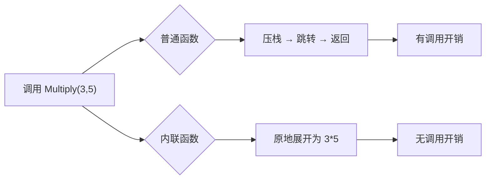

# 内联函数（inline）

## 从一个问题开始

假设你需要一个只做“两数相乘”的小功能，在代码里会调用很多次。你会怎么实现？

- 写成一个普通函数？——每次调用都有参数压栈、跳转、返回的开销。
- 写成一个宏定义？——宏只是文本替换，万一写 `Multiply(a++, b)` 就会出错。
- 有没有两全其美的办法？——这就是内联函数 `inline` 要解决的问题。

## 内联函数是什么

在函数定义或原型声明的最前面加上关键字 `inline`，就把它声明成了内联函数：

```cpp
inline int Multiply(int x, int y)
{
    return x * y;
}
```

当程序调用 `Multiply(3, 5)` 时，编译器不会像调用普通函数那样产生一条跳转指令，而是直接把函数体的代码“就地展开”，用 `3 * 5` 替换掉调用语句。这叫作**内联扩展**。



> [!IMPORTANT]
> ==内联函数的核心思想是以空间换时间：用代码体积的膨胀，换取运行速度的提升。== 因此它只适合功能简单、语句简短的函数。

## 为什么比宏更安全

宏定义在预处理阶段做的是纯文本替换，不做任何语法和语义检查。看这个例子：

```cpp
#define MULTIPLY(a, b) a * b

int result = MULTIPLY(1 + 2, 3 + 4);
```

你以为得到的是 $3 \times 7 = 21$，实际上宏展开后变成了：

```cpp
1 + 2 * 3 + 4
```

由于乘法优先级高于加法，结果是 $1 + 6 + 4 = 11$。

而内联函数完全按照函数语义编译：

```cpp
inline int Multiply(int x, int y) { return x * y; }

int result = Multiply(1 + 2, 3 + 4);  // (1+2)*(3+4) = 21
```

> [!WARNING]
> 宏在传参时有副作用：`Multiply(a++, b)` 中 `a++` 可能被展开执行两次。内联函数则严格按照“先求值实参、再进入函数体”的次序执行，==比宏安全得多==。

## 使用内联函数的注意事项

| 条件 | 说明 |
|---|---|
| 定义位置 | 一般定义在调用点之前；若调用在前、定义在后，则需在调用点之前给出带 `inline` 的原型声明 |
| 代码长度 | 应简短、功能简单 |
| 禁止结构 | 函数体内一般不能有循环语句、分支语句，递归也不允许 |
| 类内成员函数 | 从第 3 章起，定义在类内的成员函数自动视为内联函数，无需再加 `inline` |

> [!NOTE]
> `inline` 只是对编译器的一个**建议**，不是强制命令。编译器会根据函数复杂度自行决定是否真正展开。

> [!CAUTION]
> 在面向对象程序设计中，==“成员函数一定是内联函数”是错误的说法==——只有定义在类内（类体中）的成员函数才自动是内联的，定义在类外的成员函数不是。

## 与其他概念的辨析

| 概念 | 目标 | 典型场景 |
|---|---|---|
| 内联函数 | 消除调用开销，用“空间换时间” | 简单、频繁调用的小函数 |
| 函数重载 | 用同一函数名处理不同参数类型/数量 | 功能相同或类似、形参不同的一组函数 |
| 递归调用 | 用函数自身调用解决问题 | 分治、树形结构等 |
| 宏定义 | 预处理阶段的文本替换 | 常量、简单表达式（但已不建议用宏代替函数） |

## 一个算对了的例子

**题目**：在一个函数中，要求通过函数来实现一种不太复杂的功能，并且要求加快执行速度，选用（ ）。

- A. 内联函数　　B. 重载函数　　C. 递归调用　　D. 嵌套调用

**答案**：A

**解析**：题目三个关键词——“不太复杂”“加快执行速度”“通过函数实现”。重载函数解决的是命名复用问题，不直接提升速度；递归和嵌套调用反而增加调用开销。符合“功能简单 + 提速”要求的只有 ==内联函数==。

**填空常见考法**：在函数说明前加关键字 `inline`，则该函数被声明为 **内联** 函数，其引入的目的是为了消除函数调用时的开销，以提高运行速度。
