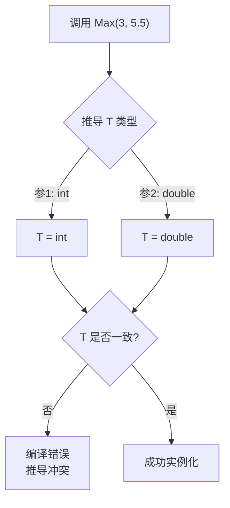

# 函数模板的异常处理
在 C++ 中，函数模板并非直接生成代码，而是由编译器根据调用时的实参类型**实例化**为具体的模板函数。这一过程严格遵循==参数类型一致性原则==。若实参类型与模板形参推导出的类型不匹配，且无法通过隐式转换解决，编译将报错。这就是所谓的“异常处理”问题——此处指编译期的类型匹配异常，而非运行时的 `try-catch`。

> [!IMPORTANT]
> 核心机制：编译器在实例化时，要求所有用于推导同一模板参数 $T$ 的实参必须具有==完全一致==的类型（忽略顶层 const/volatile）。

### 为什么需要关注？

考虑以下场景：你想写一个通用的求最大值函数。

```cpp
template <typename T>
T Max(T a, T b) {
    return (a > b) ? a : b;
}
```

若调用 `Max(3, 5.5)`，编译器会陷入困惑：
1. 从第一个参数 `3` (int) 推导 $T$ 为 `int`。
2. 从第二个参数 `5.5` (double) 推导 $T$ 为 `double`。
3. $T$ 不能既是 int 又是 double，导致==推导冲突==。



### 怎么做：解决类型不一致

当出现类型不一致时，主要有两种处理手段：

1.  **显式指定模板实参**：强制告诉编译器 $T$ 是什么类型，其余参数进行隐式转换。
2.  **强制类型转换**：在调用前手动转换实参，使其类型统一。

| 方法 | 代码示例 | 优点 | 缺点 |
| :--- | :--- | :--- | :--- |
| 显式指定 | `Max<double>(3, 5.5)` | 意图清晰，控制力强 | 需手动确定目标类型 |
| 强制转换 | `Max((double)3, 5.5)` | 兼容旧式 C 风格 | 代码冗长，易出错 |

> [!TIP]
> 记忆技巧：**“显式优先，转换兜底”**。当自动推导失败时，优先使用 `<Type>` 显式指定，这比修改实参更安全。

### 常见坑与辨析

*   **坑 1：引用与指针的混淆**
    若模板定义为 `T&`，传入常量或右值会导致绑定失败。此时需注意 const 引用或值传递的区别。
*   **坑 2：数组退化**
    传入数组名时，它会退化为指针。若期望推导为数组引用，需特殊声明（如 `T (&arr)[N]`），否则可能引发类型不匹配。

> [!WARNING]
> 不要试图用 `try-catch` 捕获模板实例化错误！模板错误是**编译期**错误，程序尚未运行，异常处理机制无效。

### 算对了的例子

假设题目要求修正以下调用错误：

```cpp
template <class T>
void Swap(T &x, T &y) { /* ... */ }

int main() {
    int a = 10;
    double b = 20.5;
    // Swap(a, b); // 错误：T 推导冲突
    Swap<double>(a, b); // 正确：显式指定 T 为 double，a 隐式转换为 double
    return 0;
}
```

在此例中，`Swap<double>(a, b)` 成功实例化为 `void Swap(double &x, double &y)`。注意，虽然 `a` 是 int，但在传递引用时，通常需要先转换为临时变量或确保类型严格匹配（视具体编译器实现及左值引用规则而定，更严谨的做法是确保实参类型一致或使用值传递模板）。在南邮考试语境下，重点在于识别==显式指定模板参数==可解决推导歧义。
