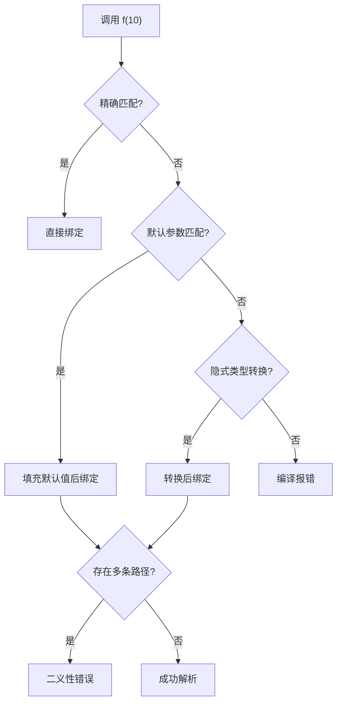

# 函数重载

## 什么是函数重载

如果需要在程序中分别处理整数、浮点数和字符串的求最大值操作，你会定义 `max_int`、`max_float`、`max_str` 三个函数吗？C++ 提供了更优雅的机制：==函数名相同，但参数列表不同==的一组函数称为**函数重载**。它属于**静态多态性**（编译时多态），与运算符重载共同构成 C++ 对 C 语言面向过程部分的重要扩展，有效减轻了用户的记忆负担。

> [!IMPORTANT]
> 重载的唯一判定标准是**形式参数表**必须在类型、个数或顺序上有所区别，==返回值类型不能作为区分依据==。

## 重载的匹配规则与二义性

编译器如何从多个同名函数中选择正确的一个？匹配过程严格遵循以下优先级：



当默认参数使两个重载版本都能被同一调用匹配时，就会产生**二义性**。例如：

```cpp
void f(int x);
void f(int x, char *s = "example");
f(10); // ❌ 二义性：两个版本均可匹配
```

> [!WARNING]
> 默认参数与重载混合使用时极易触发二义性，设计时应避免让带默认参数的版本与无参/少参版本在调用点上产生重叠。

## 常见误区辨析

| 对比维度 | 合法重载 | 非法 / 非重载 |
| :--- | :--- | :--- |
| 参数列表 | 类型/个数/顺序不同 | 完全相同 |
| 返回类型 | 可同可异 | ==仅返回类型不同≠重载== |
| const 修饰 | 顶层 const 不参与区分 | 底层 const（如 `const T&`）可区分 |
| 默认参数 | 视为参数个数变化 | 导致调用点歧义则非法 |

> [!CAUTION]
> 下列定义中 **B 选项错误**：`int disp(Myclass A)` 与 `char* disp(Myclass A)` 参数列表完全相同，仅返回类型不同，不构成重载。这是考试高频陷阱题。

## 正确示例与验证

以课件经典选择题为例，判断哪组重载在 `f(10)` 调用时无二义性：

```cpp
// ✅ 正确：int 精确匹配第一个版本
void f(int x);
void f(double x);       // A: 精确匹配优先于转换

// ❌ 错误：默认参数导致二义性（见上文）
void f(int x);
void f(int x, char *s = "example"); // B

// ✅ 正确：参数个数不同，精确匹配单参版本
void f(int x);
void f(int x, int y);   // C
```

> [!TIP]
> 解题口诀：**看重载先看参数表，返回类型靠边站；默认参数要小心，二义调用编译叹**。构造函数同样支持重载且可设默认值，但==绝不能指定返回类型==，这也是常考易错点。
