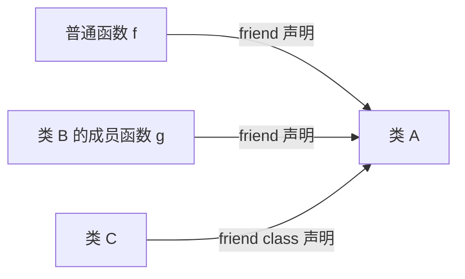

# 友元函数、友元成员与友元类

## 友元函数、友元成员与友元类

### 从一个编译错误说起

先看一段代码：

```cpp
class Date {
private:
    int year, month, day;
public:
    Date(int y, int m, int d) : year(y), month(m), day(d) {}
};

bool Equal(Date d1, Date d2) {
    return (d1.year == d2.year && d1.month == d2.month && d1.day == d2.day);
}
```

`Equal` 是一个普通函数，它试图访问 `Date` 的私有成员 `year`、`month`、`day`。编译器的反应是：**报错**。原因在于类的封装机制——私有成员只允许类自己的成员函数和它授权的“朋友”访问。

如果 `Equal` 确实有访问私有成员的需要，又不打算把它变为类的成员函数，怎么办？答案是在 `Date` 内部把 `Equal` 声明为**友元函数**：

```cpp
class Date {
private:
    int year, month, day;
public:
    Date(int y, int m, int d) : year(y), month(m), day(d) {}
    friend bool Equal(Date d1, Date d2);   // 友元声明
};

bool Equal(Date d1, Date d2) {             // 类外定义，不加 friend
    return (d1.year == d2.year && d1.month == d2.month && d1.day == d2.day);
}
```

> [!IMPORTANT]
> 友元函数的**声明**写在类内部，前面加 `friend`；**定义**通常在类外部给出，此时**不能再加** `friend`。友元函数不是类的成员函数，但它拥有访问该类所有成员（含私有成员）的权限。

### 什么是友元

友元的三类形式：

| 形式 | 语法示例 | 说明 |
| :--- | :--- | :--- |
| 友元函数 | `friend void f(A&);` | 一个不属于任何类的顶层函数，被授权访问类 `A` 的私有成员 |
| 友元成员 | `friend void B::f(A&);` | `B` 类的成员函数 `f` 被授权访问类 `A` 的私有成员 |
| 友元类 | `friend class B;` | `B` 的所有成员函数都被授权访问类 `A` 的私有成员 |

用一张图理清三者的关系：



### 友元成员

当一个类的成员函数需要访问另一个类的私有成员时，可以把它声明为另一个类的友元成员。典型问题是：**两个类的定义有先后依赖。**

```cpp
class B;                        // 前置声明（仅为在 A 中声明友元）

class A {
private:
    int x;
public:
    A(int v) : x(v) {}
    friend void B::show(const A&);   // B 的成员函数作 A 的友元
};

class B {
public:
    void show(const A& obj) {
        cout << obj.x;          // 可访问 A 的私有成员
    }
};
```

> [!WARNING]
> 友元成员**不能以内联函数的形式出现**。另外，这里必须先对 `B` 做前置声明，再在 `A` 中写出 `friend void B::show(const A&);`，等 `B` 的定义完成之后才真正实现该函数。若 `B` 的完整定义还没看到就试图在 `A` 中声明其成员为友元，编译器会报不完整类型错误。

### 友元类

如果希望另一个类的**所有**成员函数都能访问本类的私有成员，则该类整体作为友元：

```cpp
class A {
private:
    int x;
public:
    A(int v) : x(v) {}
    friend class B;    // B 是所有成员都是 A 的友元
};

class B {
public:
    void f(A a) { cout << a.x; }
    void g(A a) { cout << a.x * 2; }
};
```

### 为什么要友元

友元存在的价值主要是**效率与方便编程**。经典场景是运算符重载。例如以友元函数重载双目运算符 `+`：

```cpp
class Complex {
private:
    double real, imag;
public:
    Complex(double r = 0, double i = 0) : real(r), imag(i) {}
    friend Complex operator+(const Complex& a, const Complex& b);
};

Complex operator+(const Complex& a, const Complex& b) {
    return Complex(a.real + b.real, a.imag + b.imag);
}
```

输入输出流运算符 `<<` 和 `>>` 通常**只能**以友元函数形式重载，因为第一运算对象是 `ostream` / `istream` 流对象，而不是本类对象：

```cpp
friend ostream& operator<<(ostream& os, const Complex& c);
friend istream& operator>>(istream& is, Complex& c);
```

这两个函数的返回值都是引用类型 `ostream &` 和 `istream &`，这样才能支持链式写法 `cout << a << b;`。

### 和成员函数的对比

| | 成员函数 | 友元函数 |
| :--- | :--- | :--- |
| 是否为类成员 | 是 | 否 |
| 能否访问私有成员 | 能 | 声明为友元后能 |
| 调用形式 | `obj.fun(...)` | `fun(obj, ...)` |
| 运算符重载双目 | 左操作数为对象本身 | 两操作数都作参数 |

### 易错点与考点

> [!CAUTION]
> 友元关系**不具有对称性、传递性**。`A` 声明 `B` 是友元类，不代表 `A` 是 `B` 的友元类；`B` 是 `A` 的友元、`C` 是 `B` 的友元，也推不出 `C` 是 `A` 的友元。

> [!TIP]
> 选择题中常出现“友元函数是类的成员函数”“友元函数不能访问私有成员”——这两句话都是**错的**。正确表述是：==友元函数不是成员函数，但可以访问声明它为友元的那个类的私有成员==。判断题中“虚函数是友元函数”也错：虚函数是成员函数，友元函数是普通函数。

### 一道真题

**如果要把返回值为 void 的无参函数 A 声明为类 B 的友元函数，则应在类 B 的定义中加入的语句是？**

答案为：

```cpp
friend void A();
```

对照另一道选择题：“下面对于友元函数描述正确的是”，正确选项是 **B**——友元函数在一定程度上破坏了类的封装和信息隐藏。其余选项（必须在类内定义、是成员函数、不能访问私有成员）均错误。

> [!NOTE]
> `friend` 声明的位置在类内的**任意访问区段**（public / protected / private）都一样有效，因为友元不受访问控制影响。但习惯上常写在 public 区或类定义开头，便于阅读。
