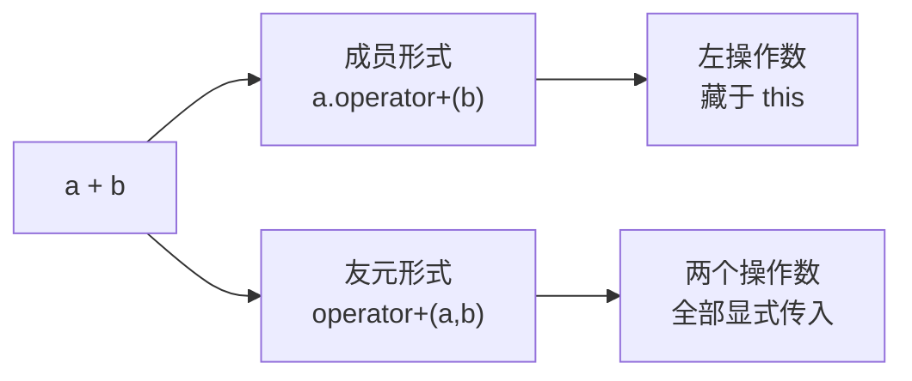

# 用友元函数重载运算符及与成员函数形式的区别

## 为什么会有两种重载方式

重载运算符的本质是给运算符写一个“新版本”的函数。问题在于：这个函数放在哪里？

- 作为**成员函数**：它的第一个运算对象天然是 `this`，也就是“左操作数必须是本类对象”。
- 作为**友元函数**：它不属于类，却可以访问类的私有成员，两个操作数都由参数列表显式给出。

> [!NOTE]
> 友元函数不是成员函数，没有 `this` 指针，但被声明为该类的 `friend` 后，可以像成员一样访问私有数据。

## 成员函数 vs 友元函数：参数个数

先看双目运算符 `+`：

```cpp
class X {
public:
    X operator+(X b);                  // 成员：只有 1 个参数
    friend X operator+(X a, X b);      // 友元：有 2 个参数
};
```

为什么成员函数只写一个参数？因为左操作数已经由 `this` 承担了。`a + b` 在成员函数形式下等价于 `a.operator+(b)`，而在友元形式下等价于 `operator+(a, b)`。

> [!IMPORTANT]
> 成员函数与友元函数实现同一双目运算符时，==参数个数差一个==——成员函数把左操作数藏在 `this` 里。

单目运算符（如前置 `++`、负号 `-`）同理：

```cpp
class X {
public:
    X operator-();                    // 成员：0 个参数
    friend X operator-(X a);         // 友元：1 个参数
};
```



## 什么时候只能用友元

一个典型场景：**左操作数不是本类对象，或者你希望左右操作数都支持隐式转换**。

例如 `cout << p`，左操作数是 `ostream` 对象，不是 `Point` 对象。如果把它写成 `Point` 的成员函数，就必须写成 `p << cout`，完全违反直觉。

```cpp
friend ostream& operator<<(ostream& out, const Point& p);
```

> [!WARNING]
> `<<` 和 `>>` 重载==只能写成友元函数==，因为左操作数是流对象而非本类对象。成员函数形式在逻辑上根本行不通。

再看另一个场景：希望 `2 + c` 也能工作（`c` 是 `Complex`）。如果用成员函数，`2` 没有 `operator+` 方法，编译器先尝试把 `2` 转成 `Complex`，但成员函数调用要求左操作数是类对象，转换规则不适用于 `this`。用友元函数则两个参数都可以参与隐式转换，`2 + c` 就合法了。

## 前置与后缀的自增区分

后缀 `++` 为了与前置区分，多一个**没用的 `int` 参数**：

```cpp
class X {
public:
    X& operator++();              // 前置 ++
    X operator++(int);            // 后缀 ++
    friend X& operator++(X& a);          // 友元前置
    friend X operator++(X& a, int);      // 友元后缀
};
```

这个 `int` 没有任何实际含义，只是语法规定。另外注意返回值：前置 `++` 通常返回==引用==（原地修改，效率高），后缀 `++` 返回==旧值副本==（要先保存修改前的状态）。

## 常见的坑

- **忘了 `friend` 关键字**：声明在类内但没有 `friend`，写出来的就是一个成员函数，参数数目对不上。
- **友元函数不是成员**：不能在函数体内直接写 `this->x`，必须通过参数对象访问，比如 `a.x`。
- **返回值写错**：`<<` 和 `>>` 重载应返回 `ostream&` 和 `istream&`，才能支持连续输出 `cout << a << b;`。返回值是引用是为了链式调用，因为不能复制流对象。
- **参数没加 `const`**：输出运算符的第二个参数常写成 `const Point&`，因为输出不应修改对象；输入运算符的第二个参数必须是非 `const` 引用，因为要从流中读入数据并写入对象。

## 一个完整的例子

选自常见考题：用友元重载 `+`，用成员重载前置 `++`，友元重载 `<<`。

```cpp
#include <iostream>
using namespace std;

class Point {
    double x, y;
public:
    Point(double xv = 0, double yv = 0) : x(xv), y(yv) {}

    // 成员函数：前置 ++
    Point& operator++() {
        ++x; ++y;
        return *this;
    }

    // 友元：加法
    friend Point operator+(const Point& a, const Point& b) {
        return Point(a.x + b.x, a.y + b.y);
    }

    // 友元：输出
    friend ostream& operator<<(ostream& os, const Point& p) {
        os << "(" << p.x << ", " << p.y << ")";
        return os;
    }
};

int main() {
    Point p1(1, 2), p2(3, 4);
    Point p3 = p1 + p2;    // 调友元 operator+
    ++p3;                   // 调成员 operator++
    cout << p3 << endl;     // 调友元 operator<<
    // 输出：(5, 7)
}
```

| 对比项 | 成员函数重载 | 友元函数重载 |
|-------|------------|------------|
| 有无 `this` | 有，左操作数即 `this` | 无，全部显式传参 |
| 双目运算符参数个数 | 1 个 | 2 个 |
| 左操作数非本类对象 | 不适用 | 适用（如 `<<`、`>>`） |
| 隐式转换 | 仅右操作数 | 左右均可 |
| 声明位置 | 类内 | 类内加 `friend`，定义常在类外 |

> [!TIP]
> 判断口诀：==“左操作数是本类对象且无需对称转换，用成员；否则用友元。”== 流插入/流提取永远用友元，且返回引用。
