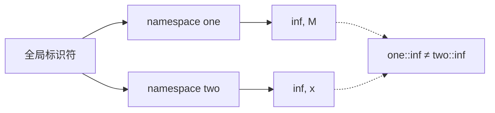

# 名字空间（namespace）的定义与使用

## 名字空间是什么

在写一个稍大的程序时，一个几乎必然遇到的问题：不同的代码来源可能定义了同名的函数、变量或类。比如你自己写了一个 `distance()` 计算两点间距离，而用到的某个图形库也定义了一个 `distance()`。编译器看到 `distance(...)` 时究竟调用哪个？

C++ 给出的解决方案就是**名字空间（namespace）**：给一组声明加上一个“姓氏”，把名字收纳进不同的框架中。同名但在不同名字空间里的实体互不冲突。



> [!IMPORTANT]
> 名字空间解决的是==命名冲突==问题。课件填空题中“C++ 语言提供名字空间来防止 ④”，答案正是**名字冲突**。

C++ 标准库的所有内容都放在名字空间 `std` 里。这解释了为什么必须写：

```cpp
#include <iostream>
using namespace std;
```

如果不包含 `iostream`，`cin`、`cout` 根本不存在；如果不使用 `using namespace std;`，就必须写 `std::cin`、`std::cout`、`std::endl`，否则编译器在全局名字空间里找不到这些标识符。

---

## 定义名字空间

定义形式如下：

```cpp
namespace 名字空间名称
{
    // 各种声明和定义
}
```

注意两点：

- 以关键字 `namespace` 开头，名字空间名称是一个合法的用户自定义标识符。
- ==右大括号后面没有分号==。这一点和类定义、函数定义都不同，是初学者容易写错的地方。

```cpp
namespace one
{
    int M = 100;
    double inf = 3.14;
}

namespace two
{
    int x = 20;
    double inf = 2.718;
}
```

同一个 `inf`，一个属于 `one`，一个属于 `two`，彼此独立，互不干扰。

---

## 使用名字空间中的内容

有三种方法可以访问名字空间内部的名字。

### 方法一：域解析符 `::`

每次使用时都要写明它来自哪个名字空间：

```cpp
one::inf
two::inf
```

这里的 `::` 称为**域解析符**或**作用域运算符**，用来指明该局部内容来自哪一个名字空间。这是最安全、最清晰的方式，不会把不同名字空间中的同名实体混在一起。

### 方法二：using namespace 指令

```cpp
using namespace one;
```

这条语句之后，可以直接使用 `one` 空间中**所有**内容：

```cpp
using namespace std;

int main()
{
    cout << "Hello" << endl;  // 不需要写 std::cout
    return 0;
}
```

方便，但把所有名字都“打开”之后，若多个名字空间包含同名实体，冲突又会重新出现。

### 方法三：using 声明

只引入某一个具体的名字：

```cpp
using two::x;
```

此后 `x` 可以直接使用，但 `two` 中的其他内容（如 `inf`）仍然要写成 `two::inf`。

三种方法可以并存混用，例如课件例 2.4 的组合使用：

```cpp
using namespace std;
using namespace one;   // 整个 one 空间
using two::x;           // 只引入 two 中 x 一个名字

cout << inf << endl;   // 来自 one
two::inf *= 2;         // 必须使用域解析符
```

---

## 和相近概念的区别

| 概念 | 作用 | 语法 | 冲突情况 |
|------|------|------|---------|
| 名字空间 | 组织一组全局实体，防止命名冲突 | `namespace ns { ... }` | 可以嵌套、可以分多次定义 |
| 类 | 封装数据和操作，定义新的类型 | `class C { ... };` | 与名字空间是两个不同维度 |
| using 声明 | 引入一个名字 | `using ns::x;` | 可能造成二义性 |
| using 指令 | 引入整个名字空间 | `using namespace ns;` | 容易引发同名冲突 |

---

## 常见的坑

> [!WARNING]
> 不要在头文件的全局作用域内随意写 `using namespace std;`。这会迫使所有包含该头文件的源文件都引入整个 `std`，极易引起污染与冲突。在 `.cpp` 实现文件中使用则通常问题不大。

> [!CAUTION]
> `namespace ns { ... }` 的右大括号后面**不能写分号**，否则编译报错。这一点与类的定义恰恰相反。

> [!NOTE]
> 一个名字空间可以多次定义，语法上是允许的。例如在多个文件中写 `namespace ns { ... }` 会将其内容合并。但为了可维护性，通常建议在一个逻辑模块内统一组织。

---

## 一个能算对的例子

下面这段短程序把三种使用方式跑通，并验证同名变量彼此独立：

```cpp
#include <iostream>
using namespace std;

namespace one
{
    int x = 10;
}

namespace two
{
    int x = 20;
}

int main()
{
    cout << "one::x = " << one::x << endl;   // 方法一
    cout << "two::x = " << two::x << endl;   // 方法一

    {
        using namespace one;                  // 方法二
        cout << "x = " << x << endl;          // 输出 10
    }

    {
        using two::x;                         // 方法三
        cout << "x = " << x << endl;          // 输出 20
    }

    cout << "one::x = " << one::x << endl;    // 仍为 10
    return 0;
}
```

运行结果：

```text
one::x = 10
two::x = 20
x = 10
x = 20
one::x = 10
```

两个 `x` 分别存放在 `one` 和 `two` 两个名字空间中，通过 `one::x` 和 `two::x` 可以精确、无歧义地访问到各自的内容。
