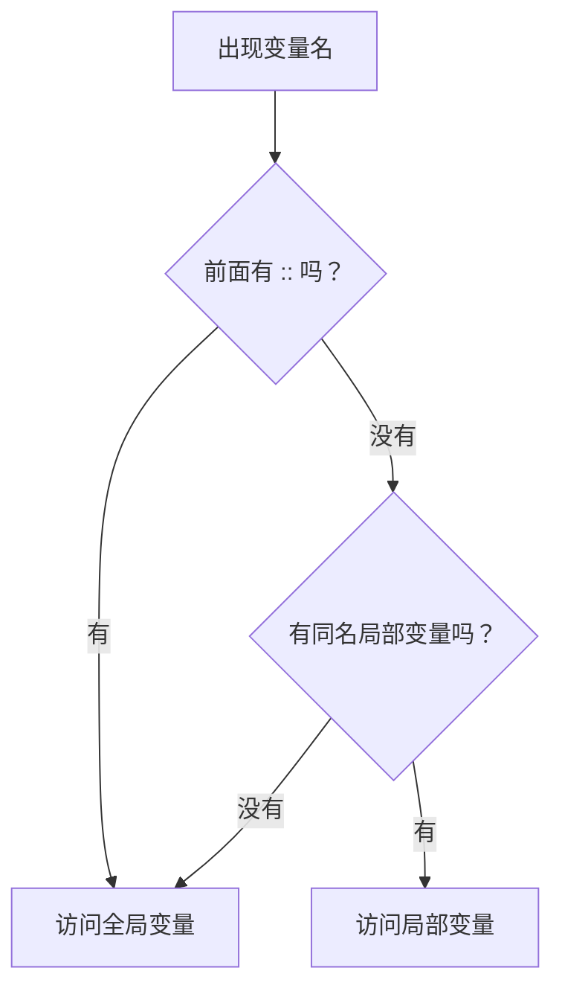

# 域解析符::扩大全局变量的可见范围

## 为什么需要域解析符 `::`

在 C++ 中，**局部变量会屏蔽同名的全局变量**。例如，全局变量和局部变量都叫 `i`，在函数内部直接写 `i`，默认访问的是局部变量。

那如果此时确实要访问全局变量，该怎么办？C++ 提供了==域解析符 `::`==：在变量名前写 `::`，表示访问全局作用域中的变量。

```cpp
int i = 0;          // 全局变量

int main()
{
    int i = 5;      // 局部变量，屏蔽全局变量
    cout << i;      // 局部变量 i
    cout << ::i;    // 全局变量 i
}
```

因此，`::` 的作用可以概括为：**扩大全局变量的可见范围，使被同名局部变量屏蔽的全局变量仍然能够被访问。**

## 基本用法与读程方法

域解析符访问全局变量的一般形式为：

```cpp
::变量名
```

其中，`::` 前面没有写类名或命名空间名，表示从**全局作用域**中查找变量。

> [!IMPORTANT]
> 在局部变量作用域内，`变量名` 通常指局部变量，`::变量名` 指同名全局变量。二者是两个不同的变量，分别占有自己的存储空间。

遇到读程题，可以按下面三步处理：

1. 先标出全局变量和局部变量，确认它们是否同名。
2. 不带 `::` 的名字，按照普通作用域规则查找，优先找到局部变量。
3. 带 `::` 的名字，直接找到全局变量，再判断语句是读取还是修改。



## 一个算对了的例子

以下程序取自课程练习，输出结果是 `5 100`：

```cpp
#include <iostream.h>
int i = 0;

int main()
{
    int i = 5;
    cout << i << "n";
    ::i = i * 20;
    cout << ::i << endl;
    return 0;
}
```

逐句分析如下：

| 语句 | 访问对象 | 结果 |
|---|---|---|
| `int i = 5;` | 定义局部变量 `i` | 局部 `i` 为 $5$，全局 `i` 仍为 $0$ |
| `cout << i << "n";` | 局部变量 `i` | 输出 `5n` |
| `::i = i * 20;` | 左边是全局 `i`，右边是局部 `i` | 全局 `i` 变为 $5\times20=100$ |
| `cout << ::i << endl;` | 全局变量 `i` | 输出 `100` 并换行 |

这里最容易看错的是赋值语句：==`::i` 和 `i` 不是同一个变量==。局部 `i` 始终是 $5$，被修改的是全局 `i`。

> [!TIP]
> 读程时可在草稿上分成“全局 `i`”和“局部 `i`”两栏，每执行一句只更新对应一栏，不要把两个变量的值混在一起。

## 与相近写法的区别

`::` 不只用于访问全局变量，还可以指明类或命名空间中的作用域。不同写法的含义如下：

| 写法 | 含义 | 示例 |
|---|---|---|
| `::i` | 访问全局变量 `i` | `::i = 100;` |
| `AB::a` | 访问类 `AB` 作用域中的成员 `a` | `AB::a = 10;` |
| `std::cout` | 访问命名空间 `std` 中的 `cout` | `std::cout << i;` |

例如，类 `AB` 中有公有静态数据成员 `static int a;`，在类外不通过对象名给它赋值为 $10$，可以写：

```cpp
AB::a = 10;
```

这是因为静态数据成员属于类，可以使用“类名 `::` 静态成员名”访问。它与 `::i` 的共同点是都用 `::` 指明作用域，但==`::i` 表示全局作用域，`AB::a` 表示类作用域==，不能混为一谈。

## 常见的坑

> [!WARNING]
> `::` 只能帮助访问已经存在且可访问的名字，不能凭空定义变量，也不能绕过类的访问权限。私有的静态成员不会因为写了 `类名::成员名` 就变成公有成员。

- **不要误认为 `::i` 会修改局部变量。** 它明确操作全局变量。
- **不要忽略局部变量的屏蔽作用。** 函数内直接写 `i`，若存在同名局部变量，就不会自动访问全局 `i`。
- **不要把 `AB::a` 写成 `::AB::a` 来应付填空。** 本课程通常要求的标准写法是 `AB::a=10`。
- **注意旧课件的头文件写法。** 老教材可能使用 `#include<iostream.h>`；现代标准 C++ 通常写 `#include <iostream>`，并使用 `std::cout`。这不影响对本知识点中 `::i` 的理解。

考试遇到多个同名变量，如教材例题中的多个 `sum`，核心仍是先判断每个名字所在的作用域，再判断是否使用 `::`，最后逐句跟踪其值。
