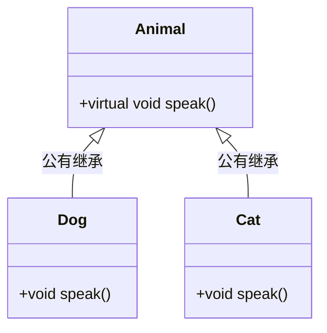

# 多态性

## 多态性：一个接口，多种实现

先通过一个生活中的场景来理解多态性：

你去食堂打饭，对阿姨说“来一份饭”。在不同窗口，这句话会产生完全不同的结果——在快餐窗口，你得到一份套餐；在面条窗口，你得到一碗面；在盖浇饭窗口，你得到一盘盖饭。**同一个指令“来一份饭”，因接收对象不同而表现出不同的行为**，这就是多态性的直观含义。

> [!IMPORTANT]
> ==多态性指的是同一种行为（函数调用）对应着多种不同的实现==。它是面向对象程序设计的第三大核心特征，让程序可以用统一的接口操作不同对象，极大提升了代码的扩展性和可维护性。

C++ 支持两种多态性，它们的实现机制和生效时机截然不同：

| 类型 | 别名 | 实现手段 | 生效时机 |
|:---|:---|:---|:---|
| 静态多态性 | 编译时多态性 | 函数重载、运算符重载 | 编译阶段确定调用哪个函数 |
| 动态多态性 | 运行时多态性 | 公有继承、虚函数、基类指针/引用 | 程序运行时根据对象实际类型决定 |

### 静态多态性：编译时就定好了

函数重载是最典型的静态多态：多个函数使用**相同的函数名**，但参数类型或个数不同。编译器根据调用时传入的实参，在编译阶段就确定到底调用哪一个版本。

```cpp
int   add(int a, int b)      { return a + b; }
double add(double a, double b) { return a + b; }

add(3, 5);      // 编译器：实参是 int，调用第一个版本
add(2.5, 1.8);  // 编译器：实参是 double，调用第二个版本
```

> [!WARNING]
> 返回值类型不同**不能**构成重载。编译器只看函数名和参数列表，不看返回值。

### 动态多态性：运行时见分晓

动态多态是 C++ 实现灵活扩展的关键武器。它需要三个条件同时满足：

1. **公有继承**：派生类公开继承基类
2. **虚函数**：基类中用 `virtual` 声明的成员函数，且派生类中函数原型**完全一致**
3. **基类指针或引用**：通过基类类型的指针或引用调用虚函数



```cpp
class Animal {
public:
    virtual void speak() { cout << "动物发声" << endl; }
};
class Dog : public Animal {
public:
    void speak() { cout << "汪汪" << endl; }
};
class Cat : public Animal {
public:
    void speak() { cout << "喵喵" << endl; }
};

Animal *p;          // 基类指针
Dog dog;
Cat cat;
p = &dog;
p->speak();         // 输出：汪汪 —— 指针指向 Dog，调用 Dog::speak
p = &cat;
p->speak();         // 输出：喵喵 —— 指针指向 Cat，调用 Cat::speak
```

**为什么需要它？** 假设你要写一个管理所有动物的函数，没有多态时，你需要为每种动物写一套处理逻辑。有了动态多态，只需写一个函数，接受基类指针即可：

```cpp
void letSpeak(Animal *p) { p->speak(); }  // 一份代码，处理所有 Animal 派生类
```

> [!NOTE]
> **虚函数实现原理**：编译器为含有虚函数的类生成一张虚函数表（vtable），每个对象存储一个指向该表的指针（vptr）。运行时通过 vptr 查到 vtable，再找到真正要调用的函数地址——这就是动态绑定。

### 纯虚函数与抽象类

当一个基类中的虚函数**完全无法给出有意义的实现**时，可以将其声明为纯虚函数：

```cpp
class Shape {                          // 抽象类
public:
    virtual double area() = 0;         // 纯虚函数：只声明接口，不实现
};
```

> [!IMPORTANT]
> 包含纯虚函数的类就是**抽象类**。==抽象类不能实例化对象==，但可以定义指针或引用，用来指向其派生类对象，实现动态多态。

```cpp
Shape s;           // ❌ 编译错误！抽象类不能创建对象
Shape *p;          // ✅ 可以定义指针
```

### 常见误区

> [!CAUTION]
> **误区一**：以为只要基类有虚函数，派生类自动虚。真相：派生类写不写 `virtual`，函数都是虚的，但**函数原型必须完全一致**，否则编译器认为是新函数，失去多态效果。

> [!CAUTION]
> **误区二**：通过对象名调用虚函数不会触发多态。只有通过**基类指针或引用**调用，才能动态绑定。直接 `dog.speak()` 调用的是 Dog 自己的函数，不涉及多态。

### 实战演练：一道经典读程题

```cpp
class Point {
    int x, y;
public:
    Point(int a=0, int b=0) : x(a), y(b) {}
    virtual Point operator+(Point &p) { return Point(x + p.x, y + p.y); }
    virtual void show() { cout << "(" << x << ", " << y << ")" << endl; }
};
class Point3D : public Point {
    int z;
public:
    Point3D(int a=0, int b=0, int c=0) : Point(a, b), z(c) {}
    Point3D operator+(Point3D &p) {
        Point3D tmp;
        tmp.x = x + p.x;   // 假设 x, y 可访问
        tmp.y = y + p.y;
        tmp.z = z + p.z;
        return tmp;
    }
    void show() { cout << "(" << x << ", " << y << ", " << z << ")" << endl; }
};
```

> [!TIP]
> **口诀**：编译时多态靠重载，一望参数便知晓；运行时多态靠虚表，基类指针（或引用）指谁调谁。
