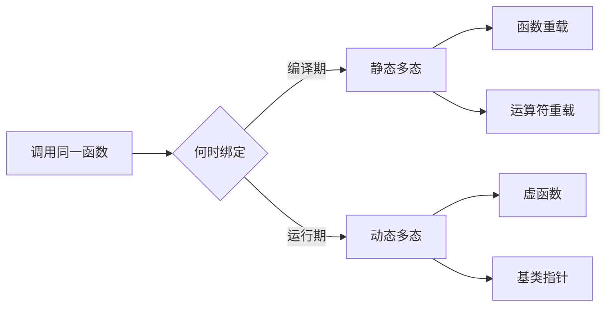

# 多态的两种类型（静态多态与动态多态）

多态性是面向对象程序设计的三大特征之一。它的含义是：**同一个操作（函数名、运算符）作用于不同对象时，可以产生不同的行为**。C++ 中多态性分为两种：==在编译阶段就能确定的叫静态多态性，到运行阶段才确定的叫动态多态性==。

## 两种多态性对比

| 特征 | 静态多态性 | 动态多态性 |
|---|---|---|
| 实现阶段 | 编译时（早绑定） | 运行时（晚绑定） |
| 实现手段 | 函数重载、运算符重载 | 公有继承 + 虚函数 + 基类指针/引用 |
| 调用关系 | 编译器按参数类型绑定 | 按指针所指对象的类型绑定 |
| 灵活性 | 较低 | 高，可扩展新派生类 |



## 静态多态性的实现

函数重载和运算符重载都属于静态多态性：编译器根据实参的个数、类型在**编译期**就选定要调用的函数体，之后不再改变。

## 动态多态性的实现

动态多态性需要三个要素共同作用：


- 在**基类**中用 `virtual` 声明成员函数为**虚函数**；
- 在**公有派生类**中==重新定义该虚函数，且函数原型必须与基类完全一致==；
- 用==基类的指针或引用==调用该函数，程序运行时会依据指针实际指向的对象类型，调用对应的函数版本。

> [!WARNING]
> 虚函数在派生类中如果原型不一致（返回类型、参数或 `const` 不同），就蜕化为普通的同名覆盖，不再具备动态多态性。

若基类只想声明接口而不实现，可用**纯虚函数**：`virtual 返回类型 函数名(参数表) = 0;`。含纯虚函数的类称为**抽象类**，它==不能定义对象，但可以定义指针或引用==，用于统一调用派生类实现。

## 一个算对了的例子

抽象类 `Shape` 与三个派生类求体积：

```cpp
class Shape {
public:
    virtual void Volume() = 0;          // 纯虚函数
};
class Cylinder : public Shape {
public:
    Cylinder(double h, double r) { height = h; radius = r; }
    void Volume() {                     // 重定义，原型一致
        cout << "Cylinder Volume: " << 3.14*radius*radius*height << endl;
    }
protected:
    double radius, height;
};

int main() {
    Shape *ptr;                         // 基类指针
    Cylinder h(1.0, 2.0);
    ptr = &h;
    ptr->Volume();                      // 输出 Cylinder Volume: 12.56
    return 0;
}
```

`ptr` 是基类指针却调用了派生类的 `Volume()`，这正是动态多态性。

> [!TIP]
> 记忆口诀：==静态看参数，动态看指针；虚函数原型要一致，抽象类只可指针引==。
