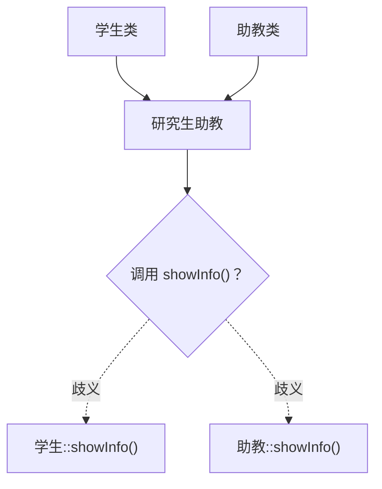
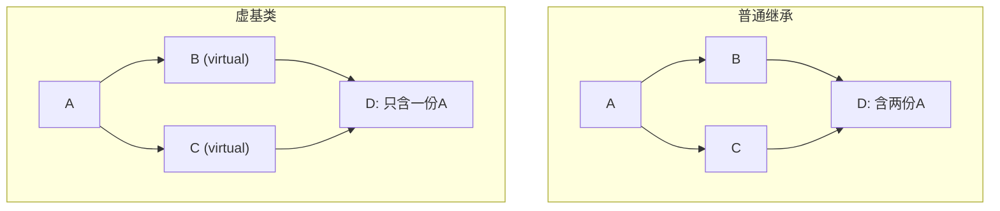

# 多重继承中的同名冲突问题

## 为什么会有二义性？

设想一个场景：学校里有“学生”和“助教”两个角色，而“研究生助教”同时继承自这两个类。学生有学号，助教有工号——这没问题。但如果学生和助教**都**有一个 `showInfo()` 方法，那么研究生助教该调用哪一个？

这就是多重继承中的==同名冲突==，也叫==二义性问题==。C++ 允许一个派生类同时继承多个基类，但当多个基类中存在同名成员时，编译器无法确定你究竟想访问哪一个。

## 单继承 vs 多重继承

在解决冲突之前，先回顾两者的区别：

| 继承类型 | 特点 | 同名问题 |
|---------|------|---------|
| 单继承 | 一个派生类只有一个直接基类 | ==同名覆盖==：派生类成员覆盖基类同名成员 |
| 多重继承 | 一个派生类有多个直接基类 | ==二义性==：多个基类中有同名成员 |

单继承中发生同名，派生类会**覆盖**基类的同名成员；若还想访问基类的，用 `基类名::成员名` 即可。但这在多重继承中不够——两个基类同时定义了同名函数，编译器不知道你要哪一个。



## 两种解决手段

### 1. 成员名限定法

在调用时用 `类名::` 明确指出要访问哪个基类的成员：

```cpp
obj.基类名::成员
```

这种方法直接、明确，但每次调用都要写限定名，代码显得繁琐。**更重要的是**：它没能从根本解决数据冗余的问题——如果两个基类继承自同一个更上层的类，限定法仍然会产生多份底层数据副本。

### 2. 虚基类（virtual）

在继承路径上使用 `virtual` 关键字，告诉编译器：==在最终派生类中，只保留一份最远基类的成员副本==。

```cpp
class A { public: int x; };
class B : virtual public A { };  // 虚继承
class C : virtual public A { };  // 虚继承
class D : public B, public C { };
// D 中只有一份 x，不再有二义性
```

`virtual` 解决了“菱形继承”的核心痛点——**数据冗余**。限定法解决了调用歧义，但虚基类从内存布局上消灭了歧义的根源。



>[!IMPORTANT]
> 虚基类的构造函数由**最底层的派生类**直接调用，而非由其直接派生类调用。

## 构造函数执行次序

带虚基类的多重继承，构造函数调用顺序如下：

虚基类 → 非虚基类 → 对象成员 → 派生类自身

>[!WARNING]
> 虚基类只初始化一次，且优先于所有非虚基类，**无论它在继承列表中出现在什么位置**。

## 一个算对了的例子

以课程考题为基础，解析完整的执行过程：

```cpp
class A {
public:
    int x;
    A(int a = 0) { x = a; }
};
class B : virtual public A {
public:
    B(int b = 0) : A(b) {}
    void show() { cout << x << "   "; }
};
class C : virtual public A {
public:
    C(int c = 0) : A(c) {}
    void show() { cout << x << "   "; }
};
class D : public B, public C {
public:
    D(int d = 0) : B(d - 1), C(d - 2), A(d - 3) {}
};
```

当 `D obj(5);` 执行时：

1. **构造 A**：由 D 直接调用 `A(5-3)` → `x = 2`
2. **构造 B**：调用 `B(5-1)`，B 尝试调 `A(4)`——但由于 A 是虚基类且已初始化，==这一调用被忽略==
3. **构造 C**：同理，调用 `C(5-2)`，C 尝试调 `A(3)`——同样被忽略
4. **构造 D**：完毕

因此两次 `show()` 均输出 `2`。这个结论直接由所列代码中的 `A(d-3)` 得到。

>[!TIP]
> ==不管 B、C 如何向 A 传参，最终 x 的值由 D 中 `A(参数)` 决定==。做题时，先定位最底层派生类对虚基类的初始化，前面的中间类传参一律忽略。

## 总结核心辨析

| 方案 | 解决什么问题 | 何时用 | 代价 |
|------|------------|--------|------|
| `类名::成员` | 调用时的歧义 | 偶尔访问不同基类的同名成员 | 需显式限定，不解决冗余 |
| `virtual` 虚基类 | 数据冗余 + 调用歧义 | 菱形继承结构中存在共同基类 | 构造函数顺序复杂，间接访问开销 |

多重继承的同名冲突，表面考的是“调用哪个”，深层考的是“类在内存里到底长什么样”——理解了虚基类只保留一份副本、由最底层类初始化，这一整块就算真正吃透了。
