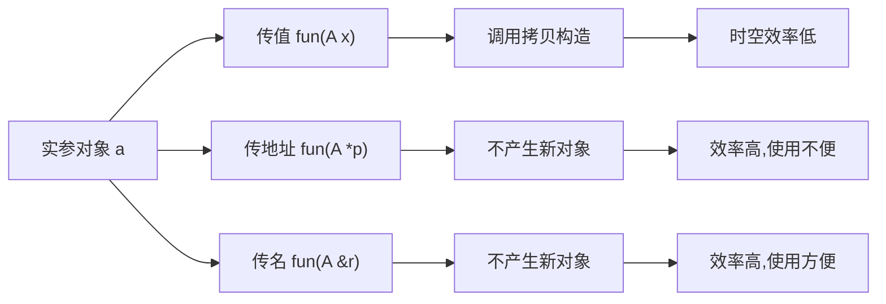

# 对象作为函数参数（传值、传指针、传引用）

> [!IMPORTANT]
> 对象作为函数参数有三种形式：==传值（对象变量）、传地址（对象指针）、传名（引用）==。在面向对象程序设计中，**多采用对象引用作为形式参数**。

## 为什么需要区分传递方式？

假设你写了一个类 `A`，里面包含大量数据成员。现在要把一个 `A` 类型的对象传给函数 `fun`，你会怎么传？如果直接把整个对象“复制”一份塞进函数，时间和空间开销会有多大？

这就引出了三种参数传递方式的本质区别：是否产生新对象、是否调用拷贝构造函数、效率如何。



## 三种形式的对比

| 传递方式 | 语法示例 | 是否产生新对象 | 是否调用拷贝构造函数 | 特点 |
| :--- | :--- | :--- | :--- | :--- |
| **传值**（对象变量） | `void fun(A x);` | 是 | ==是== | 为形参分配新空间，时空效率低 |
| **传地址**（对象指针） | `void fun(A *p);` | 否 | 否 | 效率高，但函数内需通过 `->` 访问成员 |
| **传名**（引用） | `void fun(A &r);` | 否 | 否 | 效率高且使用方便，==推荐方式== |

- **传值**：形参是实参的副本。调用时系统会为形参对象另外分配内存空间，并自动调用==拷贝构造函数==完成初始化。
- **传地址**：形参是指向实参的指针。不产生新对象，但在函数体内必须用 `(*p).member` 或 `p->member` 的形式访问成员，语法稍显繁琐。
- **传名（引用）**：引用与其代表的变量是一回事儿，占用同一段内存空间。形参成为实参对象的别名，不产生新对象，无需另外分配内存空间，也不会调用拷贝构造函数，同时保持与对象变量相同的 `.` 访问语法。

> [!TIP]
> 记忆口诀：**传值调拷贝，指针用箭头，引用最省心。**

## 读程实战：引用参数的效果

来看一道典型的期末考试题。已知类 `A` 中有如下成员函数声明：

```cpp
void Set(A& a);
```

题目问：其中 `A& a` 的含义是什么？

- A. 指向类 A 的指针为 a
- B. 将 a 的地址值赋给变量 Set
- C. a 是类 A 的对象引用，用来作函数 Set() 的形参
- D. 变量 A 与 a 按位相与作为函数 Set() 的参数

分析：`A&` 表示类 `A` 的引用类型，`a` 是形参名。因此 `A& a` 意为“a 是类 A 的对象引用，用来作函数的形参”。答案是 **C**。

> [!WARNING]
> 不要把 `A& a` 中的 `&` 误认为取地址运算符！在**类型声明**中 `&` 代表引用；只有在**表达式**中对已有变量使用 `&a` 才是取地址。

再看一个涉及引用的读程计算场景（节选自真题）：若程序中定义了类似 `void add(A& x, A y)` 的函数，第一个参数是引用，第二个参数是值。调用时，修改 `x` 的成员会直接影响实参对象（因为 `x` 是别名），而修改 `y` 的成员只影响局部副本，不影响实参。这就是“一个设为引用、另一个设为值参数”带来的不同运行效果。

> [!NOTE]
> 引用前面加 `const`（如 `const A& a`）的意义在于：既享受了引用传递的高效（不调用拷贝构造函数），又防止了在函数体内意外修改实参对象。这在后续学习运算符重载（如 `<<` 和 `>>` 的重载）时会频繁用到。
