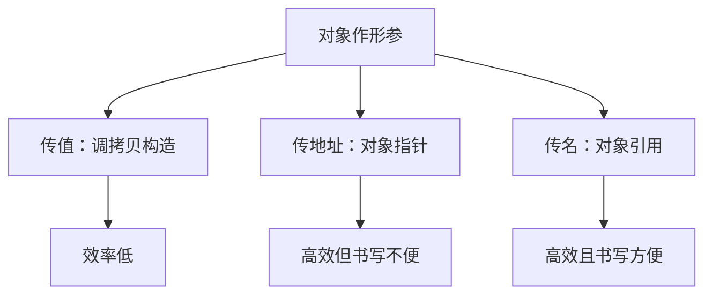

# 对象指针与对象引用

## 对象指针与对象引用是什么

对象指针与普通指针一样，保存的是对象的**首地址**；对象引用则是已经定义对象的**别名**，不另外占用内存空间，可以认为引用与它所代表的对象共享内存单元。

```cpp
Date d1(2024, 1, 1);
Date *pd = &d1;      // 对象指针
Date &rd = d1;       // 对象引用，rd 就是 d1
```

> [!IMPORTANT]
> 对象指针通过 `->` 访问成员（`pd->display()`），对象引用用 `.` 访问成员（`rd.display()`）。

## 为什么要用它们

先想一个问题：把一个对象按值传给函数，会发生什么？

- 传值：会调用**拷贝构造函数**生成新对象，时间和空间效率低；
- 传地址（对象指针）：不产生新对象，但函数里要反复写 `->`，不方便；
- 传名（对象引用）：==不产生新对象、不调用拷贝构造函数，又能像普通变量一样用 `.` 访问成员==。



> [!TIP]
> 面向对象程序设计中，**多采用对象引用作形式参数**。对象、对象指针、对象引用作形参各有适用场合，但引用用得最广泛。

## 对象指针的两种用法

- 指向已有对象：`Date *p = &d1;`，用 `p->成员` 访问；
- 用 `new` 申请动态空间，生成**动态对象或动态对象数组**：

```cpp
Date *p1 = new Date(2024, 1, 1);   // 动态对象
p1->display();
Date *p2 = new Date[3];            // 动态对象数组
delete p1;
delete [] p2;
```

> [!WARNING]
> 对象数组名实际上就是**对象指针常量**，所以也可以用指针方式引用成员；对对象数组初始化时需要调用构造函数。

## 一个容易混的题

已知 `p` 是指向类 A 数据成员 `m` 的指针，`A1` 是类 A 的一个对象。给 `m` 赋值为 5，正确的是：

```cpp
A1.*p = 5;   // 答案 C
```

- `A1.p`：p 不是 A 的成员，错误；
- `A1->p`：`->` 用于指针访问成员，错误；
- `*A1.p`：先取 `A1.p` 不存在，错误。

## 与相近概念的区别

| 形式 | 是否产生新对象 | 是否调拷贝构造 | 访问成员 | 典型用途 |
|------|--------------|--------------|---------|---------|
| 对象（传值） | 是 | 是 | `.` | 不需要修改实参的小对象 |
| 对象指针 | 否 | 否 | `->` | 动态对象、多态 |
| 对象引用 | 否 | 否 | `.` | 函数形参、返回值 |

> [!NOTE]
> 拷贝构造函数的形式参数是本类的对象引用（一般是常引用），系统默认提供浅拷贝版本；用一个对象初始化另一个同类对象、对象作值形参、返回值为类对象时都会调用它。
