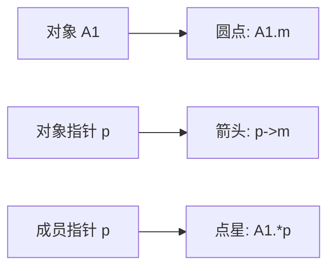

# 定义对象及圆点访问形式与指针访问形式

## 它是什么

在 C++ 中，==对象是类的实例==。定义对象的过程，就是系统根据类模板在内存中分配空间并自动调用构造函数的过程。例如执行 `AB obj_array[10];` 时，因为数组中有 10 个元素，系统就会==自动调用该类构造函数 10 次==——这是选择题和填空题里的常客。

## 为什么需要两种访问形式

定义了对象之后，我们要通过它来访问其中的数据成员或成员函数：

- **圆点访问形式**：直接通过对象本身访问，格式为 `对象名.成员名`。
- **指针访问形式**：通过指向对象的指针访问，格式为 `指针名->成员名` 或 `(*指针名).成员名`。

## 怎么做

假设有如下类和对象：

```cpp
class A {
public:
    int m;
    void set(int v) { m = v; }
};
A A1;
A* p = &A1;
```

- 圆点访问：`A1.m = 5;` 或 `A1.set(5);`
- 指针访问：`p->m = 5;` 或 `(*p).m = 5;`

> [!TIP]
> 记忆口诀：==“点跟着对象走，箭头跟着指针走”==。

## 和相近概念的区别

| 对比项 | 圆点形式 | 指针形式 |
|--------|----------|----------|
| 使用前提 | 有明确对象名 | 有指向对象的指针 |
| 语法 | `对象.成员` | `指针->成员` 或 `(*指针).成员` |
| 常见场景 | 普通对象、对象数组元素 | 动态创建的对象、函数内修改外部对象 |

特别注意：如果 `p` 是指向**类数据成员**的指针（而不是对象指针），如题中“`p` 是指向类 A 数据成员 m 的指针”，则应写作：

```cpp
A1.*p = 5;   // 正确，见选择9答案C
```



## 常见的坑

> [!WARNING]
> 对象数组定义时，==每个元素都会调用一次构造函数==，`AB obj_array[10];` 不是 1 次，而是 10 次。

> [!CAUTION]
> 成员指针不能用 `A1.p` 或 `A1->p` 访问；必须用 `==A1.*p==`。混淆“对象指针”和“成员指针”是高危误区。

## 一个算对了的例子

已知 `p` 是指向类 A 数据成员 `m` 的指针，`A1` 是类 A 的对象，给 `m` 赋值为 5：

```cpp
class A { public: int m; };
A A1;
int A::*p = &A::m;
A1.*p = 5;   // 选择9正确答案C
```

此时 `A1.m` 的值就是 5。这就是==成员指针配合圆点星号==的标准写法，也是读程题里常见的输出变化来源。
