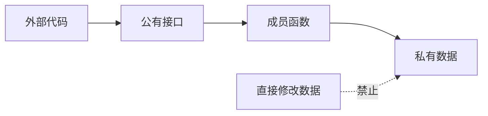

# 封装性

## 封装性是什么

面向对象程序设计最突出的特征是==封装性、继承性和多态性==；若按“抽象、封装、继承、多态”四大特征作答，顺序可以互换。封装性是第一大特征：把对象的**数据**和**操作数据的函数**包装成类，同时隐藏内部实现，只公开必要的操作接口。

例如，把“学生成绩”设计成类后，外部不应随意把成绩改成 $-20$，而应通过 `setScore()` 检查数据是否合法。



## 为什么需要封装

如果数据可以被任意修改，错误就会分散在程序各处。封装后，数据的修改规则集中由类自己维护，因此能够提高程序的==安全性和可靠性==，并带来三个实际好处：

- **保护数据**：非法值不能轻易进入对象。
- **降低耦合**：调用者只需知道“能做什么”，不必知道“内部怎样存”。
- **便于修改**：只要公有接口不变，内部实现改变时，外部代码通常无需跟着改。

## 怎样实现封装

C++ 通过**访问控制属性**限制成员访问：

| 访问控制属性 | 类外通过对象访问 | 主要用途 |
|---|---:|---|
| `public`（公有） | 可以 | 对外提供接口 |
| `private`（私有） | 不可以 | 隐藏数据和内部实现 |
| `protected`（保护） | 不可以 | 主要供派生类使用 |

常见写法是“==数据私有、接口公有==”：

```cpp
#include <iostream>
using namespace std;

class Student {
private:
    int score;                 // 隐藏内部数据
public:
    bool setScore(int s) {     // 公有接口负责检查
        if (s < 0 || s > 100)
            return false;
        score = s;
        return true;
    }
    int getScore() const {
        return score;
    }
};

int main() {
    Student stu;
    stu.setScore(90);          // 合法修改
    // stu.score = -20;        // 错误：私有成员不能这样访问
    cout << stu.getScore();    // 输出 90
    return 0;
}
```

这里即使把 `score` 的存储方式改成其他形式，只要 `setScore()` 和 `getScore()` 的用法不变，调用代码仍可保持稳定。

> [!IMPORTANT]
> 类的私有成员通常只能被它的**成员函数和友元函数**访问。友元可以突破普通访问限制，但它不是第四种访问控制属性。

## 和相近概念的区别

| 概念 | 关注点 | 与封装的关系 |
|---|---|---|
| 抽象 | 提取对象的重要特征，忽略无关细节 | 决定类中应保留什么 |
| 封装 | 组合数据与操作，并控制访问 | 决定哪些内容对外可见 |
| 继承 | 由已有类派生新类，实现复用和扩展 | 不是“把数据藏起来” |
| 多态 | 同一接口表现出不同实现 | 不是访问权限控制 |

> [!WARNING]
> “类外不能直接访问私有成员”不等于“私有成员完全无法访问”。类的成员函数可以访问它，友元函数也可按授权访问；`protected` 更不是“所有派生类以外的函数都能访问”。

## 一个做对的考题例子

**题目：** 下列不是访问控制属性的是（ ）。  
A. 公有类型　B. 私有类型　C. 友元类型　D. 保护类型

**答案：C。** 三种访问控制属性是 `public`、`private`、`protected`；“友元”用 `friend` 声明，是一种访问授权机制，不能选作访问控制属性。

> [!TIP]
> 记忆主线：**三大特征答“封装、继承、多态”；访问权限答“公有、私有、保护”；私有成员的特殊访问者再补“友元函数”。**
