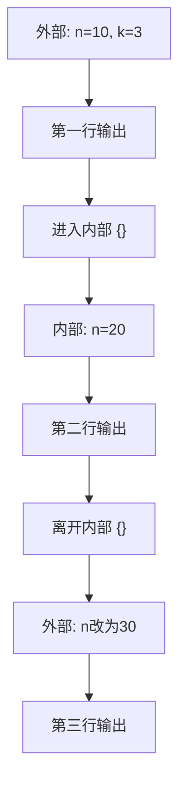

# 局部变量随用随定义

在 C 语言中，局部变量必须集中写在函数或复合语句的开头。如果一段代码很长，读到后面时往往已经忘了前面某个变量的用途。C++ 对此做了改进：允许在程序执行到需要使用变量的地方再定义它，这就是==局部变量随用随定义==。

> [!IMPORTANT]
> 核心规则：变量的作用域从它的定义点开始，到其所在的最近的一对 `{}` 结束。

## 为什么需要这样做

假设你要先计算一个中间结果，再用它去循环。在 C 中，即使循环体离计算很远，你也得把循环控制变量提前声明在最顶部。而在 C++ 中，你可以把变量的定义“推迟”到真正用到它的那一行。

这样做有两个直接好处：
1. **缩短变量的生存期**：减少变量被意外修改的风险。
2. **提高可读性**：看到定义就能立刻结合上下文理解它的用途。

## 怎么做与读程分析

来看课件例 2.5 对应的典型考法（读程题）。阅读下面这段代码，思考每次输出时 `n` 和 `k` 的值分别是多少：

```cpp
#include <iostream>
using namespace std;
int main() {
    int n = 10, k = 3;
    cout << "n=" << n << ", k=" << k << endl; // 第一次输出
    {
        int n = 20; // 内部块重新定义 n
        cout << "n=" << n << ", k=" << k << endl; // 第二次输出
    }
    n = 30; // 回到外部块
    cout << "n=" << n << ", k=" << k << endl; // 第三次输出
    return 0;
}
```

程序的执行流程与变量可见性如下：



- **第一行**：此时只有外部的 `n` 和 `k`，输出 `n=10,k=3`。
- **第二行**：进入内部 `{}` 后，定义了新的 `n=20`。这个内部的 `n` ==屏蔽==了外部的 `n`，而 `k` 未被重新定义，沿用外部的 `k=3`。输出 `n=20,k=3`。
- **第三行**：离开内部 `{}` 后，内部的 `n` 被销毁，外部的 `n` 恢复可见并被赋值为 $30$。输出 `n=30,k=3`。

> [!TIP]
> 解题口诀：**就近原则**。遇到同名变量，编译器总是使用当前作用域内最近定义的那一个。

## 与相近概念的区别

| 对比维度 | C 语言局部变量 | C++ 随用随定义 |
| :--- | :--- | :--- |
| **定义位置** | 必须在块（`{}`）的起始处 | 可以在块内的任何语句之后 |
| **作用域起点** | 块起始处 | 变量定义点 |
| **生命周期** | 贯穿整个块 | 从定义点到所在块的末尾 |

注意区分**全局变量**与**局部变量**：全局变量定义在所有函数之外，作用域默认从定义点到文件末尾；而随用随定义的局部变量，其作用域被严格限制在当前的 `{}` 内。

## 常见的坑

> [!WARNING]
> 考试中最容易丢分的边界条件：在内部块修改了同名变量，以为会影响外部，其实只是修改了内部那个“临时工”。

> [!CAUTION]
> 高危误区：不要跨作用域使用变量！如果在内部 `{}` 里定义了变量，企图在 `{}` 外面访问它，会导致编译错误。变量的生命在遇到匹配的 `}` 时就彻底结束了。
