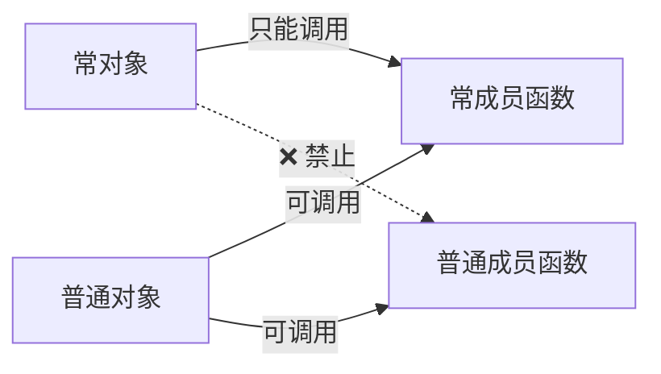

# 常对象（const对象）及其只能调用常成员函数的规则

## 常对象是什么？为什么需要它？

在面向对象程序设计中，如果我们希望某个对象在创建后，其所有数据成员在整个生存期内都==绝对不能被修改==，就需要将其定义为**常对象**。这类似于基本数据类型中的 `const` 变量，但作用域扩展到了整个类实例。

> [!IMPORTANT]
> 常对象的核心约束：对象状态只读，==只能调用常成员函数==，禁止调用任何可能修改数据的普通成员函数。

为什么需要这种限制？因为编译器无法预知普通成员函数内部是否会修改数据成员。为了保证常对象的“常量性”不被破坏，C++ 从语法层面强制规定：常对象只能访问承诺不修改数据的接口（即常成员函数）。这是一种编译期的安全契约。

## 如何定义与使用

常对象的声明格式为 `const 类名 对象名(构造参数);`。定义时==必须进行初始化==，且后续不能赋值或修改成员。

```cpp
class Person {
    string name;
public:
    Person(string n) : name(n) {}
    void print() { cout << name; }      // 普通成员函数
    void print() const { cout << name; } // 常成员函数
};

const Person p1("Alice"); // 常对象，必须初始化
Person p2("Bob");         // 普通对象
```

调用规则如下表所示：

| 对象类型 | 可调用常成员函数 | 可调用普通成员函数 | 说明 |
| :--- | :---: | :---: | :--- |
| 常对象 | ✅ | ❌ | ==只能调常成员== |
| 普通对象 | ✅ | ✅ | 优先匹配普通版本 |



## 常对象 vs 常数据成员

这是考试中最易混淆的概念。常对象是==整个对象不可变==，而常数据成员仅是==某个成员不可变==。

> [!WARNING]
> 常对象的数据成员==不一定==都是常数据成员！常对象强调的是“通过该对象不能修改任何成员”，而非成员本身带有 `const` 修饰符。

例如，一个类含有普通数据成员 `int age;`，当用该类创建常对象时，`age` 对该常对象而言就是只读的，但它本身不是常数据成员。反之，若类中定义了 `const int id;`，即使通过普通对象访问，`id` 也不可修改。

## 真题解析与避坑指南

回顾课件选择题：下列关于常对象的说法，正确的是？

-   A. 常对象的数据成员均为常数据成员（❌ 混淆概念）
-   B. 常对象只能调用常成员函数（✅ ==核心规则==）
-   C. 常对象可以调用所有成员函数（❌ 违反只读约束）
-   D. 常对象所属的类中只能定义常成员函数（❌ 类可同时定义两种函数）

答案为 **B**。

> [!TIP]
> 解题口诀：==常对象配常函数，普通对象两皆可==。看到“常对象调普通函数”直接判错；看到“常成员函数不能被普通对象调用”也要警惕——在没有同名普通函数时，普通对象==可以==调用常成员函数。

另一个高频陷阱：常成员函数内部==不能调用普通成员函数==，因为普通成员函数可能修改数据，这会间接破坏常对象的只读保证。同时，常成员函数也==不能修改任何数据成员==（包括非常数据成员），这是由 `const` 后缀在语义上决定的。
