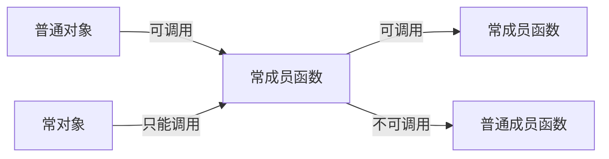

# 常成员函数（const成员函数）

## 为什么会有常成员函数

先看一个场景：你写了一个 `Student` 类，其中 `GetAge()` 只是返回年龄，并不会修改任何数据。但调用者怎么知道它“只看不改”呢？如果有一个机制能让编译器帮你检查，岂不是更安全？

C++ 的答案是：把成员函数声明为 **常成员函数（const 成员函数）**。

> [!IMPORTANT]
> 常成员函数是指对类中数据成员==只作访问而不作直接或间接修改==的成员函数。声明时在函数参数列表之后、函数体之前加 `const` 关键字。

声明格式：

```cpp
返回类型 函数名(参数表) const;
```

例如：

```cpp
class Person {
private:
    char name[20];
    int age;
public:
    void Print() const;      // 常成员函数
    int GetAge() const;      // 常成员函数
    void SetAge(int a);      // 普通成员函数
};
```

实现时也要带上 `const`：

```cpp
void Person::Print() const {
    cout << name << " " << age << endl;   // 只读不写
}
```

> [!WARNING]
> `const` 的位置容易写错。`void Print() const;` 是对的（const 在参数表圆括号**之后**），而 `const void Print();`、`void const Print();`、`void Print(const);` 都是错误写法。

## 常成员函数的规则

常成员函数的“保护性”体现在两条约束上：



- 常成员函数**一般不调用普通成员函数**，因为普通成员函数可能修改数据成员，这样就会“间接修改”。
- 反过来，普通成员函数可以调用常成员函数（只看不改，安全）。

## 常对象：更严格的约束

对象本身也可以声明为 `const`：

```cpp
const Person p1("Tom", 20);
Person p2("Jerry", 18);
```

> [!IMPORTANT]
> ==常对象只能调用常成员函数，不能调用普通成员函数==。因为普通成员函数可能修改数据成员，而常对象承诺“我的数据不可变”。

所以：

- `p1.Print()` ✓（Print 是常成员函数）
- `p1.SetAge(25)` ✗（SetAge 是普通成员函数）
- `p2.Print()` ✓（普通对象也可以调常成员函数）
- `p2.SetAge(25)` ✓

## 易错辨析

| 说法 | 对错 | 说明 |
|------|------|------|
| 常对象只能调用常成员函数 | ✓ | 核心规则 |
| 常成员函数可以被任何对象调用 | ✓ | 常对象、普通对象都可以调 |
| 常成员函数只能访问常数据成员 | ✗ | 常成员函数可访问**所有**数据成员，但只能读不能改 |
| 普通成员函数不能被常对象调用 | ✓ | 因为普通函数可能修改数据 |
| 常成员函数不可以调用普通成员函数 | ✓（一般） | 避免间接修改 |

> [!TIP]
> 记忆口诀：**“常函数只读不写，常对象只调常函数。”**

> [!CAUTION]
> 一个高频误区：以为“常成员函数只能访问常数据成员”。实际上，常成员函数对普通数据成员也可以访问，只是不能修改。

## 一个算对了的例子

题目：已知 `Print()` 是一个类的常成员函数，无返回值，正确的声明是？

分析：

- 选项 B `const void Print();`：`const` 修饰的是返回值，不是成员函数本身，错误。
- 选项 C `void const Print();`：语法错误。
- 选项 D `void Print(const);`：`const` 修饰的是参数，不是成员函数，错误。

正确答案：**A. `void Print() const;`** —— `const` 放在参数表之后，正是常成员函数的标志位置。
