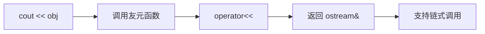

# 赋值运算符=、函数调用运算符()、输出流>>与输入流<<的重载

---
requires: [面向对象程序设计及C++/类与对象, 面向对象程序设计及C++/友元函数]
---

当你写出 `cout << obj;` 时，编译器怎么知道如何把你的自定义对象“翻译”成屏幕上的字符？当你想让对象像函数一样被调用时，又该怎么做？这就需要我们手动赋予这些符号新的含义。

## 赋值运算符的重载

如果类中包含指针成员（如动态数组），系统默认的浅拷贝会导致两个对象的指针指向同一块内存，析构时会引发重复释放的崩溃。因此需要重载 `=` 实现深拷贝。

> [!IMPORTANT]
> ==赋值运算符 `=` 只能重载为类的成员函数==，不能是友元函数。

**常见坑**：忘记处理自赋值（`a = a`）。如果先 `delete` 旧内存再拷贝，自赋值会导致数据丢失。必须在开头加上 `if (this == &other) return *this;`。

## 函数调用运算符的重载

重载 `()` 后，对象可以像函数一样被调用，这类对象常被称为“仿函数”。它必须作为==成员函数==重载。

以课件中矩阵类为例，如何用 `m(r, c)` 优雅地访问二维元素？

```cpp
class Matrix {
    int data[3][3];
public:
    // 返回引用，使得 m(1,2)=5 和 cout<<m(1,2) 均合法
    int& operator()(int r, int c) { 
        return data[r][c]; 
    }
};
```

> [!TIP]
> 返回类型设为 `int&`（引用）是核心技巧：既能放在等号左边被修改，也能放在右边读取。

## 输入输出流运算符的重载

`<<` 和 `>>` 的左操作数是 `ostream` / `istream` 对象（如 `cout`、`cin`）。因为我们无法去修改 C++ 标准库中 `ostream` 类的源码来添加成员函数，所以它们==必须重载为友元函数==。



**标准写法模板**：

```cpp
class X {
    int val;
public:
    X(int v = 0) : val(v) {}
    // 输出流重载
    friend ostream& operator<<(ostream& out, const X& obj);
    // 输入流重载
    friend istream& operator>>(istream& in, X& obj);
};

ostream& operator<<(ostream& out, const X& obj) {
    out << obj.val;
    return out; // 必须返回引用，支持 cout<<a<<b
}

istream& operator>>(istream& in, X& obj) {
    in >> obj.val; // 注意：obj 不能加 const
    return in;
}
```

> [!WARNING]
> 极易丢分点：返回值类型必须是 `ostream&` 或 `istream&`（带引用）。若按值返回，不仅效率低，还会破坏 `cout << a << b` 的链式调用机制。

## 三种运算符对比辨析

| 特性 | 赋值 `=` | 函数调用 `()` | 输入输出 `<<` `>>` |
| :--- | :--- | :--- | :--- |
| **重载方式** | 仅成员函数 | 仅成员函数 | 仅友元函数 |
| **参数个数** | 1个（右操作数） | 自定义 | 2个（流对象 + 类对象） |
| **典型返回值** | `X&`（自身引用） | 视需求而定 | `ostream&` / `istream&` |

> [!CAUTION]
> 选择题高频陷阱：单目运算符（如前缀 `++`）作成员函数时无显式参数；双目运算符（如 `+`）作成员函数时有 1 个参数，但作友元函数时有 2 个参数。而 `<<` 无论怎样都只能是友元且带 2 个参数。

## 完整验证示例

结合上述知识点，实现一个可输入输出、可赋值的简单点类：

```cpp
#include <iostream>
using namespace std;

class Point {
    int x, y;
public:
    Point(int x=0, int y=0): x(x), y(y) {}
    
    // 1. 赋值运算符重载（成员函数）
    Point& operator=(const Point& p) {
        if (this != &p) { x = p.x; y = p.y; }
        return *this;
    }
    
    // 2. 函数调用运算符（成员函数）
    void operator()(int dx, int dy) { x += dx; y += dy; }
    
    // 3. 输出流重载（友元函数）
    friend ostream& operator<<(ostream& out, const Point& p) {
        out << "(" << p.x << "," << p.y << ")";
        return out;
    }
};

int main() {
    Point p1(1, 2), p2;
    p2 = p1;       // 调用 operator=
    p2(3, 4);      // 调用 operator()，坐标变为(4,6)
    cout << p2;    // 调用 operator<<，输出 (4,6)
    return 0;
}
```

> [!NOTE]
> 在文件读写场景中，除了重载 `>>` 和 `<<`，还可直接使用 `get()` 和 `put()` 进行单字符的文件输入输出（参考教材例 8.8）。
