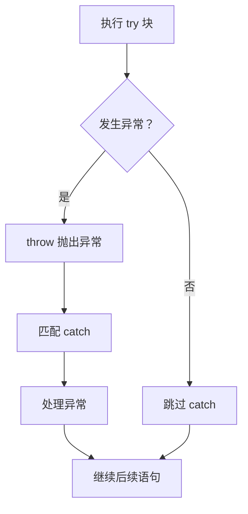

# 异常和异常处理的实现（try-catch-throw）

## 为什么需要异常处理

程序通过编译、链接后，仍可能在运行时出错，例如除数为零、输入数据不合法等。若只用 `if` 判断并直接结束程序，错误检测与处理容易混杂，也难以把错误信息传递给上级函数。

C++ 提供异常处理机制，对**事先可以预测的运行异常**进行检查和处理，从而提高程序的健壮性。它由三个环节组成：

> [!IMPORTANT]
> ==`throw` 抛出异常，`try` 检查异常，`catch` 捕捉并处理异常。==

## 三个语句怎样配合

`throw` 通常写在可能出现异常的函数体内，格式为：

```cpp
throw 表达式;
```

表达式的值就是异常信息，其类型用于匹配 `catch`。`try-catch` 的基本形式为：

```cpp
try {
    // 被进行异常检查的语句
}
catch (异常类型 变量) {
    // 异常处理语句
}
```

`try` 与 `catch` 通常放在调用可能抛出异常函数的上级函数中。执行过程如下：



发生异常后，==`try` 块中剩余语句不再执行==；处理完匹配的 `catch` 后，程序继续执行其后面的语句。若整个 `try` 块没有异常，则跳过所有 `catch`。

## 一个正确的例子

```cpp
#include <iostream>
using namespace std;

double divide(int a, int b) {
    if (b == 0)
        throw 0;              // 抛出 int 类型异常
    return static_cast<double>(a) / b;
}

int main() {
    try {
        cout << divide(6, 3) << endl;
        cout << divide(6, 0) << endl;  // 抛出异常
        cout << "不会执行" << endl;
    }
    catch (int) {
        cout << "exception of divide zero" << endl;
    }
    cout << "100" << endl;
    return 0;
}
```

第一次调用正常输出 `2`；第二次调用抛出 `int` 型异常，被 `catch (int)` 捕获，输出 `exception of divide zero`，随后输出 `100`。`"不会执行"` 不会输出。

## 相近概念与常见坑

| 概念 | 作用 | 常见误区 |
|---|---|---|
| `try` | 检查异常 | 误以为它负责抛出异常 |
| `throw` | 抛出异常信息 | 误以为只能抛出整数 |
| `catch` | 匹配、捕捉并处理异常 | 忽略异常类型必须匹配 |

> [!WARNING]
> `try` 必须在 `catch` 前，二者之间不能插入其他语句；一个 `try` 可对应多个 `catch`，以处理不同类型的异常。课件允许只有 `try` 而没有 `catch`，表示只检查而不处理异常，但考试通常按完整的三步机制作答。

> [!TIP]
> 填空题按动作记忆：**抛出 `throw`，检测 `try`，捕捉处理 `catch`**。选择题“用于抛出异常的是哪条语句”，答案为 `throw`。
