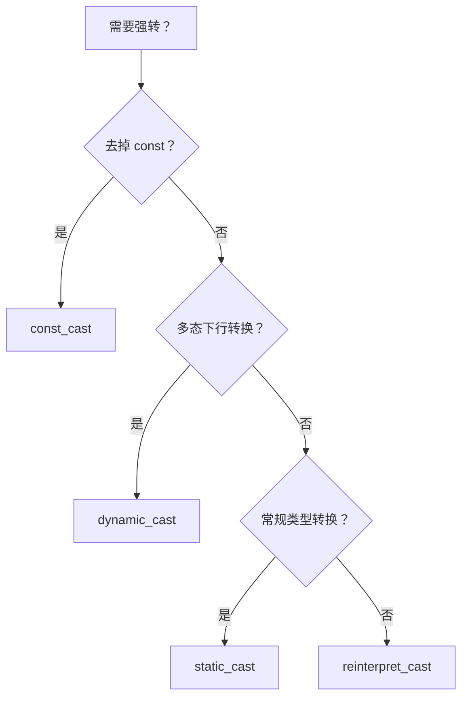

# 新增的强制类型转换方式（static_cast等）

## 为什么需要新的强制类型转换

C 语言只有一种强转写法 `(类型)表达式`，它几乎能做任何转换，编译器基本不检查。C++ 保留了这种写法，但认为它太"危险"：把 `const` 去掉、把父类指针强转成子类、把整数当指针用，统统写成一个样子，出错很难排查。

于是 C++ 引入了 **4 种"语义明确"的强制类型转换运算符**，每种只干一件事，让错误在编译期就暴露出来：

| 运算符 | 作用 | 典型场景 |
|---|---|---|
| `static_cast` | 编译期可检查的常规转换 | 基本类型、上行转换、`void*` |
| `const_cast` | 去掉 `const` / `volatile` | 调用旧式 API 时临时去常量 |
| `reinterpret_cast` | 按位重新解释 | 指针 ↔ 整数、指针类型间转换 |
| `dynamic_cast` | 运行时类型检查的安全下行 | 多态基类 → 派生类 |

## static_cast：最常用、最安全的一种

==`static_cast` 用于"编译器知道怎么转"的转换==，它在编译期做类型检查，不合法就直接报错。

```cpp
double d = 3.14;
int i = static_cast<int>(d);   // 截断小数，i = 3

int *p = static_cast<int*>(malloc(40));   // void* → int*
```

对比 C 写法：

```cpp
int i = (int)d;                // 也行，但看不出意图
const int ci = 10;
int *p2 = (int*)&ci;           // 偷偷去掉 const，编译器不拦
int *p3 = static_cast<int*>(&ci);  // ❌ 编译报错！必须用 const_cast
```

> [!IMPORTANT]
> `static_cast` **不能**去掉 `const`、**不能**做运行时类型检查。这两件事分别交给 `const_cast` 和 `dynamic_cast`。

## 一个算对了的例子

回顾选择题 10：模板 `min(T x, T y)` 要求两个实参类型**一致**。

```cpp
int i, j;  char c;
min(i, j);           // ✅ T 统一推导为 int
min((int)c, i);      // ✅ 显式把 c 转成 int，T = int
min(c, c);           // ✅ T = char
min(i, c);           // ❌ T 同时被推成 int 和 char，冲突
```

如果想让 `min(i, c)` 合法，可以用 `static_cast` 显式统一类型：

```cpp
min(i, static_cast<int>(c));   // ✅ 显式转换后类型一致
```

## 四种转换怎么选



> [!WARNING]
> 常见误区：认为 `static_cast` 能去掉 `const`。记住口诀——**"static 不动 const"**，要去 `const` 必须用 `const_cast`，而且去掉后修改原常量对象是未定义行为。

> [!TIP]
> 考试记忆法：`static` 管"常规"，`const` 管"常量"，`dynamic` 管"多态"，`reinterpret` 管"重解释"。看到题目里出现 `const` 指针强转，先想 `const_cast`。
