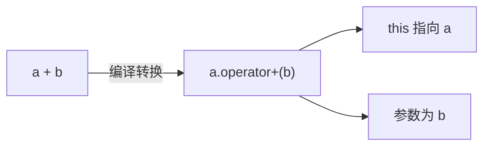

# 用成员函数重载运算符

用成员函数重载运算符，本质是把 `a + b` 这样的表达式，翻译成对左操作数对象的方法调用 `a.operator+(b)`。

为什么要这么做？因为 C++ 内置的 `+`、`-`、`++` 只能用于基本数据类型。当我们自定义了类（如复数类 `Complex`、点类 `Point`），编译器不知道两个对象相加是什么意思，必须通过重载来告诉它。而用成员函数重载，能直接访问当前对象的私有数据，且符合“左操作数调用方法”的直觉。

## 参数个数的隐藏规则

思考一个问题：双目运算符 `+` 需要两个操作数，但为什么作为成员函数重载时，参数列表里只有一个参数？

> [!IMPORTANT]
> 成员函数隐含了一个 `this` 指针指向左操作数。因此，==成员函数重载的参数个数 = 运算符原本的操作数个数 - 1==。



单目运算符（如前缀 `++`）本身只有 1 个操作数，所以成员函数重载时**参数个数为 0**。那后缀 `++` 呢？为了和前缀区分，C++ 规定后缀重载需增加一个 `int` 类型的哑元参数。

| 运算符类型 | 示例 | 成员函数形式 | 参数个数 |
| :--- | :--- | :--- | :--- |
| 双目运算 | `+`, `-`, `*`, `/` | `X operator+(X a)` | 1 |
| 单目前缀 | `-`, `++`, `--` | `X operator++()` | 0 |
| 单目后缀 | `++`, `--` | `X operator++(int)` | 1（哑元） |

## 与友元函数重载的区别

考试常考两者的辨析，核心差异在于**左操作数的类型**和**参数个数**：

| 对比维度 | 成员函数重载 | 友元函数重载 |
| :--- | :--- | :--- |
| 左操作数限制 | ==必须是该类的对象== | 无限制（可为基本类型等） |
| 参数个数（双目） | 1 个 | 2 个 |
| 参数个数（单目） | 0 个 | 1 个 |
| 能否重载 `<<` / `>>` | 不能（左操作数是流对象） | 能 |

> [!WARNING]
> 赋值 `=`、下标 `[]`、函数调用 `()`、成员访问 `->` 这四个运算符**只能**用成员函数重载，不能用友元！

## 完整示例：复数类加法与 Point 类前置 ++

结合历年考题中复数类和点类的要求，下面演示如何正确实现：

```cpp
#include <iostream>
using namespace std;

class Complex {
private:
    double real, imag;
public:
    Complex(double r = 0, double i = 0) : real(r), imag(i) {}

    // 成员函数重载双目 +，只需 1 个参数
    Complex operator+(const Complex& other) const {
        return Complex(real + other.real, imag + other.imag);
    }

    // << 只能用友元，因为左操作数是 ostream
    friend ostream& operator<<(ostream& os, const Complex& c) {
        os << c.real << (c.imag >= 0 ? "+" : "-") << abs(c.imag) << "i";
        return os;
    }
};

class Point {
private:
    double x, y;
public:
    Point(double xv = 0, double yv = 0) : x(xv), y(yv) {}

    // 成员函数重载前缀 ++，0 个参数，返回引用以支持连续 ++
    Point& operator++() {
        x++; y++;
        return *this; 
    }

    // 成员函数重载后缀 --，带 int 哑元，返回旧值
    Point operator--(int) {
        Point temp = *this;
        x--; y--;
        return temp;
    }
    
    friend ostream& operator<<(ostream& os, const Point& p) {
        os << "(" << p.x << ", " << p.y << ")";
        return os;
    }
};
```

> [!TIP]
> 记忆口诀：**“双目减一，单目归零；后缀加 `int`，流用友元”**。做选择题时，看到问“哪个参数个数不同”，直接找前缀/后缀自增或流运算符即可。

> [!CAUTION]
> 重载前缀 `++` 时，返回值类型应写 `Point&`（返回 `*this`），而后缀 `++` 必须返回 `Point`（返回局部临时对象）。如果前缀也按值返回，会导致无法执行 `++++p` 这样的连续操作，这是编程题极易扣分的坑。
