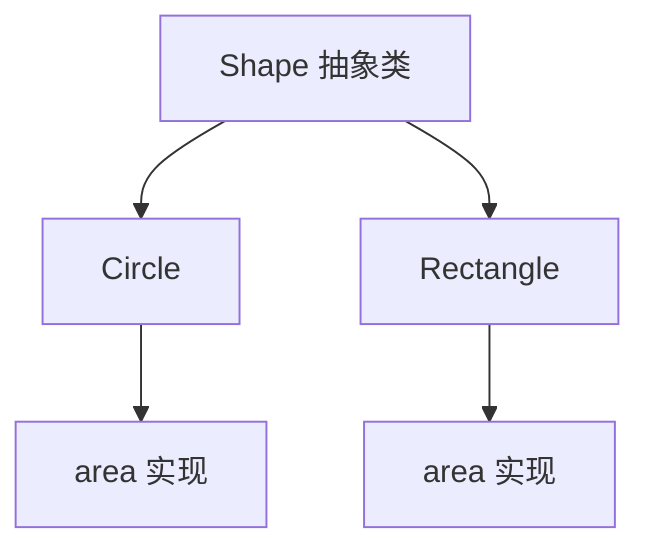

# 抽象类的概念及使用限制

## 抽象类是什么

在 C++ 中，==包含纯虚函数的类称为抽象类==。纯虚函数是在基类中声明、但没有提供具体实现的虚函数：

```cpp
class Shape {
public:
    virtual double area() const = 0;
    virtual ~Shape() = default;
};
```

其中，`virtual` 表示虚函数，`= 0` 表示纯虚函数。派生类必须为基类的每个纯虚函数提供自己的实现，否则派生类也会成为抽象类。

抽象类主要用于描述“共同的接口和属性”，把不同派生类的具体行为交给各自完成，从而支持动态多态。

## 为什么需要抽象类

考虑不同图形都要计算面积。如果只允许使用 `Shape` 类型的对象，却又希望程序在运行时根据实际图形选择正确的计算方法，就可以把 `area()` 声明为纯虚函数：

```cpp
Shape* p = new Circle(2.0);
std::cout << p->area();
```

这里，`Shape*` 是指向基类的指针，==能够指向抽象类对象所对应的派生类对象==。通过基类指针调用虚函数时，程序会在运行时调用实际对象所属类的版本。



## 使用限制

抽象类最重要的限制是：==不能直接定义抽象类的对象==。

```cpp
Shape s;       // 错误：Shape 是抽象类
Shape* p;      // 正确：可以定义基类指针
Shape& r = s;  // 错误：s 不能被定义
```

但抽象类仍然有以下能力：

- 可以定义构造函数和析构函数；
- 可以包含普通虚函数、纯虚函数和非虚函数；
- 可以定义数据成员；
- 可以作为基类，派生新的类；
- 可以定义指向该类的指针或引用。

| 操作 | 是否允许 | 说明 |
|---|---:|---|
| 定义抽象类对象 | 否 | 编译器报错 |
| 定义抽象类指针 | 是 | 用于动态绑定 |
| 定义抽象类引用 | 是 | 但必须绑定到合法对象 |
| 从抽象类派生新类 | 是 | 派生类应实现纯虚函数 |
| 声明抽象类构造函数 | 是 | 仍可规定派生对象的初始化过程 |
| 将抽象类作为函数参数或返回类型 | 是 | 适合表达统一接口 |

## 纯虚函数与普通虚函数的区别

| 特性 | 纯虚函数 | 普通虚函数 |
|---|---|---|
| 声明形式 | `virtual void f() = 0;` | `virtual void f();` 或有函数体 |
| 基类中是否必须有实现 | 不要求 | 通常应有实现 |
| 所在类能否实例化 | 不能 | 能 |
| 派生类要求 | 必须重写，否则仍为抽象类 | 可重写，也可继承 |
| 主要作用 | 规定统一接口 | 提供可重写的默认行为 |

普通虚函数可以在基类中提供默认实现；纯虚函数则强调“必须由派生类完成”。因此，不是所有带虚函数的类都是抽象类，只有包含纯虚函数的类才是抽象类。

## 常见易错点

> [!WARNING]
> “抽象类没有构造函数”是错误的。抽象类可以拥有构造函数，只是不能直接创建该类的对象。

另外，不要把“数据成员必须是抽象数据类型”与抽象类联系起来。抽象类的数据成员可以是普通类型，也可以包含指针、引用等成员；是否抽象，只取决于是否存在未实现的纯虚函数。

> [!TIP]
> 判断一个类是否为抽象类，先看它是否继承了尚未实现的纯虚函数。即使当前类没有直接写 `= 0`，只要基类纯虚函数没有被重写，它仍然是抽象类。

## 例题分析

题目：下面关于抽象类的说法正确的是：

- A. 不能定义抽象类的对象
- B. 不能从抽象类派生出新类
- C. 抽象类没有构造函数
- D. 抽象类的数据成员必须是抽象数据类型

正确答案是 **A**。

逐项判断：

- **A 正确**：抽象类不能实例化，即不能直接定义对象。
- **B 错误**：抽象类正是用于派生新类的。
- **C 错误**：抽象类可以有构造函数。
- **D 错误**：抽象类可以拥有普通数据成员。

再如题目所述：“在基类中说明、在基类中没有定义，并要求派生类定义自己版本的虚函数”，这种函数就是**纯虚函数**，对应选项 **C**。纯虚函数的典型声明为：

```cpp
virtual void show() = 0;
```

记忆时可以抓住一句口诀：==纯虚函数定接口，抽象类不能造对象；指针引用可指向，派生实现再使用。==
