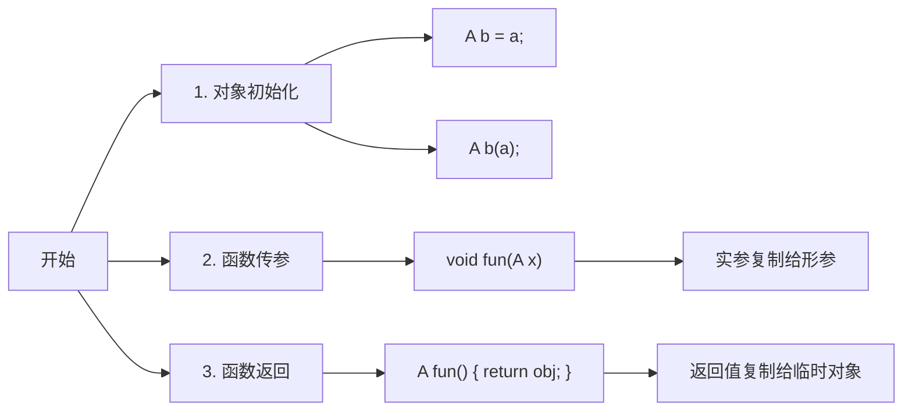

# 拷贝构造函数及其自动调用的3种情况

## 什么是拷贝构造函数

拷贝构造函数是一种特殊的构造函数，用于**使用一个已存在的对象来初始化一个新创建的对象**。其函数原型通常如下：

```cpp
ClassName(const ClassName &other);
```

> [!IMPORTANT]
> 参数必须是**同类对象的引用**（通常为 `const` 引用）。若传值会导致无限递归调用，因为传值本身就需要拷贝。

为什么需要它？当类中包含指针成员或动态分配的资源时，默认的“浅拷贝”会导致两个对象指向同一块内存，析构时发生二次释放错误。此时需自定义拷贝构造函数实现==深拷贝==。

## 自动调用的三种情况

系统会在以下三种场景下自动调用拷贝构造函数，而非赋值运算符：



1.  **声明并初始化**：如 `A b = a;` 或 `A b(a);`。注意：`A b; b = a;` 是先默认构造再赋值，**不调用**拷贝构造。
2.  **对象作为函数参数**：当函数参数为对象（非引用/指针）时，实参拷贝给形参。
3.  **函数返回对象**：当函数返回值为对象时，返回值拷贝给临时对象（现代编译器可能优化此步骤，但语义上存在）。

## 与赋值运算符的区别

这是考试中最常见的陷阱。请观察以下代码差异：

| 代码语句 | 行为描述 | 调用函数 |
| :--- | :--- | :--- |
| `A a; A b = a;` | 创建新对象 b 并初始化 | **拷贝构造函数** |
| `A a, b; b = a;` | 对象 b 已存在，进行赋值 | **赋值运算符** (`operator=`) |

> [!WARNING]
> `A b = a;` 虽然含有 `=` 号，但本质是**初始化**，不是赋值。只有当对象已经存在后使用 `=` 才是赋值。

## 常见误区与示例

**误区 1**：认为所有涉及对象复制的地方都叫拷贝构造。
**纠正**：只有**新对象诞生**时才叫构造。已存在对象的修改叫赋值。

**误区 2**：忽略常引用。
**纠正**：标准写法应为 `const ClassName &obj`，防止误修改源对象，且能接收临时对象。

**典型例题解析**：

```cpp
class A {
public:
    A() { cout << "Def" << endl; }
    A(const A&) { cout << "Copy" << endl; }
};

void fun(A x) {} // 参数传递触发拷贝

int main() {
    A a;        // 输出: Def
    A b = a;    // 输出: Copy (初始化)
    A c(a);     // 输出: Copy (初始化)
    fun(a);     // 输出: Copy (传参)
    A d;        
    d = a;      // 无输出 (调用默认赋值运算符，未重载则无声)
    return 0;
}
```

> [!TIP]
> 记忆口诀：**新建用拷贝，旧物用赋值；传参必拷贝，返回看优化。**

在复习时，重点区分 `A b=a` 和 `b=a` 的生命周期状态。若类中有指针成员，务必手动编写拷贝构造函数以实现深拷贝，否则程序运行结束时会因重复 `delete` 而崩溃。
