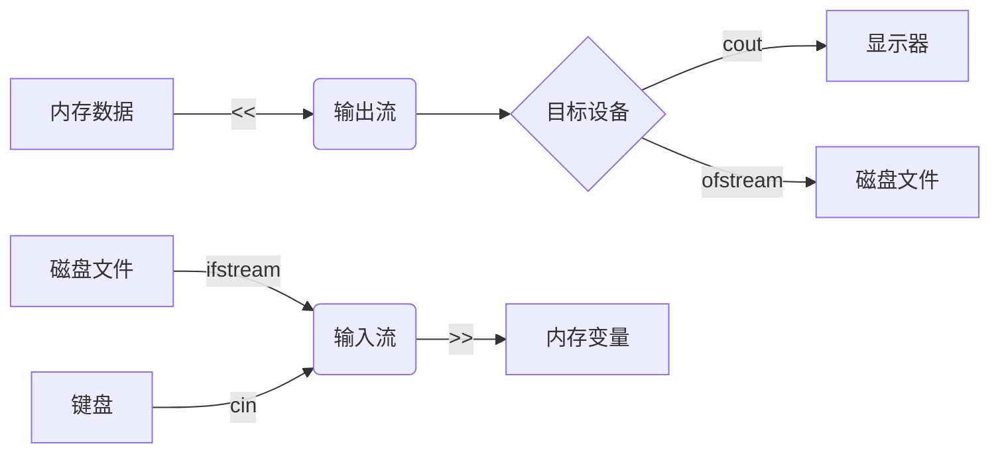

# 文件的输入/输出（包含fstream头文件，使用流运算符对文本文件操作）

> [!IMPORTANT]
> 文件的输入/输出是指对在外存磁盘上文件的数据传输，由主存到外设叫==输出或写==，由外设到主存叫==输入或读==。必须包含 `<fstream>` 头文件并使用 `std` 命名空间。

## 为什么需要文件流？

键盘输入和屏幕输出（标准 I/O）的数据在程序结束后就会丢失。如果希望数据持久化保存，或者让程序读取外部准备好的数据，就需要操作外存上的文件。C++ 的 I/O 流类库将“向屏幕输出”和“向文件写入”统一成了相同的流操作模型：你只需要把目标从 `cout` 换成一个文件流对象即可。



## 怎么做：使用流运算符操作文本文件

文本文件按字符形式存储，与内存中的表现形式一致。操作步骤分为四步：包含头文件、打开文件、读写操作、关闭文件。

1. **定义流对象并打开文件**
   - 写文件用 `ofstream`，读文件用 `ifstream`，既读又写用 `fstream`。
   - 打开时可通过第二个参数指定模式，如 `ios::out`（输出）、`ios::app`（追加到尾部）。
2. **检查是否成功打开**
   用 `if (!file)` 判断，防止文件不存在或权限不足导致崩溃。
3. **使用 `<<` 和 `>>` 读写**
   用法与 `cout` / `cin` 完全相同。
4. **关闭文件**
   输入或输出结束后，使用 `close()` 使文件与流断开联系。

> [!TIP]
> 记忆口诀：“建对象、查状态、用流符、必关闭”。

## 相近概念对比

| 特性 | 标准 I/O（`cin`/`cout`） | 文件 I/O（`ifstream`/`ofstream`） |
| :--- | :--- | :--- |
| 头文件 | `<iostream>` | `<fstream>` |
| 关联设备 | 键盘 / 显示器 | 外存磁盘文件 |
| 是否需要手动打开/关闭 | 否，系统自动管理 | 是，需显式调用 `open()`/`close()` |
| 流运算符 | `>>` / `<<` | `>>` / `<<` |

> [!NOTE]
> 除了流运算符，还可以用 `get()` 逐字符读、`put()` 逐字符写（常用于精确控制空白字符），但 `>>` 和 `<<` 会自动处理格式化转换。

## 常见的坑

> [!WARNING]
> Windows 路径中的反斜杠 `\` 是转义符！写 `"D:\abc.txt"` 会被错误解析，必须写成双反斜杠 `"D:\\abc.txt"`。

> [!CAUTION]
> 使用 `>>` 读取字符串时，遇到空格或换行就会停止。如果要读一整行带空格的文本，应改用 `getline()`。

## 完整示例：文本文件复制

下面这道题要求把 `D:\abc.txt` 的内容拷贝到当前路径下的 `xyz.txt` 中，综合了文件打开、状态检查、逐词读写和关闭操作：

```cpp
#include <iostream>
#include <fstream>
#include <string>
using namespace std;

int main() {
    // 1. 打开源文件（输入）
    ifstream ifile("D:\\abc.txt");
    if (!ifile) {
        cout << "abc.txt cannot be openned!" << endl;
        return 0;
    }

    // 2. 打开目标文件（输出）
    ofstream ofile("xyz.txt");
    if (!ofile) {
        cout << "xyz.txt cannot be created!" << endl;
        ifile.close();
        return 0;
    }

    // 3. 使用流运算符进行读写
    string word;
    while (ifile >> word) {       // 从文件读入内存
        ofile << word << " ";     // 从内存写出到文件
    }

    // 4. 关闭文件，断开联系
    ifile.close();
    ofile.close();

    cout << "Copy finished." << endl;
    return 0;
}
```

在这个例子中，`ifile >> word` 就像 `cin >> word` 一样工作，只不过数据来源从键盘变成了磁盘；`ofile << word` 同理，目的地从屏幕变成了文件。这就是 C++ 流类库设计的精妙之处——==一套接口，适配多种设备==。
