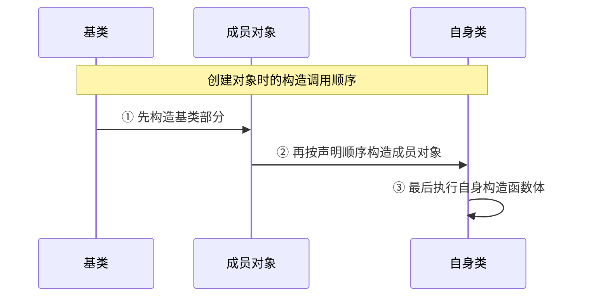

# 构造函数（含默认构造函数、带默认参数值的构造函数）

## 为什么需要构造函数

定义一个类，相当于画了一张图纸。图纸本身不是实物，只有按照图纸建造出来的“房子”——也就是对象，才能住人（存数据）。

可是，房子建好之后的初始状态是什么样的？木地板还是水泥地？墙刷白了没有？我们当然希望能在建房子的那一刻就指定好。构造函数就是这种机制：==在对象创建时自动被调用，完成对象的数据成员初始化。==

> [!IMPORTANT]
> 构造函数是类的一种特殊成员函数，函数名**必须与类名相同**，且**没有任何返回值类型**（连 `void` 都不能写）。

## 构造函数长什么样

在类体外定义构造函数的一般形式：

```cpp
类名::类名(参数表) {
    // 初始化成员的代码
}
```

如果直接在类体里定义，就省去 `类名::` 限定。构造函数几乎总是 `public` 的，否则外界根本没法创建对象。

## 默认构造函数：我不写，系统就没有吗

这里有一个最容易踩的坑。

- 如果类里**一个构造函数都没有**，编译器会悄悄生成一个**系统默认构造函数**，形式为 `类名() {}`。它只负责分配空间，**不会给数据成员赋初值**。
- 一旦你亲手写了任何一个构造函数（不管带不带参数），编译器就**不会再提供那个默认的无参构造函数**。

```cpp
class Student {
public:
    Student(string n, int a) { name = n; age = a; }
private:
    string name;
    int age;
};

Student s1;               // ❌ 编译错误！系统不再提供无参构造函数
Student s2("Alice", 20);  // ✅ 正确
```

> [!WARNING]
> 别想当然以为不写构造函数就一定有无参的可以用。只要写了任何一个构造函数，系统默认的无参构造函数就会消失。

## 带默认参数值的构造函数

有些初始化值在多数情况下是固定的，只有少数时候才需要改变。为了避免每次都重复传参，可以给构造函数的参数设定默认值：

```cpp
class Book {
public:
    Book(string t, double p = 39.9) : title(t), price(p) {}
    // ...
};

Book b1("C++ Primer");         // price 用默认值 39.9
Book b2("Design Patterns", 55.0);  // price 明确指定为 55.0
```

这样做相当于用一种写法同时兼顾了“少参”和“多参”两种构造需求，但要注意**避免与重载构造函数产生二义性**。

## 构造函数怎么调用，什么时候不能乱调

定义对象时，系统**自动**调用一次构造函数：

```cpp
类名 对象名(实际参数表);   // 自动调用匹配的构造函数
```

特别注意：既然对象一出生就已经初始化好了，就不允许在程序里再写出像 `对象名.构造函数(…)` 这种显式调用。==构造函数只能由系统自动调用，不能像普通成员函数那样由用户直接调用。==

## 一个算对了的例子

```cpp
#include <iostream>
#include <string>
using namespace std;

class Point {
private:
    int x, y;
public:
    // 带默认参数的构造函数
    Point(int a = 0, int b = 0) : x(a), y(b) {
        cout << "构造 Point(" << x << ", " << y << ")" << endl;
    }
    void print() { cout << "(" << x << ", " << y << ")" << endl; }
};

int main() {
    Point p1;         // 调用默认参数版本，x=0, y=0
    Point p2(3);      // 调用默认参数版本，x=3, y=0
    Point p3(4, 5);   // 调用默认参数版本，x=4, y=5

    p1.print();       // (0, 0)
    p2.print();       // (3, 0)
    p3.print();       // (4, 5)
    return 0;
}
```

输出：
```
构造 Point(0, 0)
构造 Point(3, 0)
构造 Point(4, 5)
(0, 0)
(3, 0)
(4, 5)
```

## 构造函数与对象成员的调用次序

当一个类里包含了其他类的对象作为成员时，构造函数的调用顺序如下：



> [!TIP]
> 记忆口诀：**先长辈（基类），再客人（成员对象），最后自己**。析构函数的调用顺序恰好相反。

## 容易混淆的辨析

| 概念 | 要点 |
|------|------|
| 构造函数 | 函数名同类名，无返回值，可重载，定义对象时自动调用 |
| 普通成员函数 | 函数名任意，必须有返回值类型，需要显式调用 |
| 默认构造函数 | 无需参数即可调用的构造函数（可能是系统生成也可能是用户定义的无参/全默认参数版本） |
| 拷贝构造函数 | 用一个已存在的同类型对象初始化新对象，参数是 `const 类名&` |

> [!CAUTION]
> `A a();` 是一个典型的陷阱。它**不是**用默认构造函数创建对象，而是声明了一个名叫 `a`、返回类型为 `A` 的空形参函数。定义默认构造的对象直接写 `A a;` 即可。
