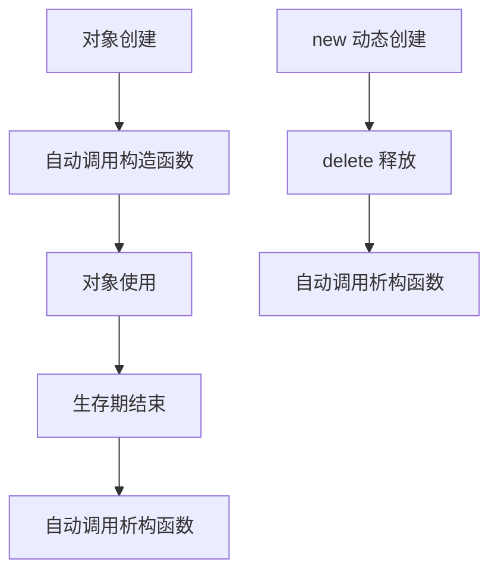
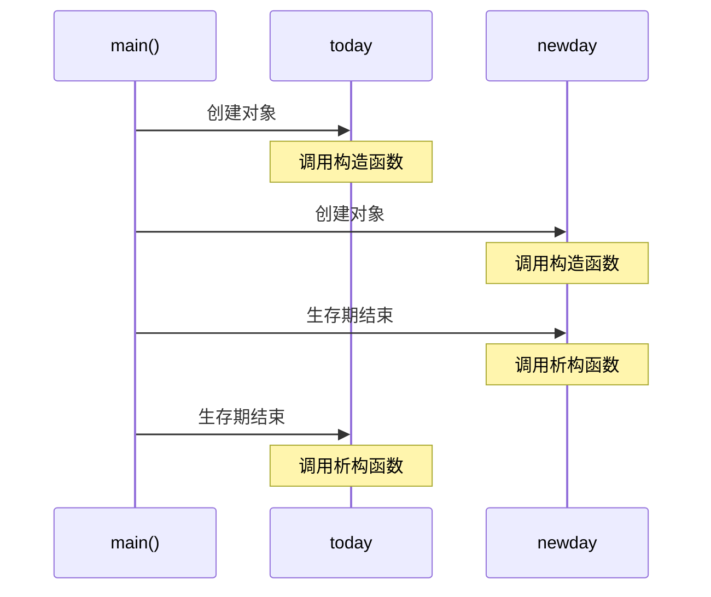

# 析构函数

## 它是什么

析构函数（destructor）是类的特殊成员函数，职责是**在对象生存期结束时释放所占的内存资源**，由系统自动调用。与构造函数"创建时初始化"相对，析构函数"销毁时清理"。

> [!IMPORTANT]
> 析构函数的定义格式：
> ```cpp
> class Student {
> public:
>     ~Student();  // 析构函数
> };
> ```

## 为什么需要

对象生存期结束（如主函数返回、delete 释放）时，系统需要回收资源。若类中有指针成员并在构造函数中申请了动态空间，**默认析构函数（函数体为空）无法释放这部分内存**，必须显式定义析构函数来 `delete`，否则造成内存泄漏。

## 怎么做：四大特点

| 特点 | 说明 | 对比构造函数 |
|------|------|--------------|
| 函数名 | 与类名相同，前加 `~` | 构造函数无 `~` |
| 返回值 | 无返回值类型，**不能加 `void`** | 构造函数同样无返回值 |
| 参数 | **无形式参数**，不能写 `(void)` | 构造函数可带参数 |
| 重载 | **不能重载，一个类只能有一个** | 构造函数可重载多个 |
| 访问属性 | 必须定义为**公有成员函数** | 构造函数通常也公有 |

## 何时自动调用



两种自动调用情形：
1. 对象生存期结束时（如局部变量离开作用域）
2. `delete` 释放 `new` 创建的对象时

> [!WARNING]
> 析构函数**不能手动调用**，只能由系统自动执行。

## 构造与析构的调用顺序



==核心结论==：**构造函数按创建顺序调用，析构函数按相反顺序调用**（先构造的后析构，类似栈的"后进先出"）。

## 一个算对了的例子

```cpp
#include <iostream>
#include <cstring>
using namespace std;

class Student {
    char *name;
    int age;
public:
    Student(const char *n, int a) {          // 构造函数
        name = new char[strlen(n) + 1];
        strcpy(name, n);
        age = a;
        cout << "Constructor: " << name << endl;
    }
    ~Student() {                             // 析构函数
        cout << "Destructor: " << name << endl;
        delete[] name;                       // 释放动态空间
    }
    void print() {
        cout << "Name: " << name << ", Age: " << age << endl;
    }
};

int main() {
    Student s1("Alice", 20);
    Student s2("Bob", 22);
    s1.print();
    s2.print();
    return 0;
}
```

运行结果：
```
Constructor: Alice
Constructor: Bob
Name: Alice, Age: 20
Name: Bob, Age: 22
Destructor: Bob
Destructor: Alice
```

==构造顺序 Alice→Bob，析构顺序 Bob→Alice==，完全相反。

## 常见的坑

> [!CAUTION]
> 1. **忘记定义析构函数**：类中有 `new` 申请的动态空间时，必须用析构函数 `delete` 释放，否则内存泄漏。
> 2. **误以为析构函数有返回值或参数**：析构函数无返回值、无参数，因此不能重载。
> 3. **混淆调用时机**：析构函数在对象生存期结束时调用，而非"定义类变量时"（那是构造函数）。

> [!TIP]
> 记忆口诀：**"构造初始化，析构清理资源；先构造后析构，顺序正好相反。"**

> [!NOTE]
> 析构函数可以是虚函数，且**建议声明为虚函数**（多态基类中），以确保 `delete` 基类指针时正确调用派生类析构函数。静态成员函数、内联函数、构造函数均不能声明为虚函数。
