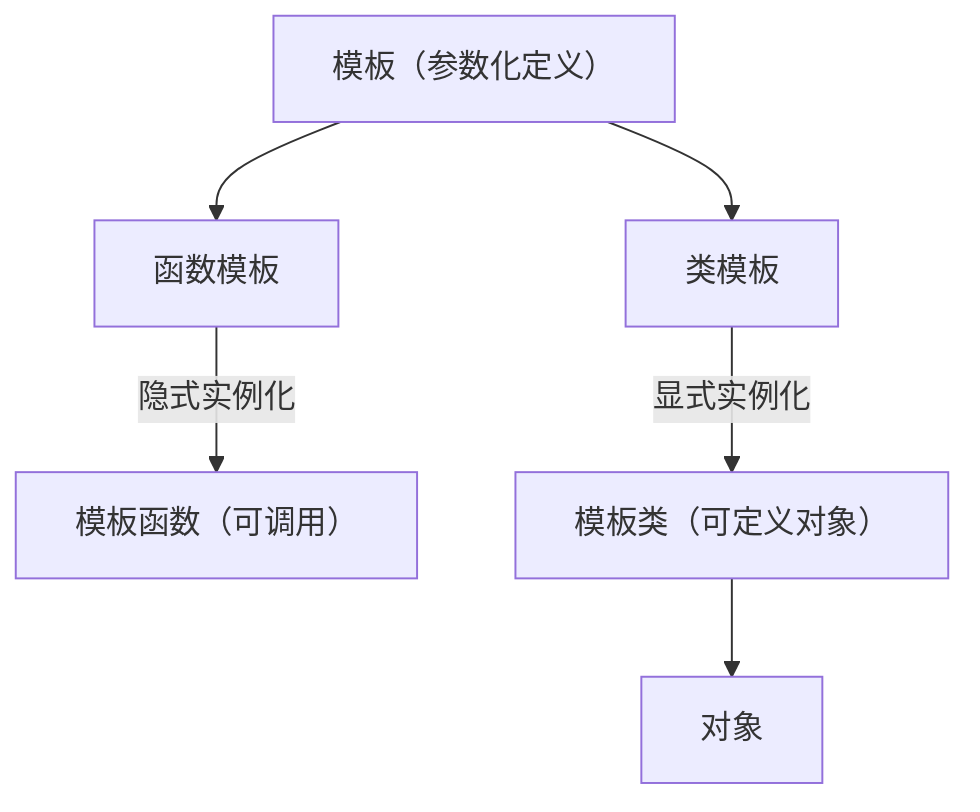

# 模板、模板函数、模板类与对象之间的关系

## 模板：从“一份代码”到“一族代码”

先想一个问题：写一个求两个数较大值的函数，针对 `int`、`double`、`char` 各写一份，三份代码逻辑完全一样，只是类型不同——能不能只写一次？

C++ 的答案就是**模板**。模板把“类型”本身变成参数，让编译器帮你按需生成针对不同具体类型的代码。

> [!IMPORTANT]
> 模板分两种：**函数模板**（生成模板函数）和**类模板**（生成模板类）。模板本身不是函数或类，它是编译器生成代码的“模具”。



### 函数模板与模板函数

**函数模板**是对一族函数的形式化描述，类型未定；当调用发生时，编译器根据实参类型自动生成一个确定类型的函数，这就是**模板函数**。

```cpp
template <class T>
T Max(T a, T b) {
    return a > b ? a : b;
}

int main() {
    Max(3, 5);        // 隐式实例化出 Max(int, int)
    Max(2.5, 1.8);    // 隐式实例化出 Max(double, double)
}
```

调用 `Max(3, 5)` 时，编译器用 `int` 替换 `T`，生成一份真正可执行的 `int Max(int, int)`。**你写的是一份函数模板，每次实例化得到的是不同的模板函数。**

> [!WARNING]
> 参数类型必须一致：`Max(3, 2.5)` 会编译失败，因为 `T` 无法同时推导为 `int` 和 `double`。解决方案：显式指定 `Max<double>(3, 2.5)` 或强制转换。

> [!TIP]
> `template <class T>` 中的 `class` 不是“类”的意思，它只是表示 `T` 是一个类型参数。多个类型参数要分别声明：`template <class T1, class T2>`。

### 类模板与模板类

**类模板**是类的模具。当类中的数据成员类型、成员函数参数或返回值类型需要抽象时，定义类模板。**用实际类型替换类型参数之后得到的类，才是模板类**——模板类才能定义对象。

```cpp
template <class T>
class Box {
    T data;
public:
    Box(T d) : data(d) {}
    T get() { return data; }
};

int main() {
    Box<int>    b1(10);      // Box<int> 是模板类，b1 是对象
    Box<double> b2(3.14);    // Box<double> 是另一个模板类
}
```

`Box` 是类模板，`Box<int>` 和 `Box<double>` 是两个不同的模板类。

> [!IMPORTANT]
> 类外定义成员函数时，必须加模板前缀和“类名<类型名表>::”：
>
> ```cpp
> template <class T>
> T Box<T>::get() { return data; }
> ```
>
> 漏掉 `template <class T>` 或只写 `Box::` 都是常见错误。

### 三者关系与一个易错题

| 名称 | 是什么 | 能定义对象吗 | 实例化方式 |
|------|--------|:---:|------|
| 函数模板 | 参数化的函数定义 | — | 调用时隐式 |
| 模板函数 | 函数模板实例化后的具体函数 | — | 自动 |
| 类模板 | 参数化的类定义 | ❌ | — |
| 模板类 | 类模板实例化后的具体类 | ✅ | 显式 `类模板名<实际类型>` |

> [!NOTE]
> 题目“模板函数实例化后得到函数模板”是错误的——方向反了。==函数模板实例化后得到模板函数；类模板实例化后得到模板类==。模板在前，实例化生成的结果在后。
