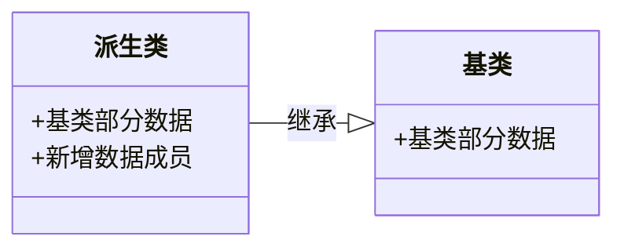

# 派生类对象的构造与析构及基类构造函数的参数传递

---

## 派生类对象的构造与析构及基类构造函数的参数传递

### 从一个问题开始

假设你有个“汽车”类 `Vehicle`，它有发动机、轮子等基本部件。现在你要造一辆“赛车” `RaceCar`，它首先得是一辆汽车，然后才有尾翼、氮气加速等特有部件。

那么问题来了：创建 `RaceCar` 对象时，是先组装汽车的部件，还是先装赛车的部件？销毁时，是先拆尾翼，还是先拆发动机？

这就是派生类对象构造与析构的核心问题。

### 构造过程：层层“搭积木”

派生类对象可以看作是 **基类部分 + 派生类新增部分** 的叠加。构造的过程，就像从地基开始搭积木，**由内而外、自底向上**。



`派生类对象 = 基类部分 + 派生类新增部分`

#### 构造函数的执行次序

1.  **基类构造函数**：首先，调用基类的构造函数，初始化“基类部分”。
2.  **对象成员构造函数**：然后，按照对象成员在派生类中**声明的顺序**，调用它们各自的构造函数。
3.  **派生类构造函数体**：最后，执行派生类自身的构造函数体，初始化新增的数据成员。

对整个继承链来说，就是从最顶层的基类开始，一层层往下调用构造函数。

> [!IMPORTANT]
> ==构造次序：基类 -> 对象成员 -> 派生类自身==

### 基类构造函数的参数传递：初始化列表是关键

如果基类没有默认构造函数（即需要参数），派生类必须显式为基类传参。这**只能**通过派生类的**构造函数初始化列表**来完成。

#### 语法格式

```cpp
派生类名::派生类名(参数列表) : 基类名(传递的参数), 对象成员1(参数), ... 
{
    // 派生类构造函数体
}
```

#### 对照考题实例

看看开头那道填空题，我们能更清楚地理解这个规则。

```cpp
// 基类 Vehicle
class Vehicle {
protected:
    int MaxSpeed;
    int Weight;
public:
    Vehicle(int m, int w) { // 没有默认构造函数
        MaxSpeed = m;
        Weight = w;
    }
};

// 派生类 Car
class Car : public Vehicle {
protected:
    int SeatNum;
public:
    // [!code highlight] // 初始化列表发生在构造函数体执行之前
    Car(int m, int w, int s) : Vehicle(m, w) { 
        SeatNum = s ;           // 体内部只能做赋值等操作
    } 
};
```

> [!TIP]
> **为什么不能在函数体里初始化基类部分？**
> 因为进入 `{ ... }` 函数体时，继承来的基类部分已经构造完毕了。如果基类又没有默认构造函数，编译就会报错。所以，`==必须通过初始化列表“抓住”构造时的瞬间，把参数传给基类构造函数==`。

### 析构过程：逆序“拆积木”

析构的过程与构造**严格相反**，**由外而内、自上向下**。

1.  **派生类析构函数体**：先执行派生类自己的析构函数体。
2.  **对象成员析构函数**：再调用对象成员的析构函数。
3.  **基类析构函数**：最后调用基类的析构函数。

从继承链看，析构从最底层的派生类开始，逐层向上调用析构函数。

> [!IMPORTANT]
> ==析构次序：派生类自身 -> 对象成员 -> 非虚基类 -> 虚基类== （与构造完全相反）

### 旁边有个坑：选择题里的常见错误

看看这道题：

> 派生类构造函数的初始化列表中，不能包含的初始化项是（ ）。
> **A.** 基类的构造函数
> **B.** 基类的对象成员所属类的构造函数
> **C.** 派生类的数据成员
> **D.** 派生类的对象成员所属类的构造函数

**答案与辨析：**

-   **A 可以**：`Car(int m, int w, int s) : Vehicle(m, w) {}`，这里是合法的。
-   **B 不可以**：`基类的对象成员`，也就是基类自己拥有的内部成员，它们的初始化应由基类自己的构造函数全权负责。派生类不应也不能越级去初始化它基类的内部成员。**这是明确的错误**。
-   **C 可以**：对，派生类的数据成员如果是 `const` 或引用，也必须在此初始化。
-   **D 可以**：派生类自己新增的对象成员，当然要在初始化列表里调用其构造函数。

### 结合考题，算一遍：多重继承与虚基类

开头有道读程题，它的输出结果是怎么得到的？我们一步步算。

**题目代码关键部分：**

```cpp
class A { public: int x; A(int a = 0) { x = a; } };
class B : virtual public A { public: B(int b = 0):A(b){} void show() { std::cout << x << " "; } };
class C : virtual public A { public: C(int c = 0):A(c){} void show() { std::cout << x << " "; } };
class D : public B, public C {
public:
    D(int d = 0) : B(d - 1), C(d - 2), A(d - 3) {}
};

int main() {
    D obj(5);      // d = 5
    obj.B::show(); // 输出 ？
    obj.C::show(); // 输出 ？
}
```

**计算推演过程：**

1.  **规则核心**：对于含虚基类的多重继承，==**虚基类的构造函数由最底层的派生类 `D` 负责直接调用**==。因此，尽管 `B` 和 `C` 的初始化列表里都调用了 `A(b)` 和 `A(c)`，但在构造 `D` 的对象时，这些调用会被**忽略**。只有 `D` 初始化列表中的 `A(d-3)` 会真正执行。
2.  **代入**：创建 `obj(5)` 时，`d = 5`。
3.  **执行**：`D` 的初始化列表 `: B(d - 1), C(d - 2), A(d - 3)` 里，最先执行的是虚基类 `A` 的构造。
    -   调用 `A(d-3)`，即 `A(5-3) = A(2)`。
    -   于是 `A` 中的 `x` 被设置为 `2`。
4.  **结论**：在整个 `D` 对象中，只有一个由虚基类 `A` 产生的 `x`，且它的值是 `2`。所以两次 `show()` 输出的值均为 `2`。

> [!NOTE]
> 在这个虚基类的例子中，`A` 就是 `B` 和 `C` 的虚基类。它的构造函数被最底层的 `D` 直接调用，确保了 `x` 只有一份拷贝，避免了通过 `B` 和 `C` 访问时出现歧义。

---

